# GIGACHAD BROWSER — Full-Stack Neural, Systems & Security Architecture (`ARCHITECTURE.md`)

> **PROPRIETARY NOTICE:** Protected under the **GIGACHAD BROWSER Proprietary Download-and-Use-Only License ([`LICENSE`](./LICENSE))**. No commercial use, no modification/derivative works, no redistribution, and no authorship misattribution.

---

## 1. High-Level System Topology

`gigachad-browser` is a self-contained **Autonomous Artificial Life (A-Life) & Multi-Brain Cybernetic Browser Operating System** built on Electron 35, Node.js, Native C/WebAssembly (`c-wasm/`), Zig 0.17 WebAssembly (`brains/cqm-xylos/`), and a **60Hz Real-Time Continuous-Time Neural Physics Engine**.

```mermaid
flowchart TD
    subgraph ElectronMain["Electron Main Process (main.js)"]
        CSP["Zero-Trust CSP & Context Isolation"]
        CDP["Native CDP DOM/Layout/Accessibility Tree Extractor"]
        TOR["Tor SOCKS5h Circuit Manager & .onion Router"]
        PORTALS["Hybrid Brain Portals IPC (brains/*)"]
        MEM["Persistent Weight & Connectome Store (userData)"]
    end

    subgraph PrecisionArena["7-Tier Heterogeneous Precision Tensor Arena (128 KB Contiguous ArrayBuffer)"]
        T1["Tier 1: Float64Array (IEEE-754 Binary64) — RK4 State, RLS P_t, Schrödinger ψ(x,t), Kerr-Newman r_±"]
        T2["Tier 2: BigInt64Array / BigUint64Array — Q32.32 Fixed-Point & Lemire 128-Bit Multiply-Shift + 1024-Bit HDC"]
        T3["Tier 3: Int32Array / Uint32Array — Q16.16 Fixed-Point Eligibility Traces & CSR Connectome Offsets"]
        T4["Tier 4: Uint16Array — IEEE-754 FP16 (s1e5m10) & BF16 (s1e8m7) Fast-Weight Overlays"]
        T5["Tier 5: Int8Array — Block-Quantized Q8_0 Synaptic Weights with Unbiased Stochastic Rounding"]
        T6["Tier 6: Uint8Array — BitNet b1.58 Ternary {-1,0,+1} Synapses (4/Byte) & Axonal Ring Delays"]
        T7["Tier 7: Float32Array + Zig/C WebAssembly SIMD — Fast Vector-Matrix & 3D Raymarching"]
    end

    subgraph PrimaryCortex["1,245,184-Parameter Primary A-Life Cortex (index.html + systems/)"]
        SLTC["Spiking Liquid Time-Constant (sLTC) + LIF Surrogate Gradients"]
        JEPA["Latent JEPA World Model + Selective SSM + Liquid-KAN"]
        THOUGHT["Atom / Tree / Graph of Thought (AoT / ToT / GoT) + Corecursive/Decursive Morphisms"]
        DIFF["Latent Denoising Diffusion + Adversarial GAN Critic + Dream Consolidation"]
    end

    subgraph Pantheon14["14-Brain Ported Multiverse Pantheon (systems/ported-multiverse-brains.js)"]
        B1["#1 Asmodensius v40 (272N 14-Region + Q3 QGT + RLS + Kalman + HPA)"]
        B2["#2 Glitchling Resilience (4 Flaws + 100×5 Area Matrix + 189 Flaw Events + Cerebellar + DeltaNet)"]
        B3["#3 CQM SuperMind (5-Stage PERCEIVE→IMAGINE→REASON→FEEL→ACT + Eshkol Reverse AD)"]
        B4["#4 Apex Hydra 11-Organ (Tangent-Map Lyapunov λ₁ + Gödel Fixed-Point)"]
        B5["#5 Xenomimic Schrödinger (Unitary Crank-Nicolson f64 + 6→8→5 Online MLP)"]
        B6["#6 Xylos 48-Foci / 192-Edge Manifold (Eshkol GWT Broadcast + Residual Calibration)"]
        B7["#7 Mechalogodrom 10-Shell Titan (10 Diff-Geom Invariants + Bi-Poo STDP)"]
        B8["#8 Glyph Pantheon 25K (32×32 FP16 Fast-Weight Oja Hebbian Overlay)"]
        B9["#9 Thaler DABUS Cusp + 9 Constitutive Markers + 4 Honest Ablations"]
        B10["#10 GraphMind C. elegans + Louvain Q + Bitwise GOAP Planner"]
        B11["#11 Tsotchke Diffusion (Dale 80/20 E:I + Tsodyks-Markram STP + DDIM CFG)"]
        B12["#12 Kerr-Newman Black Hole Horizon + Bekenstein-Hawking S_BH + Unitary Page Curve"]
        B13["#13 10-Researcher Consciousness Consortium (Seth, Damasio, Koch, Langton, Tononi, McFadden, Friston, Graziano, Dehaene, Metzinger)"]
        B14["#14 Thingmaker Voxel Morphogenesis + GRIMOIRE Arcane Ley-Line Weaver"]
    end

    ElectronMain <-->|"Structured IPC"| PrimaryCortex
    PrecisionArena <--> PrimaryCortex
    PrecisionArena <--> Pantheon14
    PrimaryCortex <-->|"60Hz Closed-Loop Sensorimotor & TD Advantage Coupling"| Pantheon14
```

---

## 2. 7-Tier Heterogeneous Precision Tensor Arena (Non-`Float32Array`-Only Architecture)

Rather than storing parameters in naïve `Float32Array` buffers, `Heterogeneous7TierPrecisionArena` ([`systems/ported-multiverse-brains.js`](./systems/ported-multiverse-brains.js)) partitions a single `131,072`-byte (`128 KB`) L2-cache-aligned `ArrayBuffer` across **7 distinct numerical representations**:

| Tier | TypedArray View | Bit-Width & Format | Byte Offset | Primary Mathematical Role |
| :---: | :--- | :--- | :---: | :--- |
| **1** | `Float64Array` | 64-bit IEEE-754 `binary64` (`f64`) | `0 .. 16,383` | Exact RK4 `sLTC` ODE state integration, Sherman-Morrison RLS inverse covariance $P_t$, unitary Crank-Nicolson Schrödinger wavepacket $\psi(x,t)$, and Kerr-Newman horizons $r_\pm$. |
| **2** | `BigInt64Array` / `BigUint64Array` | 64-bit Signed `Q32.32` & Unsigned `u64` | `16,384 .. 32,767` | Drift-free `Q32.32` fixed-point homeostatic accumulators, Lemire 128-bit unbiased multiply-shift entropy sampling, and 1,024-bit Hyperdimensional Computing (`HDC`/`VSA`) hypervectors (`16 × 64`-bit words via hardware `POPCNT` XOR-distance). |
| **3** | `Int32Array` / `Uint32Array` | 32-bit `Q16.16` Fixed-Point & CSR Indices | `32,768 .. 49,151` | Deterministic `Q16.16` synaptic eligibility traces $e_{ij}(t)$ and Compressed Sparse Row (`CSR`) connectome row-pointer / column-index tables. |
| **4** | `Uint16Array` | 16-bit IEEE-754 `FP16` (`s1e5m10`) & `BF16` (`s1e8m7`) | `49,152 .. 65,535` | `32×32` (`1,024`-entry) Oja Hebbian Fast-Weight Overlays (`encodeFp16` / `decodeFp16`) and `BFloat16` attention-schema states (`encodeBf16` / `decodeBf16`). |
| **5** | `Int8Array` | 8-bit Symmetric Block-Quantized `Q8_0` | `65,536 .. 81,919` | Dense synaptic matrices updated online via **Unbiased Stochastic Rounding** (`stochasticRoundInt8(x)`), ensuring sub-LSB gradient updates $\Delta w < \Delta_{\text{LSB}}$ accumulate in expectation $\mathbb{E}[\text{SR}(x)] = x$. |
| **6** | `Uint8Array` | 2-bit BitNet `b1.58` Ternary `{-1, 0, +1}` & Ring Delays | `81,920 .. 98,303` | Packs **4 ternary synapses per byte** (`packTernary4` / `unpackTernaryAt`) for multiplication-free addition/subtraction cascades, plus polychronous axonal delay-line ring buffers. |
| **7** | `Float32Array` + Wasm | 32-bit `binary32` + Native C/Zig WebAssembly | `98,304 .. 131,071` | Fast vector-matrix activations bridged with compiled WebAssembly (`c-wasm/` and `brains/cqm-xylos/zig-out/`). |

---

## 3. Enterprise ERD / ERM / ERP & Documentation Cross-Reference

- **Root Cosmological & Mathematical Bible:** [`BIBLE.md`](./BIBLE.md)
- **Exhaustive Technical Glossary:** [`GLOSSARY.md`](./GLOSSARY.md)
- **Master Codebase Symbol & File Index:** [`INDEX.md`](./INDEX.md)
- **Project / Program / Product Manager Kanban:** [`KANBAN.md`](./KANBAN.md)
- **Forensic Register of Bugs, Errors, Issues & Resolutions:** [`ISSUES.md`](./ISSUES.md)
- **OWASP ASVS L3, DevSecOps & Fortune 100 Full-Stack Standards:** [`docs/OWASP_DEVSECOPS_FORTUNE100.md`](./docs/OWASP_DEVSECOPS_FORTUNE100.md)
- **DSA, Big-O Complexity & Mathematical Notations:** [`docs/DSA_AND_MATHEMATICAL_NOTATIONS.md`](./docs/DSA_AND_MATHEMATICAL_NOTATIONS.md)
- **Contrast Comparative Analysis & 500-Point Forensic Audit:** [`docs/CONTRAST_COMPARATIVE_AND_FORENSIC_AUDIT.md`](./docs/CONTRAST_COMPARATIVE_AND_FORENSIC_AUDIT.md)
