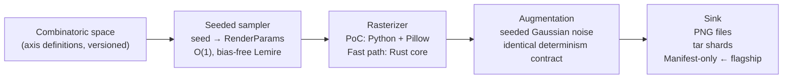

# Chaos Entropy Art Engine

[](https://github.com/0thernes/chaos-entropy-art-engine/actions/workflows/ci.yml)
[](https://github.com/0thernes/chaos-entropy-art-engine/actions/workflows/codeql.yml)
[](LICENSE)
[](docs/ROADMAP.md)

---

## Thesis

Generative AI made images cheap. This engine makes them *free* — and more importantly, *addressable*.

An image is not a file. An image is a coordinate in a combinatoric space. Every output is
fully determined by a 64-bit seed through a pure function `render(engine_version, seed) → pixels`.
That one design decision collapses the economics of synthetic data.

**The headline insight — seed-manifest storage inversion:** a dataset of 100 trillion unique
images is not 100 trillion files. It is an engine version plus a seed range — under 32 bytes —
that any party can re-materialize bit-for-bit, forever, on commodity hardware. The manifest *is*
the dataset. Pixels are a derivable cache, never the source of truth.

---

## Problem

| Pain point | Diffusion-model status quo |
|---|---|
| **Throughput** | ~0.5–2 img/s on a consumer GPU; 1M/day requires fleets |
| **Storage** | 1M 256-px PNGs ≈ 8 GB/day of *derivable* bytes — pure waste |
| **Diversity** | Latent-space sampling gives no uniqueness guarantee |
| **Reproducibility** | Re-generating the same image requires storing the full pixel grid |

---

## Solution

Strip the model. Generate via combinatorics. A single Unicode glyph rendered across structured
parameter axes produces a space of ≈ 3.3 × 10²¹ distinct single-glyph images before layered
compositions, which push the space toward 10⁴⁰:

| Axis | PoC cardinality |
|---|---|
| Glyphs (letters, digits, symbols, CJK, dingbats) | ~10,000 (PoC: 518) |
| Font families | up to 50 |
| Font sizes | 32 steps (12–200 px) |
| Rotations | 360 (1° steps) |
| Foreground colors (HSV lattice) | 2²⁰ ≈ 1,048,576 |
| Background colors (HSV lattice) | 2²⁰ ≈ 1,048,576 |
| Noise / augmentation levels | 16 |

Every variant is reachable by one seed, reproducible forever, and renderable at hundreds of
images per second per CPU core — no GPU required.

**Measured baseline: 90.4 img/s at 256 px, single core — 7.8× the 1M/day target before
any parallelism or the Rust/GPU fast path.**

---

## Quickstart

**Requirements:** Python 3.11+, pip.

```bash
# Install
pip install -r poc/requirements.txt

# Render 20 images from seed 0 into ./out/
python poc/glyph_engine.py --count 20 --seed 0 --out out/

# Render at 512 px, every 7th seed (lattice sampling)
python poc/glyph_engine.py --count 100 --seed 0 --stride 7 --size 512 --out out512/

# Write a manifest only (no PNG output) — storage inversion mode
python poc/glyph_engine.py --count 1000000 --seed 0 --manifest dataset.jsonl

# Re-render exactly from a manifest — bit-for-bit identical to original
python poc/glyph_engine.py --from-manifest dataset.jsonl --out out/

# Benchmark single-core throughput
python poc/glyph_engine.py --benchmark --count 1000 --size 256
```

**Benchmark output (dev workstation, i9-class CPU, 2026-06-12):**

```
[benchmark] 1000 images @ 256px: 90.4 img/s  (11.1 ms/img)
Projected: 7.8 M images/day, single core, before parallelism.
```

**Run tests:**

```bash
pytest tests/ -q
# Expected: 13 passed
```

---

## Architecture

### Pipeline overview



### Key architectural decisions

| Principle | Consequence |
|---|---|
| **Pure function** `render(version, seed) → pixels` | Two parties with the same engine version and seed hold the same image without transferring pixels |
| **Storage inversion** | A seed range of 100 trillion images fits in 32 bytes; the same data as PNGs would be ~800 PB |
| **No shared state** | Renders are trivially parallel; order, worker count, and machine boundaries are irrelevant to output |
| **CPU = canonical reference** | GPU float behavior varies by vendor; the CPU path owns the determinism contract; GPU is an accelerator with its own engine-version namespace |

### Module boundaries

| Layer | Status | Description |
|---|---|---|
| `poc/glyph_engine.py` | Shipped | Python/Pillow renderer; CLI; manifest IO; benchmark |
| `poc/logging_config.py` | Shipped | Structured JSON logger; run-manifest event |
| `core/src/lib.rs` | Skeleton + sampler | Rust `SeedSpace`, `splitmix64`, Lemire reduction; CI-gated |
| `core/src/main.rs` | Stub | Future CLI entry point for Rust fast path |
| GPU path (`wgpu`) | Planned | Texture-atlas instanced quads; millions/s; v1 scope |

Full design rationale: [docs/ARCHITECTURE.md](docs/ARCHITECTURE.md)

### Determinism contract

The engine version (`ENGINE_VERSION = "ceae-poc/0.1.0"`) is a content-addressable identifier.
Any axis table change, RNG draw-order change, or PNG encode parameter change is a breaking
change that bumps the version. The `space_hash` field in a manifest pins the axis tables;
consumers refuse to render if their engine's hash differs. This makes "seed = identity" honest
across time and across machines.

### Throughput table

| Configuration | img/s | img/day | Notes |
|---|---|---|---|
| Python PoC, 1 core, 256 px | **90.4** | 7.8 M | Measured |
| Python PoC, 1 core, 128 px | **215.6** | 18.6 M | Measured |
| Python PoC, 16 cores (projected) | ~1,400 | ~120 M | Linear scaling, 16 workers |
| Rust core, 1 core (estimated) | ~1,000–5,000 | ~86 M–430 M | 5–20× per-core over Pillow |
| Rust + GPU raster (v1 target) | ≥ 10,000 | ≥ 864 M | Acceptance criterion for v1 |
| Manifest-only (no PNG write) | disk-free | unlimited | Seeds are the deliverable |

Full first-principles derivation: [docs/THROUGHPUT.md](docs/THROUGHPUT.md)

---

## Project Status

`v0.1.4` — PoC renderer fully working with manifest IO, stride sampling, Lemire-biased-corrected
Rust sampler, Rust CI, and full design documentation. Highlights:

- **13/13 tests green** (determinism, manifest round-trip, sampler uniformity)
- **90.4 img/s @ 256 px, single core** — 7.8× the 1M/day target
- **Manifest storage inversion** implemented: `--manifest` + `--from-manifest` round-trips byte-identical
- **Rust CI** gate: `cargo fmt --check` + `cargo clippy -D warnings` + `cargo test` on every push
- **500-point audit** complete (248/500): gap map and Top 10 findings in [docs/AUDIT-500.md](docs/AUDIT-500.md)
- Pre-seed stage; seeking design partners (OCR, captcha-robustness, font-classification, augmentation pretraining)

---

## Roadmap

| Phase | Status | Goal | Exit criterion |
|---|---|---|---|
| **PoC** | Done | Prove `seed → identical bytes` + throughput baseline | ≥ 50 img/s single core (measured: 90.4); 13 tests green |
| **MVP** | In progress | Multiprocess pipeline; manifest v1 with space_hash; 1M materialized in < 2 h | 1M images in < 2 h wall clock; manifest round-trip verified on two machines |
| **v1** | Planned | Rust/wgpu fast path; layered composition; seeds-only delivery to first design partner | ≥ 10,000 img/s aggregate; one external training pipeline end-to-end |

Detailed acceptance criteria: [docs/ROADMAP.md](docs/ROADMAP.md)

---

## Aesthetic Lineage

The engine's combinatoric axes descend from the published entropy practice of artist
**0thernes "Not The Typical"** — whose CC-licensed adversarial prompts
(github.com/0thernes-L-L-C/Prompt-Improvisation) drive diffusion models toward decentralized,
pattern-free, maximally entropic imagery and its inverse dual of perfect geometric order.

What 0thernes forces a diffusion model to do via adversarial steering, this engine generates
natively and deterministically at throughput — mapping his aesthetic axes (entropy/order dual,
no-center-point decentralization, banned-vocabulary constraint sets, all-orientations Kakeya
framing) directly onto sampler dimensions and axis tables. The run-manifest seed system
realizes his curator model: generate at scale, select by taste, record each selection as
an 8-byte seed.

Full mapping: [docs/AESTHETIC-LINEAGE.md](docs/AESTHETIC-LINEAGE.md)

---

## Documentation Index

### Design

| Document | Contents |
|---|---|
| [docs/ARCHITECTURE.md](docs/ARCHITECTURE.md) | Module boundaries, determinism contract, pipeline stage design, GPU vs CPU decision, aesthetic axis mapping |
| [docs/THROUGHPUT.md](docs/THROUGHPUT.md) | First-principles per-stage budget, measured vs estimated numbers, bottleneck analysis |
| [docs/ERD.md](docs/ERD.md) | Entity-relationship diagram (Mermaid), conceptual ERM with five invariants, pipeline sequence diagrams, re-roll state machine |
| [docs/COMPLEXITY.md](docs/COMPLEXITY.md) | Big-O time and space per function, constant-factor breakdown at 256 px, throughput projection ladder |
| [docs/AESTHETIC-LINEAGE.md](docs/AESTHETIC-LINEAGE.md) | Conceptual ancestry: 0thernes entropy practice → engine parameter space |
| [docs/adr/](docs/adr/) | Architecture Decision Records (ADR 0001: record decisions in ADRs) |

### Quality & Audit

| Document | Contents |
|---|---|
| [docs/AUDIT-500.md](docs/AUDIT-500.md) | 500-point / 25-section deep inspection (2026-06-12); per-section scores; Top 10 findings with severity |
| [docs/AUDIT.md](docs/AUDIT.md) | Gold-standard self-audit checklist (correctness, reproducibility, performance, security, DX) |
| [docs/TESTING.md](docs/TESTING.md) | Test pyramid, determinism focus, coverage targets, CI gating, golden-seed strategy |
| [docs/OBSERVABILITY.md](docs/OBSERVABILITY.md) | Structured JSON log schema, run-manifest event, multi-worker logging protocol |
| [docs/SECURITY-NOTES.md](docs/SECURITY-NOTES.md) | Asset inventory, trust boundaries, font allow-list, planned mitigations |

### Planning

| Document | Contents |
|---|---|
| [docs/ROADMAP.md](docs/ROADMAP.md) | Three-phase plan (PoC → MVP → v1) with explicit acceptance criteria |
| [docs/KANBAN.md](docs/KANBAN.md) | Work-in-progress board with WIP limits, priorities, estimates |
| [docs/backlog/](docs/backlog/) | Detailed backlog cards for each work item (T-001 through T-015) |
| [docs/FAQ.md](docs/FAQ.md) | Answers to common questions about the approach, claims, and status |

---

## Tech Stack

| Layer | Technology |
|---|---|
| PoC renderer | Python 3.11+, Pillow ≥ 10.1, NumPy ≥ 1.26 |
| Rust fast path (skeleton) | Rust 2021 edition, zero dependencies |
| CI | GitHub Actions: ruff lint, pytest, cargo fmt/clippy/test, CodeQL |
| Target hardware | Single workstation; RTX 5070 Ti 12 GB available but not required for 1M/day |

---

## Contributing & Development

```bash
make install   # pip install -r poc/requirements.txt
make test      # pytest tests/ -q
make bench     # python poc/glyph_engine.py --benchmark --count 1000
make lint      # ruff check poc/ tests/
make audit     # pip-audit + cargo audit
```

See [CONTRIBUTING.md](CONTRIBUTING.md) for PR conventions and the determinism-contract rules.
Vulnerability reports: [SECURITY.md](SECURITY.md).

---

## License & Provenance

MIT — see [LICENSE](LICENSE).

Aesthetic lineage and CC-licensed prompt corpus: github.com/0thernes-L-L-C/Prompt-Improvisation.
Conceptual credit: 0thernes "Not The Typical", documented in the [October 2025 Medium feature](https://medium.com) and the [AESTHETIC-LINEAGE.md](docs/AESTHETIC-LINEAGE.md) document.
