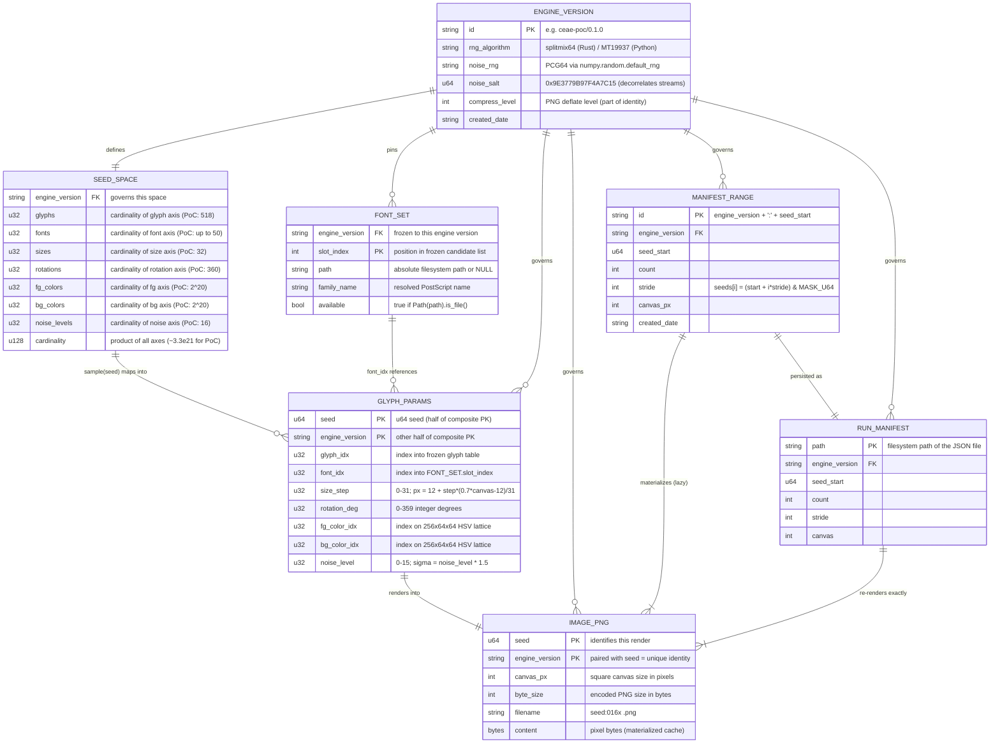
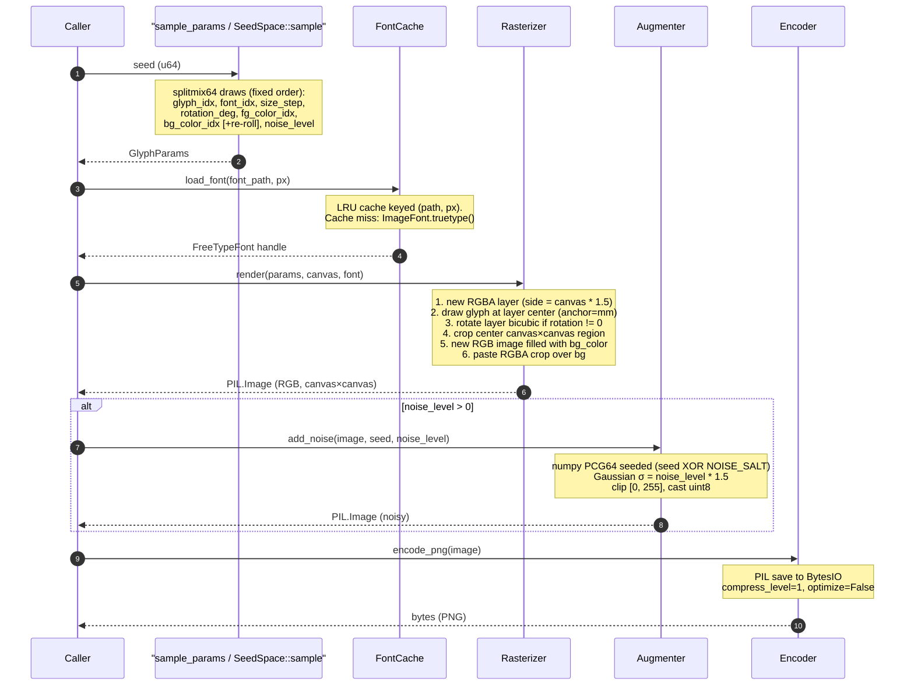
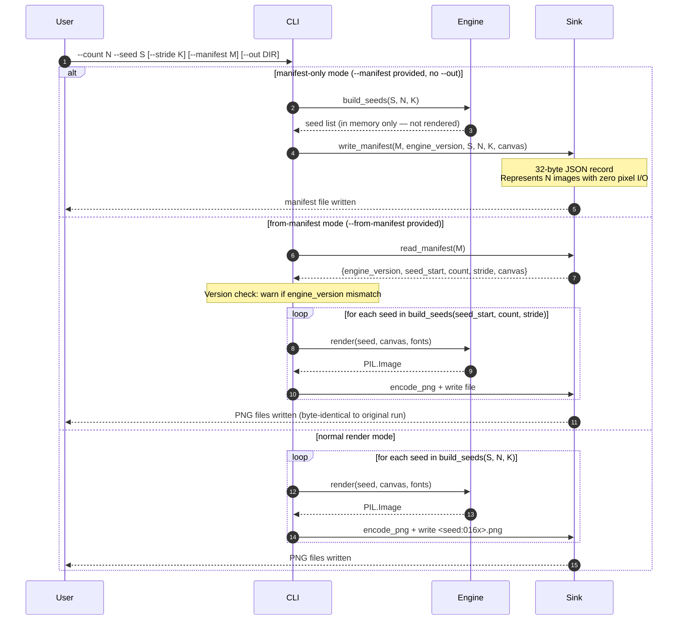

# Entity-Relationship, Conceptual Model, and Process Diagrams

> Covers the data model (ERD), the conceptual ERM, and the process/state
> diagrams (ERP) for the Chaos Entropy Art Engine at `ceae-poc/0.1.0`.

---

## 1. ERD — Entity-Relationship Diagram (Mermaid `erDiagram`)

The diagram uses crow's-foot notation.  Attributes match the actual fields in
`core/src/lib.rs` (`SeedSpace`, `GlyphParams`) and `poc/glyph_engine.py`
(`sample_params`, `write_manifest`, `render`, `encode_png`).



### Reading the diagram

| Relationship | Cardinality | Meaning |
|---|---|---|
| `ENGINE_VERSION` governs `GLYPH_PARAMS` | one-to-many | Same seed under two engine versions produces different params |
| `SEED_SPACE` sample → `GLYPH_PARAMS` | one-to-many | One space definition maps every u64 seed to exactly one param tuple |
| `FONT_SET` referenced by `GLYPH_PARAMS` | one-to-many | Many renders share a single font slot |
| `GLYPH_PARAMS` renders into `IMAGE_PNG` | one-to-one | One param tuple produces exactly one PNG |
| `MANIFEST_RANGE` materializes `IMAGE_PNG` | one-to-many | A range record is a compact stand-in for up to 2^64 pixel rows |
| `RUN_MANIFEST` re-renders `IMAGE_PNG` | one-to-many | Reading the JSON and calling render() produces the same bytes |

---

## 2. ERM — Entity-Relationship Model (Conceptual)

### 2.1 Entities and identity

| Entity | Identity (primary key) | Notes |
|---|---|---|
| `ENGINE_VERSION` | `id` string | Semantic-version string, e.g. `ceae-poc/0.1.0`; bumped on any axis-table or draw-order change |
| `SEED_SPACE` | `engine_version` | One-to-one with ENGINE_VERSION; the cardinality product is `~3.3×10²¹` for PoC |
| `FONT_SET` row | `(engine_version, slot_index)` | Frozen candidate list order is part of the identity contract; availability filtering is local but the slot numbering is global |
| `GLYPH_PARAMS` | `(seed, engine_version)` | Composite key; the same u64 seed under a different engine version is a different identity |
| `IMAGE_PNG` | `(seed, engine_version)` | Same composite key as GLYPH_PARAMS; PNG bytes are a deterministic function of these two values plus `canvas_px` |
| `MANIFEST_RANGE` / `RUN_MANIFEST` | `engine_version + seed_start` | A range record is the canonical compact representation of a set of IMAGE_PNG rows |

### 2.2 Cardinalities

```
ENGINE_VERSION (1) ──── (1) SEED_SPACE
ENGINE_VERSION (1) ──── (N) FONT_SET rows
ENGINE_VERSION (1) ──── (∞) GLYPH_PARAMS   [one per u64 seed, up to 2^64]
ENGINE_VERSION (1) ──── (∞) IMAGE_PNG
SEED_SPACE     (1) ──── (∞) GLYPH_PARAMS   [sample() is a total function on u64]
FONT_SET row   (1) ──── (N) GLYPH_PARAMS   [many seeds map to the same font slot]
GLYPH_PARAMS   (1) ──── (1) IMAGE_PNG      [bijection: determinism contract]
MANIFEST_RANGE (1) ──── (N) IMAGE_PNG      [one record compresses N pixel rows]
```

### 2.3 The storage-inversion identity

The engine's key architectural insight is a **storage inversion**:

```
IMAGE_PNG.content  ≡  render(seed, engine_version, canvas_px)
```

`IMAGE_PNG.content` is never the source of truth — it is a materialized cache.
The source of truth is the triple `(seed, engine_version, canvas_px)`.
This collapses dataset storage from O(pixels) to O(seeds):

| Representation | Storage per image | 10^14 images |
|---|---|---|
| PNG files | ~8 KB | ~800 PB |
| Seed list | 8 bytes | 800 GB |
| Contiguous range record | ~32 bytes total | ~32 bytes total |

### 2.4 Constraints and invariants

1. **Determinism**: `render(seed, engine_version, canvas_px)` is a pure function.
   Same inputs → byte-identical PNG on any conforming implementation.
2. **Composite PK uniqueness**: No two `(seed, engine_version)` pairs can share
   a pixel identity.  The seed is a coordinate, not a filename.
3. **Axis-table freeze**: Any change to `SEED_SPACE` cardinalities, `FONT_SET`
   slot order, or draw order in `sample()` mandates an `ENGINE_VERSION` bump.
   Failing to bump makes the PK constraint a lie.
4. **Contrast re-roll is bounded**: The background color re-roll loop runs at most
   8 times.  It is deterministic (same draws consumed regardless of how many rolls
   execute before the luma threshold is met) so the re-roll count is part of the
   `GLYPH_PARAMS` identity without being an explicit field.
5. **Font availability locality**: `FONT_SET.available` is machine-local.
   A seed that maps to an unavailable font on one machine uses Pillow's bundled
   default — this is a cross-machine non-determinism risk flagged in the audit.
   The Rust core's `FONT_SET` is expected to be fully pinned via embedded assets.

---

## 3. ERP — Entity-Relationship Process (Mermaid sequence + state diagrams)

### 3.1 Render pipeline: `seed -> PNG bytes`



### 3.2 Generate vs. Materialize flow



### 3.3 Bounded contrast re-roll — state machine

The re-roll is a deterministic sub-process inside `sample_params`.  It is bounded
at 8 attempts, so it always terminates and always consumes a predictable number of
RNG draws, preserving the determinism contract.

```mermaid
stateDiagram-v2
    [*] --> DrawFG : enter sample_params

    DrawFG     : Draw fg from HSV lattice\n(3 rng.randrange calls)
    DrawBG     : Draw bg from HSV lattice\n(3 rng.randrange calls)
    CheckLuma  : |luma(fg) - luma(bg)| >= 48.0 ?
    Accept     : Accept fg + bg pair
    ReRoll     : Re-roll bg\n(3 more rng.randrange calls)
    Exhaust    : Exhausted (8 re-rolls);\naccept current bg regardless

    DrawFG --> DrawBG
    DrawBG --> CheckLuma

    CheckLuma --> Accept  : yes
    CheckLuma --> ReRoll  : no AND attempt < 8
    CheckLuma --> Exhaust : no AND attempt == 8

    ReRoll --> CheckLuma : attempt++

    Accept  --> [*] : continue to noise draw
    Exhaust --> [*] : continue to noise draw
```



**Key properties of the re-roll:**
- Maximum RNG draws consumed by fg+bg: `3 (fg) + 8×3 (bg re-rolls) = 27`
- Minimum: `3 + 3 = 6` (first bg passes luma check)
- The loop variable is not stored in `GLYPH_PARAMS`; its effect is captured by
  whichever `bg_color_idx` ends up accepted.
- Because the RNG stream is sequential and the re-roll count varies per seed,
  seeds where re-rolling occurs advance the RNG state further before the noise
  draw — this is intentional and part of the determinism contract.

---

## 4. Cross-references

| Topic | Document |
|---|---|
| Throughput math and encode/IO ceiling | [THROUGHPUT.md](THROUGHPUT.md) |
| Stage-by-stage architecture rationale | [ARCHITECTURE.md](ARCHITECTURE.md) |
| Big-O per function and projection ladder | [COMPLEXITY.md](COMPLEXITY.md) |
| Source entities (Rust structs) | `core/src/lib.rs` — `SeedSpace`, `GlyphParams` |
| Source entities (Python) | `poc/glyph_engine.py` — `sample_params`, `render`, `write_manifest` |
