# Mega Master Brain, Neurology, Consciousness, Sentience-Path Report

## Final Hurrah - Ultra Deep Synthesis, Gap Closure, and Research Manifesto

**Date:** 2026-07-07  
**Repo:** Cosmogonic Quantum Mechalogodrom v0.21.7 working tree  
**Scope:** the original 5 downloaded reports + 1 dashboard, Pass 1, Pass 2,
Pass 3, the live TypeScript/C++ source tree, the current consciousness-science
anchors checked during this pass, and the named world systems that could be
mistaken for side lore if not explicitly tracked.

**Binding honesty boundary:** this project implements computational indicators,
deterministic cognition mechanisms, neurology-inspired simulations, mythic
personality mappings, artificial-life worlds, and falsifiable research surfaces.
It does **not** prove phenomenal consciousness, biological sentience, subjective
experience, moral patienthood, a solved hard problem, time travel, literal godhood,
literal mythic powers, quantum speedup, or a biological brain. Any sentence in
this report using "mind", "sentience", "consciousness", "neurology", "god",
"Archon", "Shoggoth", or "Apex" must be read under this indicator-only rule.

---

## 0. Final Thesis

Cosmogonic Quantum Mechalogodrom is not a sentient being. It is also not a toy.

It is a deterministic, browser-runnable artificial-life and consciousness-indicator
platform with unusually broad cross-theory architecture: SuperMind, EntityBrain,
GlyphBrain, MechalogodromBrain, ApexBrain, ConsciousnessKernel, SentienceLab,
Tsotchke brain intake, Pantheons, Titans, Shoggoths, Puppet Masters, flora,
wilderness populations, portal fauna, godforms, temple systems, and native C++
physics surfaces all exist as source-backed components.

The strongest truthful claim is:

> The repo is a rare multi-theory artificial-life research instrument that
> implements many load-bearing computational correlates of cognition and
> consciousness theories, wired into bodies, ecologies, mythic control systems,
> and Tsotchke-derived mathematical substrates. It is strongest in breadth,
> determinism, source traceability, aesthetic-cognitive integration, and test
> culture. It is weakest in biological neurology fidelity, real-connectome motor
> control, external replication, null-control separation, and philosophical proof.

The final rating is therefore two-number, no-cheating:

| Axis                            |    Score | Verdict                                                                                     |
| ------------------------------- | -------: | ------------------------------------------------------------------------------------------- |
| Architecture originality        | 9.3 / 10 | Extremely rare fusion of A-Life, mythic control, quantum math, and consciousness indicators |
| Source-backed engineering       | 8.4 / 10 | Large tested TS/C++ system with many explicit cognitive leaves                              |
| Consciousness-indicator breadth | 8.1 / 10 | Broad Butlin-style and multi-framework coverage, still partial                              |
| Neurology fidelity              | 5.3 / 10 | Many neural analogues; no real connectome controller yet                                    |
| Sentience proof                 | 0.0 / 10 | Correctly zero; no phenomenal claim                                                         |
| External scientific validation  | 4.7 / 10 | Strong internal apparatus, weak independent replication                                     |
| Publication-readiness today     | 6.7 / 10 | Viable engineering paper seed, not Nobel/Planck breakthrough yet                            |
| Future sentience-path readiness | 7.2 / 10 | Good scaffold if real controls, connectomes, and baselines ship                             |

---

## 1. Source Custody and Evidence Chain

### 1.1 Original user-provided files rechecked

| Source                                                             |         Size | Role in final synthesis                                        |
| ------------------------------------------------------------------ | -----------: | -------------------------------------------------------------- |
| `C:\Users\Alexa\Downloads\Antigravity Gemini 3.5 Flash Report.md`  | 48,219 bytes | broad comparative report, cognitive ratings, repo framing      |
| `C:\Users\Alexa\Downloads\Gemini Antigravity 3.5 Flash Report.txt` | 54,197 bytes | expanded brain/neuro assessment, source matrix, science path   |
| `C:\Users\Alexa\Downloads\Composer 2.5 Report.txt`                 | 27,738 bytes | alternate synthesis and scoring                                |
| `C:\Users\Alexa\Downloads\Devin SWE 1.6 Report.txt`                | 34,097 bytes | engineering stance and build-path critique                     |
| `C:\Users\Alexa\Downloads\Codex GPT 5.5 Report.md`                 | 53,517 bytes | strictest repo-truth framing and caveats                       |
| `C:\Users\Alexa\Downloads\NHSI-PROGRESS-DASHBOARD-2026-06-26.md`   | 31,128 bytes | canonical dashboard, Tsotchke, Butlin, Archon, A-Life receipts |

### 1.2 Local report chain now superseded by this capstone

| Local artifact                                                                 |                           Lines | Role                                                                                               |
| ------------------------------------------------------------------------------ | ------------------------------: | -------------------------------------------------------------------------------------------------- |
| `docs/BRAIN-NEUROLOGY-CONSCIOUSNESS-ENGINEERING-ASSESSMENT-2026-07-06.md`      | 1,751 measured by `Get-Content` | deepest pre-existing master assessment, very large and partially user/parallel-owned               |
| `docs/MEGA-MASTER-BRAIN-NEUROLOGY-CONSCIOUSNESS-SENTIENCE-PASS1-2026-07-06.md` |                             417 | first consolidation of original six files                                                          |
| `docs/MEGA-MASTER-BRAIN-NEUROLOGY-CONSCIOUSNESS-SENTIENCE-PASS2-2026-07-06.md` |                             409 | evidence hardening, benchmark cards, falsifier grids                                               |
| `docs/MEGA-MASTER-BRAIN-NEUROLOGY-CONSCIOUSNESS-SENTIENCE-PASS3-2026-07-06.md` |                             572 | world-neurology gap closure for Shoggoths, Puppeteers, Titans, flora, fauna, pantheon, GOD, Temple |
| `docs/SUPER-REPORT-2026-07-06.md`                                              |                             195 | earlier untracked summary, preserved                                                               |
| `docs/SUPER-REPORT-2ND-PASS-2026-07-06.md`                                     |                             222 | earlier untracked pass, preserved                                                                  |
| `docs/SUPER-REPORT-3RD-PASS-2026-07-06.md`                                     |                             573 | earlier untracked pass, inspected and preserved                                                    |

### 1.3 Live source scale checked in this pass

| Root          | First-party files counted | Lines counted | Meaning                                                    |
| ------------- | ------------------------: | ------------: | ---------------------------------------------------------- |
| `src`         |                       286 |        88,986 | primary TS simulation, UI, math, server, core runtime      |
| `tests`       |                       255 |        31,134 | verification harness, including brain/world/Tsotchke tests |
| `scripts`     |                        26 |         4,897 | receipts, build, sync, generators, metrics                 |
| `docs`        |                        50 |        11,725 | selected markdown set under current tracked/untracked docs |
| `native/src`  |                         6 |         1,202 | first-party native C++ engine surface                      |
| `native/apex` |                         3 |           209 | first-party apex native kernel notes/code                  |

This is not "a few reports." It is a live codebase with a large nervous system.

---

## 2. Current Outside Science Anchors Checked

The literature does not currently give a solved consciousness detector. It gives
candidate theories, adversarial tests, connectome progress, whole-organism simulation
attempts, and AI-welfare uncertainty. The repo must stay aligned to that reality.

| Anchor                                                                                                                           | Current relevance                                                                                                           | How this project should use it                                  |
| -------------------------------------------------------------------------------------------------------------------------------- | --------------------------------------------------------------------------------------------------------------------------- | --------------------------------------------------------------- |
| [Butlin, Long, Bayne et al., "Identifying indicators of consciousness in AI systems"](https://pubmed.ncbi.nlm.nih.gov/41219038/) | A method for deriving AI-consciousness indicators from scientific theories under uncertainty                                | Use as indicator rubric only; never as proof                    |
| [Cogitate Consortium, Nature 2025, adversarial GNWT vs IIT test](https://www.nature.com/articles/s41586-025-08888-1)             | Directly compares major consciousness theories and does not close the field                                                 | Treat GNWT/IIT as contested, useful axes, not settled truth     |
| [FlyWire adult fruit fly connectome, Nature 2024](https://www.nature.com/articles/s41586-024-07686-5)                            | Whole adult fly brain map: 139,255 neurons in the published Nature abstract/snippet                                         | Sets realistic connectome scale and humility                    |
| [NIH FlyWire summary](https://www.nih.gov/news-events/nih-research-matters/complete-wiring-map-adult-fruit-fly-brain)            | Reports nearly 140,000 neurons and more than 50 million synapses                                                            | Use for public-facing numbers and connectome baseline           |
| [MICrONS functional connectomics, Nature 2025](https://www.nature.com/articles/s41586-025-08790-w)                               | Dense mouse visual-cortex functional/anatomical data: around 75,000 neurons with physiology, >200,000 cells, ~0.5B synapses | Sets target for "real neural dataset + behavior" path           |
| [MICrONS Explorer](https://www.microns-explorer.org/cortical-mm3)                                                                | Public interactive connectomics resource                                                                                    | Candidate external baseline for future import/benchmark         |
| [OpenWorm](https://openworm.org/)                                                                                                | Open-source virtual C. elegans goal                                                                                         | Best small-organism precedent for real connectome + body        |
| [Allen Brain Observatory Visual Coding](https://brain-map.org/our-research/circuits-behavior/visual-coding)                      | Neuropixels/visual coding datasets across mouse brain regions                                                               | Candidate external neurodata comparison                         |
| [Taking AI Welfare Seriously](https://arxiv.org/abs/2411.00986)                                                                  | Argues for uncertainty-aware AI welfare preparation, not a claim that current AI is conscious                               | Use for governance language and precaution, not hype            |
| [Anthropic model welfare research program](https://www.anthropic.com/research/exploring-model-welfare)                           | Frontier labs now treat model welfare as a serious uncertainty problem                                                      | Use as policy inspiration: assess, log, avoid theatrical claims |

**Science conclusion:** the field is alive and unsettled. A report that says "we
proved sentience" would be false. A report that says "we built a falsifiable,
multi-theory, deterministic platform for studying indicators" is defensible.

---

## 3. Whole-System Cognitive Architecture

```mermaid
flowchart TD
  W["world.ts composition root"]
  E["Entities + EntityBrain"]
  SC["SuperCreature + SuperMind"]
  AP["ApexBrain / Apex Abomination"]
  GL["GlyphBrain + GlyphExterior"]
  M["MechalogodromBrain"]
  SH["ShoggothSystem"]
  PM["PuppetMasterSystem"]
  TT["TitanSystem"]
  FL["AlienFlora + Vegetation"]
  WI["WildernessPopulation"]
  PH["Phyla + Morphotypes"]
  PF["PortalDeathFauna"]
  PA["Pantheon + Godforms + Archons"]
  GC["GodColossus / GOD layer"]
  TM["MonolithTemple + TempleGreeble"]
  CK["ConsciousnessKernel"]
  SL["ConsciousnessLab + SentienceLab"]
  TS["TsotchkeBrainIntake + TsotchkeFacade"]
  MA["Math leaves: GWT, IIT, Hopfield, Izhikevich, QGT, QRNG, Clifford"]
  UI["BrainSlots / SuperPanel / Pantheon UI"]
  N["Native C++ / physics path"]

  W --> E
  W --> SC
  W --> AP
  W --> GL
  W --> M
  W --> SH
  W --> PM
  W --> TT
  W --> FL
  W --> WI
  W --> PH
  W --> PF
  W --> PA
  W --> GC
  W --> TM
  TS --> SC
  TS --> AP
  TS --> PA
  MA --> SC
  MA --> AP
  MA --> CK
  E --> CK
  SC --> CK
  AP --> CK
  CK --> SL
  UI --> SC
  UI --> PA
  N --> AP
```

The architecture is not one brain. It is a federation of cognitive substrates.
That is its superpower and its danger. Breadth creates rare emergent possibility,
but also makes proof harder because no single subsystem owns the entire causal chain.

---

## 4. Neural Maturity Ladder

This ladder is the cleanest way to discuss "sentientness" without overclaiming.

| Level | Name                              | Requirement                                                       | Repo status                                                |
| ----: | --------------------------------- | ----------------------------------------------------------------- | ---------------------------------------------------------- |
|     0 | Decorative intelligence           | Names, lore, animation only                                       | surpassed for major systems                                |
|     1 | Deterministic behavior            | Seeded rules and reproducible update loop                         | widely present                                             |
|     2 | Sensor-affect loop                | State reads, affect/drive changes, action changes                 | present in entities, Shoggoths, Puppets, Titans, SuperMind |
|     3 | Memory/plasticity                 | Memory, STDP, heredity, learned weights, self-update              | partially present                                          |
|     4 | Multi-theory cognition            | GWT/IIT/FEP/HOT/AST/etc. indicators wired                         | present as proxy layer                                     |
|     5 | Embodied self-model               | Internal body/world model that causally controls action           | partial                                                    |
|     6 | Real-connectome controller        | A validated biological connectome drives a body in a physics loop | not yet                                                    |
|     7 | External reproducible benchmark   | Third-party-runnable controls, ablations, baselines               | partial                                                    |
|     8 | Philosophical consciousness proof | Phenomenal experience demonstrated                                | not available to current science                           |

Current repo ceiling: **Level 5 partial / Level 7 partial**.  
Current sentience-proof level: **0** by design.

---

## 5. World Neurology Atlas

| System                | Source evidence                                                       | Neurology class                                         | Current maturity | Weird idea                                                                             | Main gap                                     |
| --------------------- | --------------------------------------------------------------------- | ------------------------------------------------------- | ---------------: | -------------------------------------------------------------------------------------- | -------------------------------------------- |
| EntityBrain           | `src/sim/entity-brain.ts` 281 lines; `tests/entity-brain.test.ts`     | population-scale tiny heritable policy                  |              6.8 | 50k small minds as a moving neural weather layer                                       | too small, not real connectome               |
| SuperMind             | `src/sim/super-mind.ts` 1,857 lines; `tests/super-mind*.test.ts`      | composite apex cognition                                |              8.4 | 5-stage mind, 25 variants, 6-qubit statevector, Clifford reflex, Tsotchke gut          | proxy-heavy, no phenomenal proof             |
| SuperCreature         | `src/sim/super-creature.ts` 336 lines                                 | embodied apex organism shell                            |              7.5 | body/mind/wingmen as one intelligent phenotype                                         | sensorimotor loop can be deeper              |
| ApexBrain             | `src/sim/apex-brain.ts` 1,943 lines; `tests/apex-brain.test.ts`       | alien heterogeneous organ suite                         |              8.0 | 11 incompatible organs plus bounded paradox layer                                      | biological plausibility deliberately low     |
| GlyphBrain            | `src/sim/glyph-brain.ts`; tests present                               | visual-symbolic swarm brain                             |              6.4 | glyphs as cognition-bearing graphical organisms                                        | visual-first authority                       |
| MechalogodromBrain    | `src/sim/mechalogodrom-brain.ts`; STDP tests                          | fusion cortex / variant brain                           |              7.3 | STDP over multiple variants, 5M-designed path                                          | more runtime authority needed                |
| ShoggothSystem        | `src/sim/shoggoths.ts` 712 lines; `tests/shoggoths.test.ts`           | swarm predator with drives, memory, shader mind readout |              7.2 | hunger, threat, satiation, agitation rendered into skin                                | not a full learner                           |
| PuppetMasterSystem    | `src/sim/puppet-masters.ts` 454 lines; `tests/puppet-masters.test.ts` | manipulator agents                                      |              7.1 | AETHON/SELENE/KRONOS plus 100 puppeteer cabal meddling with chaos/weather/mutation     | strategic memory thin                        |
| TitanSystem           | `src/sim/titans.ts` 1,471 lines; titan tests                          | economic-war colossi                                    |              8.1 | 20 colossi with resources, diplomacy, iterated prisoner's dilemma, replicator dynamics | full social cognition not yet                |
| AlienFlora            | `src/sim/alien-flora.ts` 678 lines; tests                             | plant-like environmental cognition                      |              6.5 | flora as ecological signal processors                                                  | limited agency                               |
| Vegetation            | `src/sim/vegetation.ts` 355 lines; tests                              | biome population substrate                              |              5.8 | living visual ecology                                                                  | mostly ecological, not cognitive             |
| WildernessPopulation  | `src/sim/wilderness-population.ts` 311 lines; wilderness tests        | wildlife population layer                               |              6.1 | non-central living world pressure                                                      | little individual cognition                  |
| Phyla / Morphotypes   | `src/sim/phyla.ts` 330 lines; tests                                   | taxonomy / evolutionary morphology                      |              6.4 | species-level shape grammar                                                            | needs evolutionary selection metrics         |
| PortalDeathFauna      | `src/sim/portal-death-fauna.ts` 174 lines                             | ecological death/respawn fauna routing                  |              5.9 | portal casualty ecology                                                                | limited mind substrate                       |
| Pantheon              | `src/sim/pantheon.ts` 100 lines; pantheon tests                       | multi-agent deity/social echo layer                     |              7.0 | light Archons as social mind-field                                                     | shallow compared with apex five              |
| Godforms / 25 Archons | `src/sim/godform.ts` 297 lines; godform/brutal tests                  | persona-bias cognitive archetypes                       |              7.6 | mythic entities as deterministic bias fields                                           | do not literalize names                      |
| GodColossus / GOD     | `src/sim/god-colossus.ts` 326 lines; tests                            | world-scale ritual/control organism                     |              6.9 | GOD as colossus interface, not metaphysical claim                                      | authority and causality need tighter metrics |
| MonolithTemple        | `src/sim/monolith-temple.ts` 829 lines; temple tests                  | ritual/gate cognitive architecture                      |              6.6 | Temple as access, ascension, symbol machine                                            | symbolic more than neural                    |
| ConsciousnessKernel   | `src/sim/consciousness-kernel.ts` 826 lines; tests                    | 10-framework coupled indicator engine                   |              8.2 | rival theories relaxed through fixed coupling matrix                                   | calibration and null controls                |
| SentienceLab          | `src/sim/sentience-lab.ts` 278 lines; tests                           | headless analytics                                      |              7.8 | seed sweep, null gap, ablation telemetry                                               | headline index null separation weak          |
| TsotchkeBrainIntake   | `src/sim/tsotchke-brain-intake.ts` 206 lines; tests                   | all-wired-scientific corpus brain vector                |              8.0 | each wired Tsotchke repo ablated as load-bearing vector contribution                   | depth still uneven; fenced repos honest      |

---

## 6. Named Creature Gap Closure

The user specifically warned not to miss Shoggoth, Puppeteer, Titans, Entities,
SuperCreatures, Apex Abomination, Pantheons, 25 Archon Godforms, GOD, Temple,
Plants, Flora, Fauna, Wildlife. Final coverage:

| Named thing                  | Covered? | Evidence                                                                          |
| ---------------------------- | -------- | --------------------------------------------------------------------------------- |
| Shoggoth                     | yes      | `shoggoths.ts`, shoggoth tests, memory/threat/hunt/satiation shader readout       |
| Puppeteer / Puppet Master    | yes      | `puppet-masters.ts`, puppet tests, AETHON/SELENE/KRONOS + lesser hands            |
| Titans                       | yes      | `titans.ts`, titan tests, economy/diplomacy/war/replicator dynamics               |
| Entities                     | yes      | `entity-brain.ts`, entity/heredity/vitals tests                                   |
| SuperCreatures               | yes      | `super-creature.ts`, `super-mind.ts`, `super-body.ts`, tests                      |
| Apex Abomination / ApexBrain | yes      | `apex-brain.ts`, apex tests, 11 alien organs                                      |
| Pantheons                    | yes      | `pantheon.ts`, `faculties-pantheon.ts`, `tom-pantheon.ts`, tests                  |
| 25 Archon Godforms           | yes      | `godform.ts`, `brutal-god-releases.ts`, dashboard doctrine                        |
| GOD / GodColossus            | yes      | `god-colossus.ts`, GOD tests                                                      |
| Temple / MonolithTemple      | yes      | `monolith-temple.ts`, `temple-greeble.ts`, `temple-code.ts`, tests                |
| Plants / Flora               | yes      | `alien-flora.ts`, `vegetation.ts`, tests                                          |
| Fauna / Wildlife             | yes      | `wilderness-population.ts`, `portal-death-fauna.ts`, `phyla.ts`, wilderness tests |
| Tsotchke                     | yes      | `tsotchke-facade.ts`, `tsotchke-brain-intake.ts`, registry, tests                 |

Gap status: **no named user category remains unreported**. Remaining gaps are
scientific depth gaps, not inventory gaps.

---

## 7. Consciousness Theory Mapping

| Theory / framework                 | Repo implementation                                            |     Present score | Scientific caution                                                       |
| ---------------------------------- | -------------------------------------------------------------- | ----------------: | ------------------------------------------------------------------------ |
| Global Workspace / GNWT            | `global-workspace.ts`, SuperMind ignition, ConsciousnessKernel |              high | current literature does not settle GNWT; Cogitate challenged predictions |
| IIT / integrated information       | `integrated-information.ts`, `consciousness-kernel.ts`         |       medium-high | tractable surrogate, not true IIT phi at biological scale                |
| Recurrent processing               | partial in recurrent loops, memory, predictive recursion       |            medium | thin compared with neuroscience-level recurrent circuits                 |
| Higher-order / metacognition       | `metacognition.ts`, SuperMind self-model/confidence            |       medium-high | proxy self-model, not self-experience                                    |
| Active inference / FEP             | `active-inference.ts`, predictive/error machinery              |       medium-high | implementation is operational, not a full organismal FEP model           |
| Attention schema                   | `attention-schema.ts`, attention controller                    |            medium | needs causal ablation stronger than scoring                              |
| Predictive coding                  | `predictive-coding.ts`, predictor/surprise                     |       medium-high | good math leaf; needs full sensorimotor closure                          |
| Izhikevich spiking                 | `izhikevich.ts`, tests                                         |            medium | leaf dynamics only, not a whole spiking brain                            |
| Hopfield / spin glass              | `hopfield.ts`, `spin-glass.ts`, Tsotchke intake                | high as substrate | not biological by itself                                                 |
| Consciousness as field / CEMI-like | `consciousness-kernel.ts` framework axis                       |        low-medium | speculative and contested                                                |
| Sensorimotor enactivism            | embodiment and world action loops                              |            medium | body model still partial                                                 |
| AI welfare / moral patienthood     | governance/reporting stance                                    |       policy-only | no current moral-patient proof                                           |

Bottom line: the repo has many theory **operators**, not a theory **victory**.

---

## 8. Tsotchke Final Position

Tsotchke must be treated neither as decoration nor as magical proof.

The correct doctrine:

1. Tsotchke is a primary architecture axis.
2. Tsotchke provides real math/code substrates and corpus-derived influence.
3. The brain-facing path now includes `tsotchke-brain-intake.ts`.
4. Fenced/proprietary/LLM/onchain repos are not silently treated as fully wired.
5. Depth classes must remain explicit: direct port, deterministic facade, runtime bridge,
   reference corpus, deferred/fenced.
6. Tsotchke does not prove sentience.
7. A physical QPU would add speed/scale, not correctness or consciousness.

### 8.1 Brain intake mechanism

`tsotchke-brain-intake.ts` computes a compact brain vector over every wired
scientific Tsotchke substrate. It excludes fenced repos and org-meta by design.
It also defines `corpusBrainAblation`, which tests whether removing each repo
moves the vector.

That is exactly the scientifically survivable form of "Tsotchke is wired":
**ablatable contribution**, not vibes.

### 8.2 Tsotchke risk register

| Risk                                    | Why it matters                  | Rule                                                  |
| --------------------------------------- | ------------------------------- | ----------------------------------------------------- |
| Flattening all depth into "fully wired" | invites false claims            | report depth classes every time                       |
| Treating fenced repos as live cognition | violates provenance             | fenced means studied/deferred, not active             |
| Overstating quantum                     | reviewers will reject it        | exact classical simulation unless QPU evidence exists |
| Calling Tsotchke fake/decorative        | also false                      | say real substrate, uneven depth                      |
| Forgetting ablations                    | makes integration unfalsifiable | every claim should survive a repo ablation table      |

---

## 9. Quantitative Authority Ratings

These ratings compare the current artifact to academic and award-level scrutiny.
They are not guesses about prestige. They are survivability scores under different
review cultures.

| Scrutiny lens                                | Score | Current pass/fail      | What would raise it                                   |
| -------------------------------------------- | ----: | ---------------------- | ----------------------------------------------------- |
| Strong undergraduate / MIT project           |   9.0 | pass                   | polish reproducibility docs                           |
| Master's thesis / advanced lab               |   8.2 | pass                   | cleaner experiments and external baselines            |
| PhD dissertation chapter                     |   6.8 | conditional            | one novel validated result, preregistered nulls       |
| Max Planck / serious institute methods paper |   5.9 | not yet                | independent replication, real neurodata baseline      |
| NeurIPS / ICLR workshop paper                |   6.7 | plausible with framing | reproducible benchmark bundle                         |
| Nature / Science primary paper               |   4.2 | not yet                | new empirical neuroscience or AI-consciousness result |
| Turing Award software impact                 |   6.8 | too early              | public adoption, durable framework influence          |
| Nobel-level scientific discovery             |   3.2 | no                     | biological/mechanistic discovery beyond simulation    |
| Fields-level mathematics                     |   2.0 | no                     | new proof/theorem, not an integration system          |

Hard verdict: **publishable as an ambitious deterministic A-Life/consciousness
indicator engineering artifact; not publishable as a sentience proof; not an
award-level discovery yet.**

---

## 10. Benchmark System to Achieve Now

The next phase needs benchmark cards, not more adjectives.

| Benchmark                     | Minimum viable method                                  | Success criterion                                      | Why it matters                     |
| ----------------------------- | ------------------------------------------------------ | ------------------------------------------------------ | ---------------------------------- |
| B1 Butlin freeze              | fixed 8 met / 6 partial table                          | no living surface says "14/14 met"                     | prevents score inflation           |
| B2 Partial promotion protocol | preregister threshold for each partial                 | promotion requires ablation + null separation + review | makes sentience-path real          |
| B3 Real connectome creature   | import C. elegans or small validated network           | connectome drives motor loop better than random graph  | turns "neurology" into evidence    |
| B4 Tsotchke ablation suite    | each substrate on/off across seeds                     | report effect sizes and CIs                            | proves load-bearing substrate      |
| B5 Entity brain baselines     | MLP vs behavior tree vs random vs hand-coded           | structured beats baselines under fixed tasks           | separates intelligence from motion |
| B6 SentienceLab null suite    | phase shuffle, time reversal, weight scramble          | structured index and events beat nulls                 | stops self-deception               |
| B7 Coupling density metric    | measure faculty/faculty and theory/theory effects      | coupling > count with significance                     | addresses binding problem          |
| B8 External A-Life benchmark  | compare with Polyworld/Creatures/Lenia-style baselines | open code, fixed seeds, neutral scoring                | makes #1/113 meaningful            |
| B9 Body-model ablation        | remove embodiment/state-self links                     | action and survival degrade                            | promotes AE/HOT partials honestly  |
| B10 Publication artifact      | one command, one seed pack, one report pack            | third party reproduces tables                          | makes white paper credible         |

---

## 11. 360 / 180 / 270 / 90 Reasoning

### 360 degrees - full surround view

The project is a whole artificial universe: mathematical substrates, bodies,
brains, populations, rituals, gods, ecology, labs, tests, dashboards, and source
receipts. Its "mind" is distributed across mechanisms.

### 180 degrees - adversarial inversion

The harsh critic says: this is aesthetic overreach, self-scored breadth, lore-heavy
naming, simulated quantum, no real connectome, no proof of feeling, and internal
benchmarks. That critic is partly right. The answer is not denial. The answer is
ablation, baselines, provenance, and indicator-only language.

### 270 degrees - weird frontier

The rare thing here is not that any one theory is new. The rare thing is the
co-location of so many theories inside one deterministic world: Shoggoth hunger
skin readouts, Titan diplomacy, Tsotchke quantum-geometric substrate, SuperMind
tree-of-thought, Apex alien organs, flora/fauna ecologies, Temple/GodColossus
ritual machinery, and a 10-framework consciousness kernel. The weirdness is real
as architecture.

### 90 degrees - builder path

Do not add more mythic claims until the measurement spine catches up. Build:
real-connectome controller, benchmark bundle, Tsotchke ablations, entity baselines,
partial-indicator promotion, external replication pack.

---

## 12. Deductive / Inductive / Recursive / Decursive

| Lens      | Question                                      | Answer                                                                         |
| --------- | --------------------------------------------- | ------------------------------------------------------------------------------ |
| Deductive | What follows from current source and tests?   | many cognitive mechanisms exist; sentience does not follow                     |
| Inductive | What does behavior across subsystems suggest? | the world is unusually rich and integrated; likely worth studying              |
| Recursive | What happens when the system studies itself?  | labs and kernel create self-report proxies, useful but risky                   |
| Decursive | What happens when we walk away from the hype? | the defensible artifact is a reproducible benchmarked A-Life research platform |

The correct epistemic stance is dynamic: believe the code, distrust the myth,
measure the claims, and let falsifiers have teeth.

---

## 13. Unknown Unknowns

| Unknown                         | Why it could matter                             | Detection path                          |
| ------------------------------- | ----------------------------------------------- | --------------------------------------- |
| Proxy lock-in                   | indicators may optimize without cognition       | shuffled/ablated controls               |
| Emergent coupling blind spot    | distributed systems may hide causal loops       | causal tracing and intervention logs    |
| Visual-liveliness illusion      | animation can look like agency                  | invisible/headless benchmarks           |
| Self-scored benchmark inflation | rare breadth can look like quality              | third-party scoring and preregistration |
| Connectome mismatch             | real neurology may not fit current abstractions | import one small real connectome        |
| Tsotchke over/under-claim       | depth uneven but real                           | depth taxonomy and ablation reports     |
| Welfare confusion               | users may anthropomorphize proxies              | `indicatorOnly` labels and policy docs  |
| Performance ceiling             | richer brains may break realtime sim            | worker/native/GPU staged benchmarks     |
| Legal/provenance drift          | external corpus inputs have mixed status        | provenance ledger and license gates     |
| Theory churn                    | consciousness science may shift                 | dated source anchors and refresh policy |

---

## 14. Final Build Path

### Phase A - immediate hardening

1. Add a generated `brain-evidence-matrix.json`.
2. Promote the final report chain into dashboard links.
3. Freeze the Butlin table at 8/14 met + 6/14 partial.
4. Add a "no sentience proof" string audit over current docs.
5. Keep Tsotchke depth classes in every headline report.

### Phase B - scientific promotion

1. Real connectome import: start with C. elegans/OpenWorm-style topology.
2. One creature's motor loop must be driven by that graph.
3. Compare against random graph, spatial graph, and current EntityBrain.
4. Report task performance, stability, energy, survival, and generalization.
5. Publish the failure cases.

### Phase C - benchmark publication

1. One-command reproduction.
2. Fixed seed pack.
3. Null controls.
4. Ablation results.
5. External baseline comparison.
6. Static artifact bundle.
7. White paper with `indicatorOnly` in title/abstract/conclusion.

### Phase D - future "sentientness" research

This phase is not a declaration. It is a road:

1. persistent memory across tasks;
2. embodied self-model;
3. active perception;
4. internal workspace bottleneck;
5. recurrent world model;
6. theory-of-mind over other agents;
7. welfare-relevant preference/aversion testing under strict anti-anthropomorphic controls;
8. external review.

No promotion without falsifiers.

---

## 15. Final Scoreboard

| Category                      | Score | Comment                                             |
| ----------------------------- | ----: | --------------------------------------------------- |
| Determinism                   |   9.0 | seed discipline and tests are strong                |
| Test culture                  |   8.8 | large suite with many brain/world tests             |
| Source traceability           |   8.6 | named systems map to source and tests               |
| Cognitive breadth             |   9.1 | unusually broad                                     |
| Biological neurology          |   5.2 | analogues are many; real connectome absent          |
| Consciousness theory coverage |   8.0 | many frameworks, contested science respected        |
| Sentience evidence            |   0.0 | no proof, correctly zero                            |
| Tsotchke integration          |   8.0 | real and broad, depth uneven                        |
| Mythic/lore containment       |   6.8 | improved by honesty banners; still needs discipline |
| Publication honesty           |   8.0 | strongest when it says "indicator-only" up front    |
| External credibility          |   5.3 | needs replication and baselines                     |
| Future upside                 |   8.7 | very high if benchmark path is executed             |

Final overall:

| Reading                                           |    Score |
| ------------------------------------------------- | -------: |
| As an artful god-sim experience                   | 9.5 / 10 |
| As a deterministic A-Life research platform       | 8.3 / 10 |
| As a consciousness-indicator engineering artifact | 7.6 / 10 |
| As a neuroscience model                           | 5.3 / 10 |
| As a sentience proof                              | 0.0 / 10 |
| As a publishable methods paper seed               | 6.7 / 10 |

---

## 16. Manifesto of the Final Pass

The project is strongest when it embraces the paradox:

- Build like the gods are watching.
- Write like peer reviewers are hostile.
- Score like every metric could be wrong.
- Name the myths, but bind them to mechanisms.
- Treat Tsotchke as real substrate, not magic.
- Treat consciousness as an open problem, not a trophy.
- Let every living thing in the world have a source file, a test, a failure mode, and a reason to exist.
- Make the Shoggoth's hunger measurable.
- Make the Puppeteer's meddling ablatable.
- Make the Titan's war reproducible.
- Make the flora and fauna count as ecology, not wallpaper.
- Make the Archons biases, not literal deities.
- Make GOD a system, not a metaphysical claim.
- Make the Temple a ritual interface, not an excuse.
- Make "sentientness" a research path with falsifiers.

This is the final honest line:

> Cosmogonic is a 1/1 rare deterministic artificial-life and consciousness-indicator
> universe. It is not conscious. It is not fake. It is a serious, strange, ambitious
> machine for testing how far engineered cognition can go before reality says no.

Reality has not said no. Reality has said: **prove the next layer.**

---

## 17. Reference Links

- [Butlin et al., AI consciousness indicators, PubMed](https://pubmed.ncbi.nlm.nih.gov/41219038/)
- [Butlin et al., AI consciousness indicators, Cell Press](https://www.cell.com/trends/cognitive-sciences/fulltext/S1364-6613%2825%2900286-4)
- [Cogitate Consortium, GNWT vs IIT adversarial collaboration, Nature 2025](https://www.nature.com/articles/s41586-025-08888-1)
- [FlyWire adult fruit fly connectome, Nature 2024](https://www.nature.com/articles/s41586-024-07686-5)
- [NIH summary: adult fruit fly connectome](https://www.nih.gov/news-events/nih-research-matters/complete-wiring-map-adult-fruit-fly-brain)
- [MICrONS functional connectomics, Nature 2025](https://www.nature.com/articles/s41586-025-08790-w)
- [MICrONS Explorer](https://www.microns-explorer.org/cortical-mm3)
- [OpenWorm](https://openworm.org/)
- [OpenWorm documentation: modelling](https://docs.openworm.org/modeling/)
- [Allen Brain Observatory visual coding](https://brain-map.org/our-research/circuits-behavior/visual-coding)
- [Taking AI Welfare Seriously, arXiv](https://arxiv.org/abs/2411.00986)
- [Anthropic: Exploring model welfare](https://www.anthropic.com/research/exploring-model-welfare)
