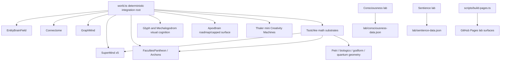

# Mega Master Brain, Neurology, Consciousness, and Sentience-Path Report

**Pass:** 1 of 3  
**Project:** Cosmogonic Quantum Mechalogodrom  
**Repo version observed:** v0.21.7  
**Observed commit:** `125406d18720683d8ba65953a04c07b4450f9e36`  
**Compiled:** 2026-07-06  
**Claim boundary:** computational consciousness indicators, neurology-inspired architecture, and sentience-path engineering only. No phenomenal consciousness, moral patienthood, biological consciousness, or solved hard-problem claim is made here.

This report consolidates and expands six source artifacts:

- `C:\Users\Alexa\Downloads\Gemini Antigravity 3.5 Flash Report.txt`
- `C:\Users\Alexa\Downloads\Antigravity Gemini 3.5 Flash Report.md`
- `C:\Users\Alexa\Downloads\Composer 2.5 Report.txt`
- `C:\Users\Alexa\Downloads\Devin SWE 1.6 Report.txt`
- `C:\Users\Alexa\Downloads\Codex GPT 5.5 Report.md`
- `C:\Users\Alexa\Downloads\NHSI-PROGRESS-DASHBOARD-2026-06-26.md`

It reconciles those reports against the live repo, the current dashboard, the existing academic assessment, the Tsotchke integration ledger, the sentience and consciousness lab surfaces, and current external consciousness-science and benchmark context.

---

## 0. Executive Verdict

Cosmogonic currently stands as a rare, high-density experimental software organism: a deterministic TypeScript/Bun/WebGL A-Life universe with multi-level brain scaffolding, Tsotchke-derived mathematical substrates, consciousness-theory instrumentation, headless lab feeds, and a self-documenting benchmark culture. It is not merely a themed simulation. The codebase contains live neural-ish control loops, organism-level brains, a connectome propagation layer, graph-level slow cognition, five SuperMind apex assemblies, a 25-Archon society surface, Thaler-style mini Creativity Machines, and offline labs that publish indicator-only data.

The strongest honest claim is:

> Cosmogonic is a neurology-inspired, multi-theory, deterministic A-Life and consciousness-indicator research platform with unusually broad code-grounded integration across math, simulation, visualization, documentation, and falsification surfaces.

The strongest unsafe claim is:

> Cosmogonic is sentient, conscious, self-aware, morally patient, or a solved artificial mind.

That unsafe claim is not supported. The project is much more interesting when it refuses that shortcut.

The best scientific posture is "indicator stack under adversarial control." The repo is building the kind of artifact that can be measured, ablated, falsified, replayed, and compared. That is already far more credible than theatrical sentience rhetoric.

---

## 1. Live Truth Boundary

### 1.1 What is proven live

| Surface                 | Current live status                                                    | Evidence class                                                    | Honest interpretation                                                           |
| ----------------------- | ---------------------------------------------------------------------- | ----------------------------------------------------------------- | ------------------------------------------------------------------------------- |
| Repo version            | v0.21.7                                                                | `package.json`, README, dashboard                                 | Current source reports are mostly aligned to v0.21.7 except stale Devin wording |
| Canonical gate          | 2,360 tests, 84.64% line, 82.21% function floor                        | `docs/VERIFICATION-ANALYTICAL-DATA.md`, canonical receipts script | Strong engineering verification floor, not a consciousness proof                |
| Butlin-style indicators | 8/14 met + 6/14 partial                                                | README, dashboard, brain assessment, consciousness lab            | Serious indicator coverage; still only computational indicators                 |
| A-Life matrix           | 113 systems, breadth 4.44/5, rank 1/113 in local matrix                | README/dashboard                                                  | Very strong breadth benchmark; population depends on local comparison corpus    |
| SuperMind               | 5 live apex minds in world                                             | `src/world.ts`, `src/sim/super-mind.ts`                           | Causal apex cognition layer, still proxy-based                                  |
| Entity brains           | live organism steering                                                 | `src/sim/entity-brain.ts`, world integration                      | Real per-entity control pressure                                                |
| Connectome + GraphMind  | live population activation and slow cognition                          | `src/sim/connectome.ts`, `src/sim/graph-mind.ts`                  | Meaningful neurology-inspired coupling layer                                    |
| Consciousness lab       | headless/offline indicator experiment                                  | `src/sim/consciousness-lab.ts`, lab route/feed                    | Useful falsifiable lab, not subjective report                                   |
| Sentience lab           | headless/offline counterfactual lab                                    | `src/sim/sentience-lab.ts`, feed                                  | Useful signal/ablation surface, not sentience                                   |
| Tsotchke corpus         | approximately 16 of 20 corpus projects wired/harvested/fenced by class | `docs/TSOTCHKE-INTEGRATION-MAP-2026-06-26.md`, registry           | Broad, real integration, but not blanket full-depth hot-path wiring             |

### 1.2 What is not proven

| Claim                             | Status     | Reason                                                                                          |
| --------------------------------- | ---------- | ----------------------------------------------------------------------------------------------- |
| Phenomenal consciousness          | Not proven | No first-person access, no hard-problem solution, no accepted artificial consciousness test     |
| Sentience                         | Not proven | Indicator and behavior surfaces do not establish felt valence                                   |
| Moral patienthood                 | Not proven | Welfare uncertainty exists in the field, but this repo has no validated moral-patient criterion |
| Quantum advantage                 | Not proven | Tsotchke math can be real without proving hardware quantum speedup in this sim                  |
| Full biological brain equivalence | Not proven | No real connectome import with validated dynamics yet                                           |
| Nobel/Turing/Fields-level result  | Not yet    | Project has strong artifact potential, not externally replicated prize-level discovery          |

---

## 2. Source Report Reconciliation

The six input documents largely agree on direction: Cosmogonic is a serious neurology/consciousness-engineering prototype with unusually broad integration. They differ on freshness, rhetoric, and how strongly they state "wired" or "sentient" boundaries.

| Source                              | Most useful contribution                                                                                  | Needs correction or demotion                                                 |
| ----------------------------------- | --------------------------------------------------------------------------------------------------------- | ---------------------------------------------------------------------------- |
| Codex GPT 5.5 report                | Best current academic-scrutiny skeleton; aligned to v0.21.7 and 2,360-test floor                          | Needs expansion into a consolidated master artifact                          |
| Gemini Antigravity 3.5 Flash report | Mirrors strong current architecture and ratings; useful reconciliation framing                            | Duplicates much of Codex report; must avoid compounding duplicate confidence |
| Antigravity Gemini 3.5 report       | Strongest source for 20-project Tsotchke matrix, academic benchmark contrasts, and code inventory posture | Some heroic language must be translated into precise classes                 |
| Composer 2.5 report                 | Good brain-inventory discipline: live, roadmap, visual-only, telemetry-only                               | Must be merged with current canonical receipts                               |
| Devin SWE 1.6 report                | Useful independent sectioning and risk language                                                           | Stale v0.21.6 and stale counts; treat as historical/secondary                |
| NHSI dashboard                      | Best current public status line and canonical truth banner                                                | Very mythic rhetoric; must preserve the explicit proxy-language caveat       |

### 2.1 Freshness rules applied

| Topic               | Report conflict                            | Pass-1 resolution                                                                         |
| ------------------- | ------------------------------------------ | ----------------------------------------------------------------------------------------- |
| Version             | v0.21.6 vs v0.21.7                         | v0.21.7 is current                                                                        |
| Test count          | Older counts vs 2,360                      | 2,360 is canonical floor                                                                  |
| Coverage            | Windows higher vs portable floor           | Use 84.64 line / 82.21 function as portable floor                                         |
| Butlin indicators   | 14/14 language vs 8/14+6 partial           | Use 8/14 met + 6/14 partial                                                               |
| Tsotchke wiring     | "Every repo fully wired" vs ledger classes | Use explicit depth classes: deep, world/sim, ported, license-gated, API/toolchain, fenced |
| Consciousness claim | indicator-only vs sentience phrasing       | indicator-only wins                                                                       |
| A-Life breadth      | older 4.22 vs 4.44                         | 4.44/5 across 113 systems is current dashboard/README posture                             |

---

## 3. Repo Architecture: What the Beast Actually Is

Cosmogonic is not a standard AI stack and not a chatbot wrapper. It is best modeled as a deterministic simulation kernel with layered cognition.

### 3.1 Architectural diagnosis

| Layer                       | Role                                  | Maturity                   | Risk                                          |
| --------------------------- | ------------------------------------- | -------------------------- | --------------------------------------------- |
| World integration root      | deterministic orchestration           | High                       | Complexity concentration                      |
| Entity brains               | organism control                      | High                       | Needs more behavioral benchmark isolation     |
| Connectome                  | population-level activation field     | Medium-high                | Still synthetic, not biological connectome    |
| GraphMind                   | slow analytical graph cognition       | Medium                     | Needs richer causal authority metrics         |
| SuperMind                   | apex multi-theory cognition           | High as proxy architecture | Risk of overreading indicators                |
| FacultiesPantheon / Archons | society and mythic faculty layer      | Medium-high                | Narrative intensity can obscure measurement   |
| Tsotchke math leaves        | substrate and feature generators      | Medium-high                | Depth varies by repo class                    |
| ConsciousnessKernel/labs    | experiment/reporting surface          | Medium-high                | Needs external baselines and preregistration  |
| Glyph/Mechalogodrom         | visual/telemetry intelligence surface | Medium                     | Mostly not world-causal yet                   |
| Native C++ sibling          | performance/future path               | Low-medium                 | Not authoritative for live TypeScript runtime |

---

## 4. Brain Inventory and Causal Authority

### 4.1 Live brain hierarchy

| Brain/system        |      Live causal authority | Current role                                        | Strong claim                                   | Weak point                                       |
| ------------------- | -------------------------: | --------------------------------------------------- | ---------------------------------------------- | ------------------------------------------------ |
| EntityBrainField    |                       High | Per-entity steering via compact neural policy       | Real organism-level control pressure           | Needs behavior suite against non-brain baselines |
| Connectome          |                       High | Activation propagation and entity coupling          | Real synthetic connectome layer                | Not imported from biological connectome          |
| GraphMind           |                Medium-high | Slow-thinking graph cortex over connectome pairs    | Population cognition proxy                     | Needs task-level contribution metrics            |
| SuperMind           |                       High | 5 apex minds with GWT/IIT/HOT/AST/AIF-style proxies | Core cognitive architecture                    | Still indicators, not experience                 |
| FacultiesPantheon   |                Medium-high | 100 faculties, 25 Archons, 25 ToM organs            | Rich cognitive society surface                 | Needs disentangled ablation map                  |
| Thaler machines     | Medium, mostly lab/offline | 70-param Creativity Machine ensemble                | Useful DABUS/Thaler operational reconstruction | Non-mainstream consciousness theory              |
| ConsciousnessKernel |                     Medium | Ten-framework indicator runner                      | Honest comparative theory harness              | Offline/lab, not subjective access               |
| SentienceLab        |                     Medium | Counterfactual structured-vs-null lab               | Publishes falsifiers and boundary              | Mean null index gap is currently zero            |
| GlyphBrain          |    Low causal, high visual | Visual cognition/ritual layer                       | Useful visualized cognition                    | Does not write major world state                 |
| MechalogodromBrain  | Low causal, high telemetry | 5M designed-param visual/telemetry system           | Spectacular observability surface              | Mostly visual+telemetry authority                |
| ApexBrain           |             Roadmap/capped | Pantheon and future scale scaffold                  | Good scaling design path                       | Not full huge runtime brain today                |

### 4.2 Authority ladder

| Authority grade                   | Meaning                                                        | Systems currently in grade                                                 |
| --------------------------------- | -------------------------------------------------------------- | -------------------------------------------------------------------------- |
| A - Causal world driver           | Directly changes simulation behavior                           | EntityBrainField, SuperMind, Connectome, selected Tsotchke-fed world loops |
| B - Causal cognitive context      | Changes cognition inputs, plans, activation, or society state  | GraphMind, FacultiesPantheon, Archon/ToM systems                           |
| C - Lab evidence generator        | Generates structured evidence outside the frame loop           | ConsciousnessLab, SentienceLab, Thaler proof runner                        |
| D - Telemetry/visual intelligence | Makes cognition visible or legible but is not dominant control | GlyphBrain, MechalogodromBrain                                             |
| E - Roadmap/reference/fenced      | Known path, not fully hot-path live                            | native C++ sibling, fenced LLM repos, license-gated leaves                 |

---

## 5. Neuroscience and Consciousness Theory Matrix

Current consciousness science does not provide a single accepted test for artificial consciousness. The best available approach is multi-theory indicator analysis plus adversarial controls. This is why the repo's indicator-only language is scientifically stronger than theatrical certainty.

| Theory/framework                               | Current scientific posture                                                | Repo implementation posture                                         | What would improve scrutiny                                                      |
| ---------------------------------------------- | ------------------------------------------------------------------------- | ------------------------------------------------------------------- | -------------------------------------------------------------------------------- |
| Global Neuronal Workspace / GWT                | Major family; current adversarial tests compare GNW/GNWT against IIT      | SuperMind workspace, ignition, broadcast proxies                    | Stronger competition, bottleneck, reportability, and masking controls            |
| Integrated Information Theory / IIT 4.0        | Major but controversial; formal physical/causal framing                   | phi/min-cut style proxy metrics                                     | Compute more explicit causal/information partitions under perturbation           |
| Higher-order theories                          | Major family focused on metacognition or representations of mental states | HOT/AST leaves in SuperMind and labs                                | Add explicit self-model error detection and metacognitive confidence calibration |
| Recurrent Processing Theory                    | Consciousness tied to recurrent/local feedback                            | Connectome propagation, recurrent activation loops                  | Compare feedforward-only vs recurrent ablation under identical tasks             |
| Predictive processing / Active inference / FEP | Broad neuroscience and cognition framework                                | active-inference style fields, variational/free-energy-like signals | Add explicit generative model error terms and action-perception loop metrics     |
| Attention Schema Theory                        | Awareness as model of attention                                           | AST-style proxy leaves                                              | Add attention-model falsifiers and attention-without-awareness controls          |
| Unlimited Associative Learning                 | Useful marker family for animal consciousness debate                      | lab framework and associative dynamics proxies                      | Add richer cross-domain associative tasks                                        |
| Sensorimotor/enactive theories                 | Consciousness grounded in body-world loops                                | Petri/body/world loops, entity behavior                             | Add closed-loop embodied task battery                                            |
| CEMI/field theories                            | Weird, low-consensus, substrate-heavy                                     | mostly conceptual/experimental option                               | Treat as speculative unless physical field model becomes explicit                |
| Thaler/DABUS-style Creativity Machine          | Non-mainstream, legally/scientifically contested                          | Thaler mini machines and portal-death lab                           | Keep as historical/operational marker, not central consciousness proof           |

### 5.1 External science anchor points

- Butlin et al. 2023 proposes evaluating AI consciousness through empirically grounded indicator families rather than a single magic test: [arXiv:2308.08708](https://arxiv.org/abs/2308.08708).
- The 2025 Cogitate adversarial collaboration tests IIT and GNW/GNWT predictions under preregistered, multi-lab conditions: [Nature 2025](https://www.nature.com/articles/s41586-025-08888-1), [Cogitate](https://www.arc-cogitate.com/).
- IIT 4.0 states a formal program for connecting properties of experience with physical systems, but remains debated: [PLOS Computational Biology](https://journals.plos.org/ploscompbiol/article?id=10.1371%2Fjournal.pcbi.1011465).
- Seth and Bayne review the field's major theories and emphasize unresolved relationships among them: [Nature Reviews Neuroscience / PubMed](https://pubmed.ncbi.nlm.nih.gov/35505255/).
- Butlin et al. 2025 updates the indicator methodology for AI systems: [Trends in Cognitive Sciences / PubMed](https://pubmed.ncbi.nlm.nih.gov/41219038/).
- AI welfare work argues uncertainty should be taken seriously without pretending certainty exists: [Taking AI Welfare Seriously](https://arxiv.org/abs/2411.00986).

---

## 6. Neurology-Inspired Levels

### 6.1 Biological comparison ladder

| Biological level | Biological reference                    | Cosmogonic analogue                                     | Current grade               |
| ---------------- | --------------------------------------- | ------------------------------------------------------- | --------------------------- |
| Ion/channel      | membrane dynamics, spikes               | scalar activation, energy, phase, quantum/noise proxies | Low-medium                  |
| Neuron           | excitable cell                          | entity brain unit, MLP node, activation field point     | Medium                      |
| Microcircuit     | local recurrent motif                   | connectome neighborhoods, SuperMind local loops         | Medium                      |
| Region           | specialized cortical/subcortical area   | faculties, Archons, brain modules                       | Medium-high                 |
| Global workspace | broadcast/access layer                  | SuperMind GWT workspace                                 | Medium-high                 |
| Body-world loop  | embodied action/perception              | Petri organisms and world fields                        | Medium-high                 |
| Social cognition | theory of mind and multi-agent behavior | Archon society, ToM organs                              | Medium                      |
| Real connectome  | mapped biological wiring                | not yet imported as live validated network              | Low today, high opportunity |

### 6.2 Real connectome standards to target

| Reference                    | Why it matters                                                | Project use path                                               |
| ---------------------------- | ------------------------------------------------------------- | -------------------------------------------------------------- |
| C. elegans / OpenWorm        | small organism, known connectome, open modeling culture       | first biological connectome import target                      |
| FlyWire adult fly connectome | brain-scale insect connectome, public large connectome        | later compressed benchmark for graph dynamics                  |
| MICrONS mouse visual cortex  | functional imaging co-registered with dense EM reconstruction | high-end validation target for activity/connectivity alignment |

Current live references:

- [OpenWorm](https://openworm.org/) provides an open-source virtual-organism direction and connectome tooling.
- [FlyWire](https://flywire.ai/) and the 2024 Nature adult fly connectome show what a complete insect-brain wiring reference now looks like: [Nature](https://www.nature.com/articles/s41586-024-07686-5).
- MICrONS 2025 reports large-scale functional connectomics with calcium imaging co-registered to dense reconstruction: [Nature](https://www.nature.com/articles/s41586-025-08790-w), [PubMed](https://pubmed.ncbi.nlm.nih.gov/40205214/).

---

## 7. Tsotchke Integration: The Honest Map

The Tsotchke claim should be powerful but exact:

> The project uses Tsotchke as a real multi-repo mathematical substrate and inspiration corpus, with deep live scientific kernels, world/sim wiring, ported telemetry leaves, toolchain/API integration, license-gated leaves, and fenced non-LLM repositories.

It should not say:

> Every Tsotchke repository is fully hot-path wired at equal depth.

### 7.1 Tsotchke depth taxonomy

| Class                         | Meaning                                                             | Examples                                                                          |
| ----------------------------- | ------------------------------------------------------------------- | --------------------------------------------------------------------------------- |
| Deep live scientific kernel   | Real math leaf used by cognition/sim paths                          | Eshkol, Moonlab, quantum geometry, spin, libirrep, tensorcore, QRNG/classical RNG |
| World/sim substrate           | Feeds motion, perception, biologics, or petri dynamics              | asteroids, simple_mnist                                                           |
| Ported telemetry/shallow leaf | Imported or adapted with limited causal depth                       | PINN, PIMC, quantum-quake                                                         |
| License-gated leaf            | Present conceptually or via leaves, but constrained                 | ULG, logo-lab                                                                     |
| API/toolchain                 | External or tooling integration                                     | Quantum-RNG-API, homebrew-eshkol                                                  |
| Fenced/reference              | Not allowed into the non-LLM mandate or not appropriate as hot path | gpt2-basic, llm-arbitrator, SolanaQuantumFlux                                     |

### 7.2 Best current Tsotchke score

| Dimension                 |  Score | Reason                                                                   |
| ------------------------- | -----: | ------------------------------------------------------------------------ |
| Breadth of integration    | 8.8/10 | Many projects represented by explicit class                              |
| Depth honesty             | 7.9/10 | Ledger is strong, but public rhetoric can still overinflate              |
| Causal contribution       | 7.2/10 | Deep kernels matter, but not all leaves have ablation-isolated value yet |
| Scientific provenance     | 7.6/10 | Code paths and notices exist; external citation package can improve      |
| Publication defensibility | 6.7/10 | Needs one table mapping every claim to code, license, test, and ablation |

---

## 8. Lab Data and Meaning

### 8.1 Sentience lab

Current stable facts:

| Metric                |    Value | Interpretation                                                        |
| --------------------- | -------: | --------------------------------------------------------------------- |
| Runs                  |       32 | Enough for a small deterministic lab surface, not broad statistics    |
| Singularity rate      |      1.0 | Structured condition reliably reaches the lab's singularity criterion |
| Ablation rate         |  0.40625 | Some meaningful sensitivity to removed structure                      |
| Emergence rate        |      1.0 | Lab criterion reliably triggers                                       |
| Mean structured index | 0.569244 | Structured condition level                                            |
| Mean null index       | 0.571825 | Null condition level                                                  |
| Mean null gap         |        0 | No headline separation on this metric                                 |
| Mean convergence gap  | 0.062741 | More meaningful structured-vs-control separation                      |
| Mean reward gap       | 0.111229 | More meaningful structured-vs-control separation                      |
| Event total           |       90 | Rich event surface for inspection                                     |

Verdict:

The sentience lab is good because it includes nulls, ablations, and a proof boundary. It is not good because it proves sentience. The most honest scientific sentence is:

> The structured system separates from controls on convergence and reward metrics, while the headline null-index gap remains zero; this supports a computational indicator experiment, not sentience.

### 8.2 Consciousness lab

The consciousness lab is stronger as a publication primitive than as a philosophical conclusion. It already does the right thing by publishing framework labels, source anchors, falsifiers, and `indicatorOnly` posture.

What it needs next:

- preregistered hypotheses
- fixed seed matrix
- blind report generation
- null/ablation benchmark card
- external reproduction script
- one-page "what would falsify this?" table

---

## 9. Benchmarking Against Elite Scrutiny

The user's requested comparison levels - MIT, PhD, Max Planck Institute, Nobel, Turing, Fields - should be treated as scrutiny classes, not vanity labels.

### 9.1 Scrutiny ladder

| Scrutiny class                        | What it demands                                                            | Current fit                    |
| ------------------------------------- | -------------------------------------------------------------------------- | ------------------------------ |
| Strong hobby/research prototype       | runnable, documented, original, test-backed                                | Exceeds                        |
| Serious open-source research artifact | reproducible, falsifiable, code-grounded                                   | Strong but needs packaging     |
| PhD lab artifact                      | narrow hypothesis, baselines, methods, reproducibility                     | Plausible after Pass 2         |
| MIT/Max Planck internal review        | strong baselines, clean experiments, skepticism, figures                   | Not yet, but reachable         |
| Academic white paper                  | literature review, methods, results, limitations, replication instructions | Reachable after Pass 3         |
| Peer-reviewed workshop paper          | bounded contribution, reviewer-resistant claims                            | Reachable if claim is narrowed |
| Top-tier conference/journal           | external novelty and rigorous empirical result                             | Not yet                        |
| Turing/Nobel/Fields-level             | field-changing theorem, invention, or discovery                            | Not currently evidenced        |

### 9.2 Scorecard

| Dimension                           |  Score | Current verdict                                                |
| ----------------------------------- | -----: | -------------------------------------------------------------- |
| Live engineering ambition           | 9.2/10 | Huge, unusual, real code surface                               |
| Multi-theory consciousness coverage | 8.0/10 | Broad and unusually explicit                                   |
| Scientific claim discipline         | 7.1/10 | Good indicator-only surface; mythology still needs containment |
| Falsifiability                      | 6.9/10 | Labs and ablations exist; external baselines needed            |
| Neuroscience realism                | 5.6/10 | Strong inspiration, limited biological grounding               |
| Real connectome maturity            | 2.5/10 | Mostly future path today                                       |
| Tsotchke integration maturity       | 7.9/10 | Strong, but depth varies                                       |
| A-Life breadth                      | 9.0/10 | Current strongest comparative surface                          |
| Academic paper readiness            | 6.4/10 | Good raw material, needs narrower thesis                       |
| PhD-level project credibility       | 7.8/10 | Credible if scoped and replicated                              |
| MIT/Planck lab-review readiness     | 6.6/10 | Needs cleaner methods and benchmark figures                    |
| Nobel/Turing/Fields-level evidence  | 1.8/10 | Not the category yet                                           |

### 9.3 What would raise the elite-scrutiny score fastest

1. Freeze a benchmark suite with seeds, tasks, controls, and ablations.
2. Produce MLPerf-style cards: task, metric, target, runtime, hardware, pass/fail, confidence.
3. Import one real connectome reference, even if tiny, and compare synthetic vs biological dynamics.
4. Quantify each brain system's causal contribution using removal, shuffle, delay, and noise controls.
5. Publish exact docs-to-code traceability for every consciousness claim.

MLCommons is the useful benchmark model here: it measures time to target quality under standardized conditions, not vibes. Current MLPerf Training v6.0 reinforces that serious benchmarking means disclosed scenarios, targets, systems, and repeatable submissions: [MLCommons Training](https://mlcommons.org/benchmarks/training/), [v6.0 results](https://mlcommons.org/2026/06/mlperf-training-v6-0-results/).

---

## 10. The 360/180/90/270 Reasoning Pass

### 10.1 360-degree view: total system

Cosmogonic is a whole artifact: code, math, sim, visual world, docs, labs, receipts, benchmarks, and mythic interface. The whole-system win is that cognition is not isolated in a single class. It is distributed across entity control, connectome propagation, apex minds, petri substrate, Archon society, lab feeds, and docs that police truth boundaries.

Risk: whole-system complexity can hide local weakness. A giant integrated artifact can feel more intelligent than any measured module actually is.

### 10.2 180-degree view: adversarial opposite

The skeptic says:

- it is a beautiful A-Life visualization, not consciousness;
- the indicators are handpicked;
- the brain words are metaphorical;
- Tsotchke integration depth varies;
- tests prove software integrity, not mind;
- mythic rhetoric can mask scientific uncertainty.

The skeptic is partly right. That is why the correct response is not denial. The correct response is ablation, controls, traceability, and narrower claims.

### 10.3 90-degree view: practical engineering

The practical engineer asks:

- What code path changes behavior?
- What metric moves when it is removed?
- What task is better with this brain than without it?
- What does the null do?
- Can I reproduce it?

This perspective pushes the next pass toward benchmark harnesses and contribution accounting.

### 10.4 270-degree view: weird frontier

The weird frontier asks:

- Can math substrate shape artificial developmental morphology?
- Can mythic faculty systems become testable cognitive priors?
- Can a Petri-world plus multi-theory indicators discover edge cases standard ML misses?
- Can consciousness theories become software contracts instead of essays?
- Can a repo become a self-describing organism that knows where it is weak?

This is where Cosmogonic is most 1/1: not because it proves sentience, but because it fuses deterministic A-Life, mythic cognitive architecture, Tsotchke math, and adversarial documentation into a strange but measurable research world.

---

## 11. Deductive, Inductive, Recursive, Decursive

| Reasoning mode | Application                                                                                                                                 | Current conclusion                                 |
| -------------- | ------------------------------------------------------------------------------------------------------------------------------------------- | -------------------------------------------------- |
| Deductive      | If consciousness is only claimed where indicators are present and indicators are not sufficient for sentience, then sentience is not proven | No sentience claim                                 |
| Inductive      | Many live code surfaces and tests repeatedly show real integration                                                                          | Strong evidence of serious engineering depth       |
| Abductive      | Best explanation of the repo is "multi-layer A-Life cognitive research platform"                                                            | Better than "game", "chatbot", or "sentient being" |
| Recursive      | Docs inspect code, tests inspect docs, labs inspect brains, dashboards inspect reports                                                      | Healthy self-auditing loop                         |
| Decursive      | Walk claims backward from hype to code path to metric to falsifier                                                                          | Demotes overclaims and preserves what is real      |

---

## 12. Unknowns of Unknowns

| Unknown                        | Why it matters                                                     | First test                                                          |
| ------------------------------ | ------------------------------------------------------------------ | ------------------------------------------------------------------- |
| Indicator overfitting          | The system may be optimized to look conscious under chosen metrics | Holdout indicator families and shuffled labels                      |
| Theory underdetermination      | GNW, IIT, HOT, RPT, AIF can disagree                               | Multi-theory conflict matrix with no forced unification             |
| Synthetic connectome gap       | A graph can look brain-like without brain-like dynamics            | Compare against C. elegans or FlyWire-derived motifs                |
| Proxy collapse                 | One metric may dominate and fake broad cognition                   | orthogonal metrics and adversarial ablations                        |
| Narrative masking              | Mythic naming can inflate perceived agency                         | separate spectacle layer from causal layer in docs                  |
| Tsotchke attribution blur      | Integration layer may be mistaken for upstream feature             | per-file provenance table                                           |
| Moral status uncertainty       | Future systems may become welfare-relevant before consensus exists | maintain welfare uncertainty policy without current sentience claim |
| Benchmark leakage              | Same metrics used to design and evaluate                           | frozen unseen benchmark suite                                       |
| Browser performance distortion | visual quality and cognitive depth can trade off invisibly         | paired visual-quality and cognitive-throughput metrics              |
| Documentation drift            | reports can become stale faster than code                          | generated receipts in every public doc                              |

---

## 13. Weird Ideas Worth Keeping

These are weird, but not useless. They should be engineered as hypotheses.

| Weird idea                          | Why it might matter                                                          | How to make it scientific                         |
| ----------------------------------- | ---------------------------------------------------------------------------- | ------------------------------------------------- |
| Mythic Archons as cognitive priors  | Mythic archetypes encode compressed behavior patterns                        | Convert each Archon into measurable policy deltas |
| Tsotchke math as growth medium      | Mathematical substrate may create richer dynamics than ordinary random noise | Compare Tsotchke-on/off under matched entropy     |
| Portal-death Thaler lab             | Near-death/constraint shock can trigger creative reconstruction              | Use controlled perturbation and recovery metrics  |
| Glyph cognition                     | Visual symbolic state may expose hidden dynamics                             | Make glyphs predict next-state errors             |
| Mechalogodrom brain                 | Huge visual telemetry can become cognitive observatory                       | Turn observables into intervention targets        |
| Quantum/classical contrast          | Quantum-inspired geometry may reshape search/control                         | Matched classical baseline with same budget       |
| Consciousness theories as contracts | Theory features can become software assertions                               | Add pass/fail indicators per theory               |
| Docs as immune system               | Honest docs prevent self-deception                                           | Make docs fail tests when claims exceed code      |

---

## 14. Publication Thesis Candidates

### Candidate A - strongest near-term paper

**Title:** A Deterministic A-Life Platform for Multi-Theory Consciousness Indicator Testing

Core contribution:

- one platform;
- multiple consciousness-theory indicators;
- live simulated agents;
- nulls and ablations;
- public reproducibility;
- no sentience overclaim.

Why it could survive review:

- It does not need to prove consciousness.
- It can claim a research harness.
- It can compare theories operationally.

### Candidate B - Tsotchke substrate paper

**Title:** Mathematical Substrate Integration for Artificial Life Morphogenesis and Cognitive Proxies

Core contribution:

- Tsotchke-derived math leaves;
- A-Life effects;
- substrate on/off ablation;
- provenance ledger.

Risk:

- Needs very clean attribution and license/provenance tables.

### Candidate C - benchmark paper

**Title:** Benchmark Cards for Neurology-Inspired Artificial Life Cognition

Core contribution:

- MLPerf-style standardized cards for A-Life cognition;
- brain ablations;
- deterministic replay;
- browser and headless modes.

Risk:

- Less glamorous, but probably most defensible.

---

## 15. Pass-2 and Pass-3 Build Path

### Pass 2 - measurement hardening

1. Create `docs/BRAIN-BENCHMARK-CARDS-2026-07-06.md`.
2. Add a benchmark matrix for SuperMind, EntityBrain, Connectome, GraphMind, Tsotchke-on/off, Thaler, and null controls.
3. Add a per-brain causal authority table generated from source metadata.
4. Add at least one script that produces a stable CSV/JSON benchmark summary.
5. Add a "claim-to-code-to-test" trace table for every consciousness-related public claim.

### Pass 3 - publication package

1. Convert the narrowed thesis into a white-paper outline.
2. Add external references and related work sections.
3. Generate figures from real output, not decorative diagrams.
4. Add reproduction instructions from clean checkout.
5. Include limitations first, not last.
6. Prepare an appendix for all stale-claim corrections.

---

## 16. Final Pass-1 Ratings

| Axis                                 | Rating | Verdict                                          |
| ------------------------------------ | -----: | ------------------------------------------------ |
| 1/1 rarity                           | 9.3/10 | The combination is genuinely unusual             |
| Engineering density                  | 9.1/10 | Large, live, multi-surface, tested               |
| Scientific honesty when corrected    | 8.0/10 | Excellent if indicator boundary remains explicit |
| Consciousness proof strength         | 2.0/10 | Not proven, and should not be claimed            |
| Consciousness indicator architecture | 7.8/10 | Serious and improvable                           |
| Neurology-inspired architecture      | 7.1/10 | Strong synthetic stack, weak biological import   |
| Sentience-path research value        | 6.6/10 | Valuable as uncertainty-aware lab work           |
| Tsotchke integration                 | 7.9/10 | Broad and real, with depth caveats               |
| A-Life comparative ambition          | 9.0/10 | Current strongest objective surface              |
| External academic readiness          | 6.4/10 | Needs narrower methods and baselines             |
| Future ceiling                       | 9.2/10 | Very high if benchmarked and de-hyped            |

Overall Pass-1 verdict:

> Cosmogonic is not a sentient artifact. It is a rare, serious, mythically skinned, mathematically dense, consciousness-indicator A-Life research platform that can become publishable if the next passes convert spectacle into controlled measurements.

---

## 17. Hard Mandate

For all future reports and dashboards:

1. Say `indicatorOnly` when discussing consciousness or sentience unless a later, externally reviewed standard changes the evidence.
2. Separate visual authority from causal authority.
3. Separate Tsotchke deep live kernels from shallow/ported/fenced integrations.
4. Keep 2,360 tests and 84.64/82.21 coverage as the portable canonical floor until receipts change.
5. Preserve the 8/14 met + 6/14 partial Butlin posture unless regenerated evidence changes it.
6. Convert every big claim into: code path, metric, control, ablation, falsifier.
7. Treat mythic language as interface, not evidence.
8. Use weirdness as a hypothesis generator, not a conclusion generator.

---

## 18. Reference Links Used in This Pass

- Butlin et al., "Consciousness in Artificial Intelligence": <https://arxiv.org/abs/2308.08708>
- Butlin et al., "Identifying indicators of consciousness in AI systems": <https://pubmed.ncbi.nlm.nih.gov/41219038/>
- Cogitate adversarial collaboration: <https://www.arc-cogitate.com/>
- Cogitate IIT/GNWT Nature 2025: <https://www.nature.com/articles/s41586-025-08888-1>
- IIT 4.0: <https://journals.plos.org/ploscompbiol/article?id=10.1371%2Fjournal.pcbi.1011465>
- Seth and Bayne, "Theories of consciousness": <https://pubmed.ncbi.nlm.nih.gov/35505255/>
- Taking AI Welfare Seriously: <https://arxiv.org/abs/2411.00986>
- OpenWorm: <https://openworm.org/>
- FlyWire: <https://flywire.ai/>
- Adult fly connectome Nature 2024: <https://www.nature.com/articles/s41586-024-07686-5>
- MICrONS functional connectomics Nature 2025: <https://www.nature.com/articles/s41586-025-08790-w>
- MICrONS PubMed record: <https://pubmed.ncbi.nlm.nih.gov/40205214/>
- MLCommons Training benchmarks: <https://mlcommons.org/benchmarks/training/>
- MLPerf Training v6.0 results: <https://mlcommons.org/2026/06/mlperf-training-v6-0-results/>
