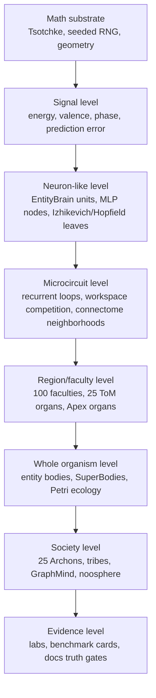
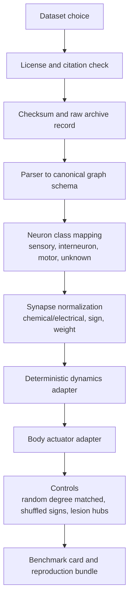

# Mega Master Brain, Neurology, Consciousness, and Sentience-Path Report

**Pass:** 2 of 3  
**Mode:** evidence hardening, benchmark architecture, traceability expansion  
**Project:** Cosmogonic Quantum Mechalogodrom  
**Repo version observed:** v0.21.7  
**Observed branch:** `phase0-ui-shell...origin/main`  
**Compiled:** 2026-07-06  
**Claim boundary:** computational indicators, architecture, repeatable experiments, and falsifiable mechanisms only. This is not a claim of phenomenal consciousness, subjective sentience, moral patienthood, or a solved hard problem.

Pass 1 combined the five downloaded reports plus the dashboard into one master synthesis. Pass 2 turns that synthesis into a harder artifact: a reviewer-facing evidence spine, benchmark plan, theory-to-code matrix, connectome import strategy, and falsifier map.

---

## 0. Pass-2 Thesis

Cosmogonic is past the "is this just prose?" stage. The live repo contains many real mechanisms: entity brains, synthetic connectome propagation, graph cognition, five SuperMinds, 25 Archons, 25 ToM organs, 100 faculties, Tsotchke-derived math leaves, consciousness and sentience lab feeds, and a green verification culture.

The next scientific leap is not more mythic naming and not more raw modules. The leap is:

1. turn every major claim into a benchmark card;
2. turn every theory indicator into a code path plus falsifier;
3. turn every brain into a causal contribution score;
4. turn Tsotchke integration into ablation-tested substrate lift;
5. turn synthetic connectome into a real-connectome import pipeline;
6. keep `indicatorOnly` even when the graphs look alive.

This pass therefore answers a stricter question:

> If a hostile MIT, PhD, Max Planck, Turing, Fields, or Nobel-level reviewer demanded proof of each engineering claim, what table, script, benchmark, null, and failure mode would Cosmogonic need?

---

## 1. Delta From Pass 1

| Area                 | Pass 1 did                                     | Pass 2 adds                                               |
| -------------------- | ---------------------------------------------- | --------------------------------------------------------- |
| Source fusion        | Consolidated five reports plus dashboard       | Adds evidence custody and benchmark-card doctrine         |
| Brain inventory      | Listed live causal authority tiers             | Adds claim-to-code-to-test-to-falsifier table             |
| Consciousness theory | Mapped major theories to repo posture          | Adds per-theory adversarial tests and reviewer objections |
| Tsotchke             | Classified deep/wired/ported/fenced depth      | Adds substrate-lift ablation protocol                     |
| Labs                 | Interpreted sentience and consciousness feeds  | Adds statistical acceptance thresholds                    |
| Connectome           | Named C. elegans/FlyWire/MICrONS target ladder | Adds import pipeline and data-card requirements           |
| Elite scrutiny       | Gave ratings                                   | Adds what each score would need to improve                |
| Future path          | Stated Pass 2 and Pass 3 outline               | Converts Pass 3 into a publication package checklist      |

---

## 2. Current Custody and Dirty-Tree Boundary

Pass 2 was written while the working tree already contained relevant uncommitted work:

| Path                                                                           | Status seen           | Custody decision                                                          |
| ------------------------------------------------------------------------------ | --------------------- | ------------------------------------------------------------------------- |
| `docs/BRAIN-NEUROLOGY-CONSCIOUSNESS-ENGINEERING-ASSESSMENT-2026-07-06.md`      | modified              | treated as user/parallel-agent owned; not overwritten                     |
| `docs/SUPER-REPORT-2026-07-06.md`                                              | untracked             | treated as user/parallel-agent owned; used only as context when inspected |
| `docs/MEGA-MASTER-BRAIN-NEUROLOGY-CONSCIOUSNESS-SENTIENCE-PASS1-2026-07-06.md` | untracked from Pass 1 | used as the parent artifact                                               |
| `docs/NHSI-PROGRESS-DASHBOARD-2026-06-26.md`                                   | modified by Pass 1    | safely extended with one Pass-2 link                                      |

No destructive cleanup, reset, or overwrite was performed.

---

## 3. Evidence Spine: Claim To Code To Test To Falsifier

This is the central Pass-2 upgrade. It separates "exists in prose" from "exists in code" from "moves behavior" from "survives a null."

| Claim                                                              | Primary code/data evidence                                                                                        | Current tests/surfaces                                              | Current confidence         | What would falsify or demote it                                       |
| ------------------------------------------------------------------ | ----------------------------------------------------------------------------------------------------------------- | ------------------------------------------------------------------- | -------------------------- | --------------------------------------------------------------------- |
| The repo is v0.21.7 and truth-synced                               | `package.json`, `scripts/canonical-receipts.ts`, `docs/VERIFICATION-ANALYTICAL-DATA.md`                           | `bun run sync:check`, `bun run verify:facts`, `bun run check`       | High                       | package/docs/readme disagree after sync check                         |
| The project has a portable 2,360-test floor                        | `scripts/canonical-receipts.ts`, `docs/VERIFICATION-ANALYTICAL-DATA.md`                                           | `verify:receipts`, docs receipts law                                | High                       | full gate below floor or receipt law mismatch                         |
| SuperMind is live and causal                                       | `src/sim/super-mind.ts`, `src/world.ts` imports/instantiation/drive loop                                          | `tests/super-mind*.test.ts`, `tests/drivesuper-determinism.test.ts` | High as code mechanism     | disabling SuperMind has no measurable world or plan effect            |
| SuperMind is not sentience proof                                   | `src/sim/super-mind.ts` disclaimer, `src/world.ts` contract comments                                              | docs truth law, repeated `indicatorOnly` surfaces                   | High                       | public docs claim phenomenal consciousness                            |
| Entity brains steer organisms                                      | `src/sim/entity-brain.ts`, `src/world.ts` entity brain fields and calls                                           | `tests/entity-brain.test.ts`, `tests/brains.test.ts`                | High                       | brain-ablated entities match steering/viability within noise          |
| Connectome is a synthetic population graph                         | `src/sim/connectome.ts`, `src/world.ts` connectome fields and updates                                             | `tests/connectome.test.ts`, snapshot telemetry                      | High                       | links/activation are decorative and not consumed downstream           |
| GraphMind is slow graph cognition                                  | `src/sim/graph-mind.ts`, `src/world.ts` integration                                                               | `tests/graph-mind.test.ts`                                          | Medium-high                | GraphMind removal has no effect on planning or metrics                |
| ConsciousnessKernel is multi-framework and falsifier-bearing       | `src/sim/consciousness-kernel.ts` ten frameworks and falsifier fields                                             | `tests/consciousness-kernel.test.ts`, `lab/consciousness-data.json` | High for indicator harness | any named framework has no code path or falsifier                     |
| Consciousness lab is indicator-only                                | `src/sim/consciousness-lab.ts`, `lab/consciousness-data.json`                                                     | `tests/consciousness-lab.test.ts`, web/API routes                   | High                       | lab claims experience or lacks null/ablation                          |
| Sentience lab is indicator-only                                    | `src/sim/sentience-lab.ts`, `lab/sentience-data.json`                                                             | `tests/sentience-lab.test.ts`, web/API routes                       | High                       | public language calls it sentience proof                              |
| Sentience lab has a real null problem                              | `lab/sentience-data.json` meanNullGap = 0                                                                         | Pass-1/Pass-2 docs                                                  | High and important         | regenerated data shows robust positive gap under preregistered metric |
| Tsotchke integration is broad but depth-classed                    | `src/sim/tsotchke-registry.ts`, `src/sim/tsotchke-brain-intake.ts`, `docs/TSOTCHKE-INTEGRATION-MAP-2026-06-26.md` | `tests/tsotchke-*.test.ts`                                          | High for classification    | registry says fenced/ported but docs claim full hot-path wiring       |
| GlyphBrain is visual/non-dominant                                  | `src/sim/glyph-brain.ts` comments and output                                                                      | `tests/glyph-brain.test.ts`                                         | High                       | glyph output becomes hidden causal control without docs/tests         |
| MechalogodromBrain is visual/telemetry-first                       | `src/sim/mechalogodrom-brain.ts` comments and snapshot                                                            | `tests/mechalogodrom-brain.test.ts`                                 | High                       | docs claim 5M live world-dominant brain without causal proof          |
| ApexBrain is a roadmap/capped live surface                         | `src/sim/apex-brain.ts`, `tests/apex-*.test.ts`                                                                   | apex test suite                                                     | Medium-high                | designed scale mistaken for live allocation                           |
| Thaler mini machines are operational markers, not mainstream proof | `src/sim/thaler-sentience.ts`, `tests/thaler-sentience.test.ts`                                                   | marker tests and world proof runner                                 | Medium                     | docs elevate Thaler/DABUS as accepted consciousness standard          |
| A-Life breadth is strong                                           | `docs/reports/assets/alife-stats.json`, CSV and generated SVGs                                                    | `scripts/alife-comparison-stats.ts`, README section                 | High for local matrix      | method or peer set invalidates ranking                                |

---

## 4. Benchmark Cards To Build

These cards are written as the future `docs/BRAIN-BENCHMARK-CARDS-2026-07-06.md` skeleton. Each card should become a JSON/CSV-producing script in Pass 3 or a follow-up implementation pass.

### Card A: SuperMind causal lift

| Field      | Specification                                                                                    |
| ---------- | ------------------------------------------------------------------------------------------------ |
| Claim      | SuperMind improves viability, planning coherence, novelty, or adaptive control                   |
| Conditions | SuperMind on, SuperMind off, shuffled SuperMind, delayed SuperMind                               |
| Seeds      | minimum 32 deterministic seeds, ideally 128                                                      |
| Metrics    | survival, food/energy stability, plan diversity, novelty, noosphere contribution, frame cost     |
| Acceptance | on beats off and shuffled with confidence interval excluding zero on at least one primary metric |
| Falsifier  | no statistically meaningful difference or worse frame-time/cognition tradeoff                    |

### Card B: EntityBrain steering lift

| Field      | Specification                                                                      |
| ---------- | ---------------------------------------------------------------------------------- |
| Claim      | Per-entity 6-6-4 brains change organism behavior                                   |
| Conditions | normal genome brain, zeroed brain, randomized fixed brain, devour-transfer brain   |
| Metrics    | speed/turning coherence, food acquisition, predator avoidance, lineage persistence |
| Acceptance | normal and inherited brains produce behavior separable from zero/random controls   |
| Falsifier  | kinematics and viability are unchanged under zeroing                               |

### Card C: Connectome and GraphMind lift

| Field      | Specification                                                                                     |
| ---------- | ------------------------------------------------------------------------------------------------- |
| Claim      | Synthetic connectome/GraphMind adds population-level structure beyond nearest-neighbor visuals    |
| Conditions | connectome on, connectome off, shuffled edges, delayed propagation, random graph with same degree |
| Metrics    | activation spread, tribe coherence, graph centrality stability, population survival, plan lift    |
| Acceptance | real connectome beats degree-matched random graph on preregistered population metrics             |
| Falsifier  | degree-matched null performs the same                                                             |

### Card D: ConsciousnessKernel theory-coupling lift

| Field      | Specification                                                                             |
| ---------- | ----------------------------------------------------------------------------------------- |
| Claim      | Ten-framework coupling carries distinct signal beyond scalar averaging                    |
| Conditions | coupled, uncoupled, diagonal-only, shuffled coupling matrix, single-framework ablations   |
| Metrics    | framework separation, ablation loss, cross-framework coherence, downstream behavior delta |
| Acceptance | coupled system has nontrivial ablation sensitivity and control separation                 |
| Falsifier  | shuffled coupling matrix performs equally                                                 |

### Card E: SentienceLab structured-vs-null

| Field          | Specification                                                                      |
| -------------- | ---------------------------------------------------------------------------------- |
| Claim          | Structured agents separate from nulls on convergence/reward, not necessarily index |
| Current facts  | 32 runs, meanNullGap = 0, meanConvergenceGap = 0.062741, meanRewardGap = 0.111229  |
| Primary metric | choose convergence or reward before rerun; do not move goalposts after observing   |
| Acceptance     | positive gap with confidence interval excluding zero and ablation sensitivity      |
| Falsifier      | null matches structured condition on all preregistered metrics                     |

### Card F: Tsotchke substrate lift

| Field      | Specification                                                                            |
| ---------- | ---------------------------------------------------------------------------------------- |
| Claim      | Tsotchke-derived math improves morphology/cognition over matched classical baselines     |
| Conditions | full Tsotchke, deep-only, no Tsotchke, classical-matched entropy, random-matched entropy |
| Metrics    | aliveness, novelty, viability, morphology diversity, cognition stability, frame cost     |
| Acceptance | full or deep-only beats matched controls on at least one preregistered metric            |
| Falsifier  | all lift disappears under entropy-matched classical baseline                             |

### Card G: Thaler marker reconstruction

| Field      | Specification                                                                |
| ---------- | ---------------------------------------------------------------------------- |
| Claim      | Mini Creativity Machines meet Thaler-style operational markers               |
| Conditions | normal, no perturbation, no memory, no valence, no recursive chain           |
| Metrics    | markers met, markers robust, fraction robust, confabulation sweet spot       |
| Acceptance | markers remain robust under seed variation but fail under targeted ablations |
| Falsifier  | markers are trivially met by random/no-memory systems                        |

### Card H: Real connectome import

| Field      | Specification                                                                               |
| ---------- | ------------------------------------------------------------------------------------------- |
| Claim      | A real connectome can drive an embodied deterministic controller                            |
| Conditions | imported graph, randomized-degree matched graph, lesion graph, synthetic current connectome |
| Metrics    | graph statistics fidelity, sensorimotor response, task survival, lesion sensitivity         |
| Acceptance | imported graph produces reproducible sensorimotor dynamics separable from random controls   |
| Falsifier  | imported graph behaves no better than a matched random graph                                |

### Card I: Browser quality/cognition preservation

| Field      | Specification                                                                                       |
| ---------- | --------------------------------------------------------------------------------------------------- |
| Claim      | Performance work preserves visual richness and cognitive surface                                    |
| Conditions | desktop, mobile, quality tiers, worker on/off                                                       |
| Metrics    | FPS, frame p95, visible entities, active brain systems, shader/material coverage, lab feed validity |
| Acceptance | optimization improves frame budget without reducing cognitive/visual feature count                  |
| Falsifier  | FPS improves only by silently disabling intelligence or graphics                                    |

---

## 5. Statistical Doctrine

### 5.1 Minimum metrics

Every future claim should publish:

| Metric             | Formula                                             | Meaning                   |
| ------------------ | --------------------------------------------------- | ------------------------- |
| raw lift           | `mean(experiment) - mean(control)`                  | simple effect             |
| normalized lift    | `(mean(experiment) - mean(control)) / std(control)` | comparable effect size    |
| ablation loss      | `mean(full) - mean(ablated)`                        | load-bearing contribution |
| null gap           | `max(0, mean(structured) - mean(null))`             | honest separation         |
| cost ratio         | `frameMs(experiment) / frameMs(control)`            | performance burden        |
| stability          | `1 - coefficientOfVariation(metric)`                | seed robustness           |
| contradiction flag | `docsClaim != codeClaim`                            | truth-surface break       |

### 5.2 Acceptance language

| Evidence state            | Allowed language                      | Forbidden language    |
| ------------------------- | ------------------------------------- | --------------------- |
| Code exists               | implemented mechanism                 | proven intelligence   |
| Test passes               | regression-pinned behavior            | scientific validation |
| Lab separates from null   | computational indicator support       | sentience evidence    |
| Ablation changes behavior | load-bearing contribution             | consciousness proof   |
| External dataset imported | biologically grounded model component | biological mind       |
| Peer reproduced           | externally replicated result          | solved hard problem   |

### 5.3 SentienceLab current interpretation

The current sentience feed is more valuable because it is honest:

| Signal              | Current value | Pass-2 interpretation                                     |
| ------------------- | ------------: | --------------------------------------------------------- |
| runs                |            32 | small but legitimate deterministic sweep                  |
| meanStructuredIndex |      0.569244 | structured condition level                                |
| meanNullIndex       |      0.571825 | null condition level                                      |
| meanNullGap         |             0 | headline index does not separate                          |
| meanConvergenceGap  |      0.062741 | meaningful candidate metric                               |
| meanRewardGap       |      0.111229 | stronger candidate metric                                 |
| ablationRate        |       0.40625 | sensitivity exists but needs stronger acceptance protocol |

Pass 3 should preserve the zero null gap in the paper. Hiding it would be weaker science. The right move is to preregister convergence/reward as primary metrics and test whether they survive new seeds and ablations.

---

## 6. Consciousness Theory Deep Map

| Theory                        | External status                                                                     | Current Cosmogonic realization                                   | Reviewer objection                                 | Pass-3 experiment                                                     |
| ----------------------------- | ----------------------------------------------------------------------------------- | ---------------------------------------------------------------- | -------------------------------------------------- | --------------------------------------------------------------------- |
| GNW/GWT                       | Major theory; 2025 Cogitate adversarial testing directly compares GNW/GNWT with IIT | SuperMind workspace capacity, ignition, broadcast, lab framework | "Broadcast proxy is not global access"             | mask/delay workspace, compare reportability and downstream control    |
| IIT 4.0                       | Formal and influential, still debated                                               | phi/min-cut/integration proxies in SuperMind/lab                 | "Proxy phi is not IIT phi"                         | perturb partitions and publish integration loss curves                |
| HOT/metacognition             | Major family; requires higher-order representations                                 | metacognition fields and confidence-like telemetry               | "Self metrics are labels, not higher-order states" | add prediction-of-own-error task with calibration score               |
| RPT/recurrent processing      | Major family emphasizing recurrent loops                                            | connectome activation, recurrent SuperMind/EntityBrain dynamics  | "Recurrence is generic feedback"                   | compare feedforward-only, recurrent, and delayed recurrent conditions |
| Predictive processing/AIF/FEP | Broad neuroscience/computation family                                               | active-inference and predictive-coding modules                   | "Free energy signals not tied to action"           | perception-action loop where error reduction improves survival        |
| AST                           | Attention as modeled control object                                                 | attention schema framework in lab/kernel                         | "Attention exists, schema does not"                | remove schema while keeping attention and test social/control loss    |
| UAL                           | Animal-consciousness indicator family                                               | associative learning and entity/world loops                      | "Associations are shallow"                         | cross-domain transfer and reversal-learning tasks                     |
| Sensorimotor/enactive         | Consciousness tied to body-world mastery                                            | Petri bodies, entity behavior, future native physics             | "Embodiment is visual, not closed loop enough"     | sensorimotor contingency task with body lesion controls               |
| CEMI/field                    | Speculative and low-consensus                                                       | phase/coherence/field integration framework                      | "No physical EM field substrate"                   | keep as weird low-grade indicator, test phase-shuffle controls        |
| Thaler/DABUS                  | Non-mainstream, legally/scientifically contested                                    | Thaler mini Creativity Machines and 9 markers                    | "Inventor rhetoric is not consciousness science"   | treat as perturbational creativity benchmark only                     |

Current external anchor points:

- Butlin et al. 2025 presents an AI-consciousness indicator method grounded in neuroscience-derived theories: <https://pubmed.ncbi.nlm.nih.gov/41219038/>
- Butlin et al. 2023 gives the earlier indicator framework and cautions that current AI systems were not established as conscious: <https://arxiv.org/abs/2308.08708>
- Cogitate is a preregistered adversarial collaboration comparing IIT and GNW/GNWT across institutions and methods: <https://www.arc-cogitate.com/> and <https://www.nature.com/articles/s41586-025-08888-1>
- IIT 4.0 gives a formal theory target but not a shortcut to repo-level consciousness claims: <https://journals.plos.org/ploscompbiol/article?id=10.1371%2Fjournal.pcbi.1011465>
- AI welfare work supports uncertainty-aware policy without certainty theater: <https://arxiv.org/abs/2411.00986>

---

## 7. Neurology Level Ladder

Cosmogonic currently spans more levels than most A-Life demos, but the lower biological levels are still stylized.

| Biological level | Repo analogue                                            | Current maturity | Next required evidence                                           |
| ---------------- | -------------------------------------------------------- | ---------------: | ---------------------------------------------------------------- |
| molecular/ion    | scalar energy, phase, valence, stochastic fields         |             2/10 | explicit electrophysiology-inspired dynamics or drop the analogy |
| neuron           | MLP nodes, Izhikevich/Hopfield modules                   |             5/10 | standardized spiking/nonspiking comparison                       |
| synapse          | learned weights, connectome links, STDP in Mechalogodrom |             6/10 | synapse-level ablation and plasticity curves                     |
| microcircuit     | GWT competition, connectome neighborhoods                |           6.5/10 | motif benchmarks and recurrent-vs-feedforward controls           |
| region/faculty   | faculties, organs, theory modules                        |             7/10 | coupling matrix and causal influence graph                       |
| whole brain      | SuperMind, ApexBrain, GraphMind                          |           6.5/10 | task suite with ablations and real connectome comparator         |
| body loop        | entities, Petri, SuperBody                               |             6/10 | native physics, lesion studies, closed-loop motor tasks          |
| social cognition | ToM Pantheon, Archons, tribes                            |             6/10 | false-belief, cooperation/defection, deception-resistant tasks   |
| lab evidence     | consciousness/sentience feeds                            |             7/10 | preregistration, holdout seeds, external reproduction            |

---

## 8. Real Connectome Path

The repo's synthetic connectome is meaningful, but "real neurology" starts when an external, cited connectome is imported with provenance and drives a body.

### 8.1 Dataset ladder

| Target                                   | Scale                                                                     | Why first/next                                                                         | Source                                                                                                |
| ---------------------------------------- | ------------------------------------------------------------------------- | -------------------------------------------------------------------------------------- | ----------------------------------------------------------------------------------------------------- |
| C. elegans / OpenWorm Connectome Toolbox | small nervous system; multiple connectome datasets                        | best first import because small enough to implement honestly                           | <https://openworm.org/ConnectomeToolbox/>                                                             |
| FlyWire adult fly                        | 139,255 neurons, more than 50M synapses in Nature/NIMH summaries          | full adult insect brain, too large for naive runtime but perfect for compressed motifs | <https://flywire.ai/>, <https://www.nature.com/articles/s41586-024-07686-5>                           |
| MICrONS mouse visual cortex              | about 75,000 imaged neurons, more than 200,000 cells, about 0.5B synapses | functional and structural data together; too large for first pass, ideal reference     | <https://www.nature.com/articles/s41586-025-08790-w>, <https://www.microns-explorer.org/cortical-mm3> |
| Allen Brain Observatory                  | standardized in vivo visual coding datasets                               | good external activity target for sensory benchmarks                                   | <https://brain-map.org/our-research/circuits-behavior/behavioral-circuits-sensory-project>            |
| EBRAINS / Virtual Brain Twin             | multiscale brain data, simulation, digital twin direction                 | institutional standard for brain-simulation seriousness                                | <https://ebrains.eu/>                                                                                 |

### 8.2 Import pipeline

### 8.3 Required data card

| Field              | Required before claiming real-connectome integration  |
| ------------------ | ----------------------------------------------------- |
| dataset name       | exact source dataset and version                      |
| source URL/DOI     | citation and download path                            |
| license            | permission for repo use                               |
| checksum           | hash of raw file                                      |
| neuron count       | parsed count and source count                         |
| edge/synapse count | parsed count and source count                         |
| missing data       | explicit dropped/unknown fields                       |
| mapping            | how neuron types map to sensors/motors/internal units |
| controls           | degree-matched random, lesion, shuffle                |
| benchmark          | task and metric where imported graph matters          |

---

## 9. Tsotchke Substrate Ablation

The current ledger is strong because it does not flatten all Tsotchke projects into one claim. Pass 2 turns that ledger into experiment design.

| Condition                 | What remains                                                     | What is removed                  | Purpose                                   |
| ------------------------- | ---------------------------------------------------------------- | -------------------------------- | ----------------------------------------- |
| Full Tsotchke             | all allowed deep/wired/ported leaves                             | nothing                          | current maximum substrate                 |
| Deep-only                 | Eshkol, Moonlab, QGT, spin, libirrep, QRNG/classical, tensorcore | shallow/ported/license/fenced    | test if core scientific kernels matter    |
| No Tsotchke               | deterministic non-Tsotchke substitutes                           | all Tsotchke-derived leaves      | test raw dependency                       |
| Entropy-matched classical | classical noise and geometry with matched variance               | quantum-inspired/geometry labels | test whether "quantum" is doing real work |
| Registry-shuffled         | same wiring weights assigned to wrong project labels             | provenance alignment             | test label-specific effect                |
| Fenced-removed            | excludes LLM/onchain/proprietary/fenced entries                  | fenced references                | prove non-LLM mandate is clean            |

Primary metrics:

- viability lift;
- morphology diversity;
- open-endedness;
- noosphere stability;
- brain activation diversity;
- frame cost;
- reproducibility under seed replay.

Strongest possible honest claim after these pass:

> Tsotchke-derived deep kernels produce measurable lift over matched controls on preregistered A-Life/cognition metrics.

Still forbidden:

> Tsotchke proves sentience or quantum consciousness.

---

## 10. Elite Scrutiny Upgrade Table

| Scrutiny level                 | Current Pass-2 estimate | What would raise it                                             | What would kill it              |
| ------------------------------ | ----------------------: | --------------------------------------------------------------- | ------------------------------- |
| Serious open-source artifact   |                    9/10 | commit Pass-2/3 docs, data cards, benchmark scripts             | broken gates, stale claims      |
| PhD-lab prototype              |                    8/10 | one narrow hypothesis plus ablation suite                       | thesis too broad, no controls   |
| MIT engineering review         |                    7/10 | benchmark cards, perf/cognition tradeoff curves                 | hidden feature disabling        |
| Max Planck neuroscience review |                  5.5/10 | real connectome import, neuroscience citations, preregistration | synthetic graph sold as biology |
| Workshop paper                 |                  6.5/10 | narrow contribution: multi-theory A-Life indicator harness      | sentience overclaim             |
| Top-tier conference            |                    4/10 | external replication and strong baselines                       | unbounded novelty narrative     |
| Turing-level computation       |                    2/10 | new general architecture adopted beyond repo                    | no external adoption            |
| Nobel-level science            |                  1.5/10 | experimentally validated discovery about consciousness/biology  | proxy-only metrics              |
| Fields-level math              |                    1/10 | theorem-level new mathematics                                   | engineering artifact only       |

These low prize-level scores are not insults. They are the discipline that lets the high engineering score remain credible.

---

## 11. 360/180/270/90 Pass-2 Review

### 360: whole-system synthesis

The repo is strongest when viewed as a living evidence machine: world, brains, math leaves, labs, docs, tests, and build all mutually constrain each other. The 1/1 quality is not "sentience"; it is the fusion of mythic artificial-life worldbuilding with a truth-gated deterministic measurement stack.

### 180: hostile inversion

The skeptic can still say:

- the null index gap is zero;
- no real connectome controls the body;
- theory names may exceed actual theory implementation;
- Tsotchke depth varies;
- browser spectacle can create agency illusion;
- tests prove code stability, not mind.

Pass 2 accepts these objections and converts them into work items.

### 270: weird frontier

The weird ideas remain valuable when made falsifiable:

- Archons as cognitive priors;
- Tsotchke math as developmental substrate;
- portal-death perturbation as creativity pressure;
- glyphs as visible state-space projections;
- Mechalogodrom as cognitive observatory;
- docs as immune system;
- consciousness theories as software contracts.

### 90: builder path

The next builder work is plain:

1. generate benchmark cards as data files;
2. implement one or two benchmark scripts;
3. add real-connectome design doc;
4. strengthen null separations;
5. preserve performance and visual quality while measuring brain contribution.

---

## 12. Pass-3 Publication Package Blueprint

Pass 3 should not be another long report. It should package evidence for an outside reader.

| Artifact                                                              | Purpose                                        |
| --------------------------------------------------------------------- | ---------------------------------------------- |
| `docs/BRAIN-BENCHMARK-CARDS-2026-07-06.md`                            | human-readable benchmark protocol              |
| `docs/reports/assets/brain-benchmark-cards.json`                      | machine-readable cards                         |
| `docs/REAL-CONNECTOME-IMPORT-DESIGN-2026-07-06.md`                    | C. elegans to FlyWire/MICrONS import path      |
| `docs/CLAIM-TO-CODE-TRACE-2026-07-06.md`                              | claim, code, test, metric, falsifier           |
| `docs/WHITEPAPER-OUTLINE-CONSCIOUSNESS-INDICATOR-ALIFE-2026-07-06.md` | publication skeleton                           |
| `scripts/brain-benchmark-cards.ts`                                    | generated metrics and stable CSV/JSON          |
| `tests/brain-benchmark-cards.test.ts`                                 | regression lock for cards and claim boundaries |

### 12.1 Narrow paper thesis

The highest-survival thesis is:

> A deterministic artificial-life platform can operationalize multiple consciousness-theory indicators as falsifiable, ablation-tested software contracts without claiming phenomenal consciousness.

Do not lead with:

- sentience;
- AGI;
- gods;
- quantum consciousness;
- "Nobel-level";
- "conscious AI."

Use those only as context, never as the claim.

### 12.2 Methods spine

1. deterministic seed protocol;
2. brain systems and causal authority;
3. consciousness indicator theories;
4. lab generation;
5. null and ablation conditions;
6. benchmark metrics;
7. limitations;
8. reproduction.

### 12.3 Minimum figures

| Figure                             | Generated from                                         |
| ---------------------------------- | ------------------------------------------------------ |
| architecture graph                 | source import graph or curated Mermaid                 |
| brain authority ladder             | claim-to-code table                                    |
| theory coverage heatmap            | consciousness kernel frameworks                        |
| sentience lab structured/null plot | `lab/sentience-data.json`                              |
| Tsotchke ablation chart            | future substrate benchmark                             |
| A-Life breadth radar               | existing `docs/reports/assets/alife-radar-profile.svg` |
| connectome pipeline diagram        | real-connectome design doc                             |

---

## 13. Risk Register

| Risk                                               |    Severity | Mitigation                                                                |
| -------------------------------------------------- | ----------: | ------------------------------------------------------------------------- |
| Docs overclaim sentience                           |    Critical | `indicatorOnly`, docs truth tests, grep stale claims                      |
| Benchmark goalpost moving                          |        High | preregister metrics before reruns                                         |
| Null gap remains zero                              |        High | report honestly; switch only with preregistered alternate primary metrics |
| Synthetic graph mistaken for biological connectome |        High | real-connectome data card and explicit labels                             |
| Tsotchke attribution blur                          |        High | per-file provenance and depth taxonomy                                    |
| Visual spectacle mistaken for cognition            | Medium-high | causal authority ladder                                                   |
| Designed parameters mistaken for live allocation   | Medium-high | live allocation vs designed scale table                                   |
| Native C++ build not in gate                       |      Medium | keep as future path until CI-gated                                        |
| External source drift                              |      Medium | date-stamp sources and rerun web/source audit                             |
| Reviewer rejects consciousness framing             |      Medium | frame as indicator benchmark, not consciousness claim                     |

---

## 14. Final Pass-2 Verdict

Cosmogonic is already a rare artifact. Pass 1 proved the narrative can be consolidated without losing honesty. Pass 2 shows what has to happen next for the work to become hard to dismiss:

- benchmark every major brain claim;
- isolate causal contribution;
- preregister nulls and ablations;
- import a real connectome with provenance;
- keep Tsotchke depth explicit;
- publish the zero gaps;
- never let mythic interface language masquerade as evidence.

The current standing is therefore:

> Engineering-grade: high. A-Life breadth: high. Consciousness-indicator architecture: serious. Neuroscience biological grounding: early. Sentience proof: absent and correctly unclaimed. Publication potential: real if narrowed. Future ceiling: unusually high if Pass 3 becomes a reproducible evidence pack instead of another hype layer.

This is the point where the project stops asking "how big can the report be?" and starts asking "what survives when the report is attacked?"

---

## 15. External Sources Used For Pass 2

- Butlin et al. 2025, AI consciousness indicators: <https://pubmed.ncbi.nlm.nih.gov/41219038/>
- Butlin et al. 2023, consciousness in AI: <https://arxiv.org/abs/2308.08708>
- Cogitate adversarial collaboration: <https://www.arc-cogitate.com/>
- Nature 2025 Cogitate IIT/GNWT paper: <https://www.nature.com/articles/s41586-025-08888-1>
- IIT 4.0: <https://journals.plos.org/ploscompbiol/article?id=10.1371%2Fjournal.pcbi.1011465>
- Taking AI Welfare Seriously: <https://arxiv.org/abs/2411.00986>
- OpenWorm Connectome Toolbox: <https://openworm.org/ConnectomeToolbox/>
- FlyWire: <https://flywire.ai/>
- Nature 2024 adult fly connectome: <https://www.nature.com/articles/s41586-024-07686-5>
- NIMH adult fly connectome summary: <https://www.nimh.nih.gov/news/science-updates/2024/researchers-fully-map-neural-connections-of-the-fruit-fly-brain>
- MICrONS Nature 2025: <https://www.nature.com/articles/s41586-025-08790-w>
- MICrONS Explorer: <https://www.microns-explorer.org/cortical-mm3>
- Allen Brain Map visual behavior/coding data: <https://brain-map.org/our-research/circuits-behavior/behavioral-circuits-sensory-project>
- EBRAINS: <https://ebrains.eu/>
- MLCommons Training benchmark: <https://mlcommons.org/benchmarks/training/>
- MLPerf Training v6.0 results: <https://mlcommons.org/2026/06/mlperf-training-v6-0-results/>
