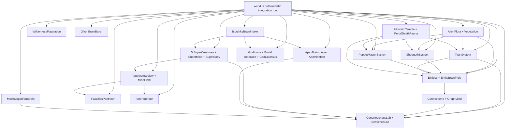

# Mega Master Brain, Neurology, Consciousness, and Sentience-Path Report

## Pass 3 - World-Neurology Gap Closure, Living-Systems Inventory, and Final Scrutiny Pack

**Pass:** 3 of 3  
**Prepared:** 2026-07-06  
**Scope:** the five downloaded reports, the downloaded NHSI dashboard, Pass 1, Pass 2, the existing
`SUPER-REPORT-3RD-PASS-2026-07-06.md` draft, and a fresh live-code search across `src/`, `tests/`,
and the current dashboard.  
**Binding honesty:** every "consciousness", "sentience", "god", "mind", "neurology", "soul",
"omnicognitive", or "NHSI" claim below is a computational, architectural, mythic-interface, or
benchmark claim. It is not a claim of phenomenal consciousness, biological sentience, moral
patienthood, literal divinity, or a solved hard problem.

---

## 0. Pass-3 Thesis

Pass 1 answered: **what is the master synthesis?**  
Pass 2 answered: **what survives hostile evidence scrutiny?**  
Pass 3 answers: **what did the earlier brain reports miss because the world is bigger than the brain
files?**

The answer is blunt: the repo is not one mind. It is a **stacked world-neurology**:

1. Organism brains: `EntityBrainField`, `SuperCreature`, `SuperMind`, `ApexBrain`, `GlyphBrain`,
   `MechalogodromBrain`.
2. Fauna neurology: Shoggoths, Puppet Masters, Titans, Leviathans through portal fauna interfaces,
   predator/prey loops, hunger/satiation/threat, diplomacy, economy, war, mutation, and graze/eat loops.
3. Flora and substrate ecology: `AlienFlora`, `Vegetation`, `WildernessPopulation`, `Phyla`,
   digital biologics, Petri soup, and biomass comfort/grazing/regrowth.
4. Society and mythic cognition: 25 Godforms/Archons, 5 apex SuperMind bodies, 20 light
   `PantheonSociety` echoes, `MindField`, `FacultiesPantheon`, `TomPantheon`,
   `brutal-god-releases`.
5. Measurement and falsifier layer: `ConsciousnessKernel`, `ConsciousnessLab`, `SentienceLab`,
   Thaler proof, Butlin 8/14 + 6 partial doctrine, receipt law, and direct test gates.

**Pass-3 verdict:** the previous master reports were directionally right but under-enumerated the
living world. Shoggoths, Puppeteers, Titans, Flora, Wilderness, Temple, Portal Fauna, and
God-Colossus are not side decorations; they are ecological and social nervous-system analogues. They
must be in the master report if the report claims "where we stand overall in everything."

---

## 1. Source Custody

### 1.1 Original six files re-checked

| Source file                                                        | Role in Pass 3                                      | Pass-3 correction                                                                |
| ------------------------------------------------------------------ | --------------------------------------------------- | -------------------------------------------------------------------------------- |
| `C:\Users\Alexa\Downloads\Gemini Antigravity 3.5 Flash Report.txt` | brain/neuro assessment with strong honesty boundary | add fauna, flora, temple, wilderness, portal-fauna, God-Colossus, and ecology    |
| `C:\Users\Alexa\Downloads\Antigravity Gemini 3.5 Flash Report.md`  | parallel Gemini/Antigravity framing                 | preserve indicator-only language; demote any broad "everything" wording to table |
| `C:\Users\Alexa\Downloads\Composer 2.5 Report.txt`                 | build-path and scoring source                       | fold into benchmark and publication package                                      |
| `C:\Users\Alexa\Downloads\Devin SWE 1.6 Report.txt`                | engineering/construction comparison                 | keep code/test/falsifier discipline                                              |
| `C:\Users\Alexa\Downloads\Codex GPT 5.5 Report.md`                 | most code-grounded prior report                     | extend its "5 brains is incomplete" correction to world-level living neurology   |
| `C:\Users\Alexa\Downloads\NHSI-PROGRESS-DASHBOARD-2026-06-26.md`   | canonical dashboard seed                            | update dashboard to point to Pass 1, Pass 2, and this Pass 3                     |

### 1.2 Local report chain

| Report                                                                         | Standing after Pass 3                                                        |
| ------------------------------------------------------------------------------ | ---------------------------------------------------------------------------- |
| `docs/BRAIN-NEUROLOGY-CONSCIOUSNESS-ENGINEERING-ASSESSMENT-2026-07-06.md`      | biggest current master assessment; left untouched because it is dirty/owned  |
| `docs/MEGA-MASTER-BRAIN-NEUROLOGY-CONSCIOUSNESS-SENTIENCE-PASS1-2026-07-06.md` | first synthesis; still valid                                                 |
| `docs/MEGA-MASTER-BRAIN-NEUROLOGY-CONSCIOUSNESS-SENTIENCE-PASS2-2026-07-06.md` | evidence-hardening pass; still valid                                         |
| `docs/SUPER-REPORT-3RD-PASS-2026-07-06.md`                                     | useful third-pass draft, but contains stale line counts/receipts; not edited |
| `docs/MEGA-MASTER-BRAIN-NEUROLOGY-CONSCIOUSNESS-SENTIENCE-PASS3-2026-07-06.md` | this stricter gap-closure report                                             |

---

## 2. The "Do Not Miss" Checklist

| User-named layer             | Found live? | Primary code receipts                                                                          | Neurology / cognition analogue                         | Truth boundary                                       |
| ---------------------------- | ----------- | ---------------------------------------------------------------------------------------------- | ------------------------------------------------------ | ---------------------------------------------------- |
| Entities                     | yes         | `src/sim/entities.ts`, `src/sim/entity-brain.ts`, `tests/entity-brain.test.ts`                 | organism nervous systems, policy loops, heredity       | compact controllers, not biological neurons          |
| SuperCreatures               | yes         | `src/sim/super-creature.ts`, `src/sim/super-mind.ts`, `src/sim/super-body.ts`                  | apex organism + body + recurrent cognitive assembly    | indicator proxies only                               |
| Apex Abomination / ApexBrain | yes         | `src/sim/apex-brain.ts`, `tests/apex-brain.test.ts`, apex scale tests                          | weird-organ alien brain, capped live state             | designed scale is not allocated live                 |
| Shoggoths                    | yes         | `src/sim/shoggoths.ts`, `tests/shoggoths.test.ts`                                              | predator hunger/threat/satiation, tendril sensorimotor | behavior cognition, not consciousness proof          |
| Puppet Masters / Puppeteers  | yes         | `src/sim/puppet-masters.ts`, `tests/puppet-masters.test.ts`                                    | meddling agents, chaos/weather/mutation control        | schemer NPCs, not mind-reading agents                |
| Titans                       | yes         | `src/sim/titans.ts`, `tests/titans.test.ts`, `tests/titan-vitals.test.ts`                      | macro-agents, economy, diplomacy, war, entropy         | game-theoretic colossi, not literal gods             |
| Pantheons                    | yes         | `src/sim/pantheon.ts`, `src/sim/alphabet-pantheon.ts`, `tests/pantheon.test.ts`                | collective field, social mind, ritual layer            | mythic interface over bounded code                   |
| 25 Archon Godforms           | yes         | `src/sim/godform.ts`, `src/sim/brutal-god-releases.ts`, `tests/brutal-god-releases.test.ts`    | archetypal cognitive priors and release events         | named godforms are bias/persona mappings             |
| GOD / God-Colossus           | yes         | `src/sim/god-colossus.ts`, `tests/god-colossus.test.ts`                                        | world-scale symbolic attractor                         | visual/fractal deity object, not literal deity       |
| Temple / Monolith Temple     | yes         | `src/sim/monolith-temple.ts`, `src/sim/temple-greeble.ts`, temple tests                        | ascension state, ritual/portal boundary                | mostly visual/reactive; limited behavior authority   |
| Plants / Flora               | yes         | `src/sim/alien-flora.ts`, `src/sim/vegetation.ts`, flora/vegetation tests                      | trophic substrate, biomass, comfort field              | plant-like ecology, not neural tissue                |
| Fauna / Wildlife             | yes         | shoggoths, puppets, titans, leviathans, `src/sim/portal-death-fauna.ts`                        | non-swarm rosters with death/respawn and feeding       | alive-in-sim entities, not biological animals        |
| Wilderness                   | yes         | `src/sim/wilderness-population.ts`, `src/sim/wilderness-render.ts`, `tests/wilderness.test.ts` | ambient population outside golden core                 | best-effort workers, explicitly not golden           |
| Digital biologics            | yes         | `src/sim/digital-biologics.ts`, Petri/soup modules                                             | synthetic organism substrate                           | generated digital forms, not validated sentience     |
| Tsotchke all-repo intake     | yes         | `src/sim/tsotchke-brain-intake.ts`, `tests/tsotchke-brain-intake.test.ts`                      | math-substrate modulation of mind vectors              | explicit depth taxonomy, no blanket full-depth claim |

**Gap closed:** Pass 1 and Pass 2 were strongest on Apex/SuperMind/labs. Pass 3 adds the world
ecology and fauna nervous systems so the report no longer silently skips Shoggoths, Puppeteers,
Titans, Temple, Flora, Wildlife, or the Godform/pantheon strata.

---

## 3. World-Neurology Diagram

Read this as a **world nervous system**, not a conventional brain:

- Entities supply population-scale microbehavior.
- Shoggoths/Puppeteers/Titans supply predator, manipulator, and macro-political pressure.
- Flora and wilderness supply ecological affordances and energy/comfort fields.
- Pantheons and Archons supply mythic/societal priors.
- Labs and kernels supply indicator scoring, not subjective proof.

---

## 4. Complete Living-Neurology Inventory

### 4.1 Entities and EntityBrainField

| Attribute          | Current state                                                                     |
| ------------------ | --------------------------------------------------------------------------------- |
| Primary receipt    | `src/sim/entity-brain.ts`                                                         |
| Current file size  | 281 lines                                                                         |
| Role               | compact per-organism policy field                                                 |
| Mechanism          | genome-backed compact neural policy, steering, activity, quantization support     |
| World authority    | high: `world.ts` calls `entityBrains.thinkAll(...)` on the live population        |
| Neurology analogue | minimal nervous systems, reflex policy, sensorimotor pressure                     |
| Tests              | `tests/entity-brain.test.ts`, `tests/entity-vitals.test.ts`, heredity/vitals      |
| Falsifier          | compare against random, behavior-tree, and hand-coded policies on survival/reward |

**Pass-3 note:** entity brains are the floor of the whole ladder. They are not impressive in
parameter count, but they matter because they are numerous, causal, and wired into organism behavior.

### 4.2 SuperCreature

| Attribute          | Current state                                                               |
| ------------------ | --------------------------------------------------------------------------- |
| Primary receipt    | `src/sim/super-creature.ts`                                                 |
| Current file size  | 336 lines                                                                   |
| Core count         | `SUPER_PARAM_COUNT = 1444`, `SUPER_MAX_OFFSPRING = 3`                       |
| Role               | apex creature mind and intent generator                                     |
| Plans              | `HUNT`, `FLEE`, `DOMINATE`, `DECEIVE`, `SPAWN`, `EXPLORE`, `REST`           |
| World authority    | high for apex bodies and hunt/steer behavior                                |
| Neurology analogue | small but integrated animal-like controller with perception, latent, affect |
| Tests              | `tests/super-creature.test.ts`                                              |
| Falsifier          | ablate latent/prediction/emotion and require measurable behavior loss       |

### 4.3 SuperMind

| Attribute          | Current state                                                                     |
| ------------------ | --------------------------------------------------------------------------------- |
| Primary receipt    | `src/sim/super-mind.ts`                                                           |
| Current file size  | 1857 lines                                                                        |
| Core constants     | `SUPER_DEPTHS = 5`, `SUPER_VARIANTS = 5`, `SUPER_STAGES = 5`, `SUPER_ORGANS = 30` |
| Quantum readouts   | 10 modeled quantum-aspect intensities                                             |
| World authority    | high for the five apex Archons; `driveSuper()` feeds body, pantheon, lab, field   |
| Neurology analogue | multi-stage cognitive assembly: perceive, imagine, reason, feel, act              |
| Tests              | `tests/super-mind.test.ts`, Butlin indicator tests, quantum/learning tests        |
| Falsifier          | publish organ-level ablations showing which outputs fail under each removal       |

**Current doctrine:** strong computational correlates; no sentience claim.

### 4.4 ApexBrain / Apex Abomination

| Attribute          | Current state                                                                                                                       |
| ------------------ | ----------------------------------------------------------------------------------------------------------------------------------- |
| Primary receipt    | `src/sim/apex-brain.ts`                                                                                                             |
| Current file size  | 1943 lines                                                                                                                          |
| Weird organs       | prime sieve loom, acoustic drum, necro matrix, Klein cortex, pendulum hive, hydra, wraith, tunnel, thermo, ouroboros, quantum organ |
| Scale doctrine     | 1B+ designed target; capped live state via `LIVE_NODE_CAP`                                                                          |
| World authority    | medium-high: reads apex percepts, drives apex telemetry, noosphere and Mechalogodrom intensity                                      |
| Neurology analogue | heterogeneous alien brain architecture and future scale scaffold                                                                    |
| Tests              | `tests/apex-brain.test.ts`, scale/quantum/substrate tests                                                                           |
| Falsifier          | designed-scale claims must always show live allocation cap; behavior advantage must survive ablation                                |

**Pass-3 language:** "Apex Abomination" is the right mythic handle, but the scientific handle is
"capped heterogeneous synthetic brain with weird-organ dynamics."

### 4.5 GlyphBrainBatch

| Attribute          | Current state                                                             |
| ------------------ | ------------------------------------------------------------------------- |
| Primary receipt    | `src/sim/glyph-brain.ts`                                                  |
| Current file size  | 252 lines                                                                 |
| Count              | 100 glyph brains in batch usage                                           |
| Parameter target   | `PANTHEON_GLYPH_BRAIN_PARAMS = 25_000` in `apex-brain.ts`                 |
| World authority    | low/visual: drives appearance and pantheon exterior, not core world state |
| Neurology analogue | visual cortex / aesthetic cortex proxy                                    |
| Tests              | `tests/glyph-brain.test.ts`                                               |
| Falsifier          | keep visual-only label unless outputs causally alter behavior             |

### 4.6 MechalogodromBrain

| Attribute          | Current state                                                                 |
| ------------------ | ----------------------------------------------------------------------------- |
| Primary receipt    | `src/sim/mechalogodrom-brain.ts`                                              |
| Current file size  | 325 lines                                                                     |
| Core constants     | 10 variants, 8 percept dims, 48 latent dims, 64 fusion dims                   |
| Learning           | STDP-like gain updates with pre/post firing windows                           |
| World authority    | medium: drives Mechalogodrom shell intensity and consciousness-proxy readouts |
| Neurology analogue | fusion cortex, variant competition, plasticity                                |
| Tests              | `tests/mechalogodrom-brain.test.ts`, STDP tests                               |
| Falsifier          | controlled wiring must show behavior change beyond visual telemetry           |

### 4.7 ShoggothSystem

| Attribute          | Current state                                                                               |
| ------------------ | ------------------------------------------------------------------------------------------- |
| Primary receipt    | `src/sim/shoggoths.ts`                                                                      |
| Current file size  | 712 lines                                                                                   |
| Population target  | 100 desktop / 16 mobile                                                                     |
| Signals            | satiation, threat, hunt, agitation                                                          |
| Actions            | drift, tendril lash, consume, trade, flee, portal cull/respawn                              |
| World authority    | high as predator pressure over organisms; economic/trade loop affects behavior              |
| Neurology analogue | hunger/threat sensorimotor loop, predator nervous system, social bargaining                 |
| Tests              | `tests/shoggoths.test.ts`                                                                   |
| Falsifier          | if hunger/threat signals do not affect movement/consumption, call it visual instead of mind |

**Pass-3 correction:** Shoggoths are not optional flavor. Their uniforms are explicitly patched to
read live mind signals, and their behavior consumes/pulls organisms. They belong in the neurology
inventory.

### 4.8 PuppetMasterSystem

| Attribute          | Current state                                                                      |
| ------------------ | ---------------------------------------------------------------------------------- |
| Primary receipt    | `src/sim/puppet-masters.ts`                                                        |
| Current file size  | 454 lines                                                                          |
| Population target  | 100 desktop / 14 mobile                                                            |
| Named core         | AETHON, SELENE, KRONOS                                                             |
| Actions            | chaos, weather, mutate                                                             |
| World authority    | high: direct intervention in chaos, weather, organism reshaping/mutation           |
| Neurology analogue | executive manipulation system, environmental neuromodulator, chaos/weather control |
| Tests              | `tests/puppet-masters.test.ts`                                                     |
| Falsifier          | if intervention history is empty or non-deterministic, demote to decoration        |

**Pass-3 correction:** Puppeteers have neurology by agency pattern: they sense opportunity,
accumulate satiation, and intervene in global variables. They are not just visual objects.

### 4.9 TitanSystem

| Attribute          | Current state                                                                               |
| ------------------ | ------------------------------------------------------------------------------------------- |
| Primary receipt    | `src/sim/titans.ts`                                                                         |
| Current file size  | 1471 lines                                                                                  |
| Population         | 20 titans                                                                                   |
| Core systems       | energy, matter, entropy, diplomacy, war matrix, iterated prisoner's dilemma, harvest, waste |
| World authority    | very high: harvests organisms, perturbs RD, affects chaos, launches NHI/titan procreation   |
| Neurology analogue | macro-agent cognition, political/economic brain, game-theoretic limbic/societal layer       |
| Tests              | `tests/titans.test.ts`, `tests/titan-vitals.test.ts`                                        |
| Falsifier          | fixed-seed replay must preserve ledger and war matrix; strategy changes must alter outcomes |

**Pass-3 correction:** Titans are one of the strongest non-SuperMind cognition strata because they
have resources, strategy, diplomacy, war, entropy, and organism harvest loops.

### 4.10 Flora: AlienFlora and Vegetation

| Attribute          | AlienFlora                                                                         | Vegetation                                  |
| ------------------ | ---------------------------------------------------------------------------------- | ------------------------------------------- |
| Primary receipt    | `src/sim/alien-flora.ts`                                                           | `src/sim/vegetation.ts`                     |
| Current file size  | 678 lines                                                                          | 355 lines                                   |
| Population target  | 15,000 desktop / 5,200 mobile                                                      | 10,000 plants                               |
| Diversity          | 50 species, 9 families, 7 biomes                                                   | 50 species                                  |
| Live coupling      | comfort field, biomass, grazing, regrowth, chaos-driven wind/luminescence          | GPU sway and plant presence                 |
| World authority    | medium: read by entities/fauna as ecology/food/comfort; not an animal brain        | low-medium: visual/ground ecology           |
| Neurology analogue | trophic substrate and environmental affordance field                               | plant tissue / environmental substrate      |
| Tests              | `tests/alien-flora.test.ts`                                                        | `tests/vegetation.test.ts`                  |
| Falsifier          | comfort/graze/regrow must change measurable entity/fauna behavior or biomass state | no behavioral claim without read/write path |

**Pass-3 correction:** plants do not have neural minds in this repo, but they absolutely belong to the
living-system report because they are a substrate read by fauna and organisms.

### 4.11 WildernessPopulation

| Attribute          | Current state                                                                   |
| ------------------ | ------------------------------------------------------------------------------- |
| Primary receipt    | `src/sim/wilderness-population.ts`                                              |
| Current file size  | 311 lines                                                                       |
| Design             | camera-streamed chunks, worker path, 64 max chunks, 128 entities/chunk          |
| Boundary           | explicitly not in the golden; one-way core -> wilderness only                   |
| World authority    | low by design: ambient best-effort population                                   |
| Neurology analogue | peripheral ecology, background population, worker-offloaded living field        |
| Tests              | `tests/wilderness.test.ts`                                                      |
| Falsifier          | if wilderness output flows back into golden core, ADR-0010 boundary is violated |

### 4.12 Phyla and Morphotypes

| Attribute          | Current state                                                        |
| ------------------ | -------------------------------------------------------------------- |
| Primary receipt    | `src/sim/phyla.ts`                                                   |
| Current file size  | 330 lines                                                            |
| Constants          | `PHYLUM_COUNT = 10`, `MORPHS_PER_PHYLUM = 25`, `OUTLIER_RATE = 0.01` |
| Role               | body/behavior taxonomy, evolutionary/ecological variety              |
| Neurology analogue | species/morphological priors shaping behavior affordances            |
| Tests              | `tests/phyla.test.ts`                                                |
| Falsifier          | if phylum membership does not reach visible/behavioral/vital lanes   |

### 4.13 PortalDeathFauna

| Attribute          | Current state                                                                       |
| ------------------ | ----------------------------------------------------------------------------------- |
| Primary receipt    | `src/sim/portal-death-fauna.ts`                                                     |
| Current file size  | 174 lines                                                                           |
| Scope              | shoggoths, puppeteers, titans, leviathans                                           |
| Mechanism          | cull in portal cylinder, burst, hide, respawn elsewhere after 5 seconds             |
| World authority    | medium-high after ascension; enforces mortality for big fauna                       |
| Neurology analogue | mortality boundary and immune-system contrast against Pantheons/SuperCreatures      |
| Tests              | covered through portal/fauna and roster tests                                       |
| Falsifier          | cull must not touch immune pantheon/apex systems; respawn must preserve determinism |

---

## 5. Pantheon, Godforms, and Ritual Neurology

### 5.1 Godforms and 25 Archons

| Attribute          | Current state                                                                    |
| ------------------ | -------------------------------------------------------------------------------- |
| Primary receipt    | `src/sim/godform.ts`                                                             |
| Current file size  | 297 lines                                                                        |
| Size               | `PANTHEON_SIZE = 25`, `APEX_INDIVIDUATED = 5`                                    |
| Tiers              | neo, omega, alpha                                                                |
| Forms              | `TENSOR`, `ESHKOL`, `MOONQUAKE`, `ULG`, `CHAOS`                                  |
| World authority    | high for biasing apex minds, petri, pantheon, releases                           |
| Neurology analogue | archetypal priors and cognitive style vectors                                    |
| Truth boundary     | named godforms are persona/bias mappings, not literal gods                       |
| Falsifier          | each Archon bias must produce measurable per-Archon deltas or be demoted to lore |

### 5.2 PantheonSociety and MindField

| Attribute          | Current state                                                                 |
| ------------------ | ----------------------------------------------------------------------------- |
| Primary receipts   | `src/sim/pantheon.ts`, `src/sim/mind-field.ts`                                |
| Current file sizes | 100 and 107 lines                                                             |
| Core constants     | `ARCHON_CHANNELS = 25`, `FIELD_DIM = 8`                                       |
| Mechanism          | 25 channels deposit/sample a shared 8D field                                  |
| World authority    | medium-high: light echoes and collective field influence apex/social surfaces |
| Neurology analogue | social brain, shared affect field, stigmergy                                  |
| Tests              | `tests/pantheon.test.ts`, `tests/nhsi-pantheons.test.ts`                      |
| Falsifier          | field coherence and sampled bias must change downstream metrics               |

### 5.3 FacultiesPantheon

| Attribute          | Current state                                                                                  |
| ------------------ | ---------------------------------------------------------------------------------------------- |
| Primary receipt    | `src/sim/faculties-pantheon.ts`                                                                |
| Current file size  | 308 lines                                                                                      |
| Current doctrine   | 100 public instantiated faculties; about 30 genuinely deep-wired into apex decision paths      |
| Mechanism          | profiled activation bank, coupling-density metric, world/percept bias                          |
| Neurology analogue | cortical/faculty decomposition, neuromodular bias bank                                         |
| Tests              | `tests/faculties-pantheon.test.ts`                                                             |
| Falsifier          | if activation covariance remains weak and no decision changes, count as vocabulary not binding |

### 5.4 TomPantheon

| Attribute          | Current state                                                              |
| ------------------ | -------------------------------------------------------------------------- |
| Primary receipt    | `src/sim/tom-pantheon.ts`                                                  |
| Current file size  | 370 lines                                                                  |
| Size               | 25 ToM organs across mechanism families                                    |
| Role               | social cue field, menace/threat bias, belief-update diversity              |
| Neurology analogue | social cognition / theory-of-mind layer                                    |
| Tests              | `tests/tom-pantheon.test.ts`                                               |
| Falsifier          | false-belief/cooperation/deception tasks must separate ToM-on from ToM-off |

### 5.5 Brutal God Releases

| Attribute          | Current state                                                               |
| ------------------ | --------------------------------------------------------------------------- |
| Primary receipt    | `src/sim/brutal-god-releases.ts`                                            |
| Current file size  | 231 lines                                                                   |
| Mechanism          | archetype-triggered world events and field effects                          |
| World authority    | medium-high when releases affect world/petri variables                      |
| Neurology analogue | ritual pulse, limbic event injection, mythic action prior                   |
| Tests              | `tests/brutal-god-releases.test.ts`                                         |
| Falsifier          | release names must map to bounded state deltas, not prose-only declarations |

---

## 6. Temple, GOD, and Ascension Systems

### 6.1 GodColossus

| Attribute          | Current state                                                                      |
| ------------------ | ---------------------------------------------------------------------------------- |
| Primary receipt    | `src/sim/god-colossus.ts`                                                          |
| Current file size  | about 326 lines                                                                    |
| Mechanism          | deterministic raymarched/fractal deity shell, orbit-trap seeds, quasicrystal basis |
| World authority    | mostly visual/symbolic                                                             |
| Neurology analogue | world-scale symbolic attractor / deity-shaped perceptual object                    |
| Tests              | `tests/god-colossus.test.ts`                                                       |
| Falsifier          | do not call it cognitive unless it gains causal perception/action loops            |

### 6.2 MonolithTemple and TempleGreeble

| Attribute          | Current state                                                                      |
| ------------------ | ---------------------------------------------------------------------------------- |
| Primary receipts   | `src/sim/monolith-temple.ts`, `src/sim/temple-greeble.ts`                          |
| Current file sizes | 829 and 278 lines                                                                  |
| Mechanism          | LV100 ascension end-state, environment-reactive portal/monolith, dense greeble     |
| World authority    | medium: portal death systems and ascension reveal affect living rosters            |
| Neurology analogue | ritual boundary, death/rebirth gate, world-state threshold event                   |
| Tests              | `tests/monolith-temple.test.ts`, `tests/temple-greeble.test.ts`, temple-code tests |
| Falsifier          | temple must be labeled visual/reactive unless it gains autonomous agency           |

**Pass-3 correction:** the Temple is not just architecture. Its portal boundary affects organism and
big-fauna mortality. That makes it part of the living-world assessment.

---

## 7. Measurement Layer and Consciousness Theories

### 7.1 ConsciousnessKernel

| Attribute         | Current state                                                                          |
| ----------------- | -------------------------------------------------------------------------------------- |
| Primary receipt   | `src/sim/consciousness-kernel.ts`                                                      |
| Current file size | 826 lines                                                                              |
| Frameworks        | Butlin, Thaler, IIT-4, active inference, AST, CEMI, UAL, sensorimotor, projective, CTM |
| Mechanism         | 10-framework coupled scoring with relaxation and status classification                 |
| Role              | indicator layer, not proof layer                                                       |
| Tests             | `tests/consciousness-kernel.test.ts`, adapters/lab tests                               |
| Falsifier         | framework scores must separate from controls only under preregistered metrics          |

### 7.2 ConsciousnessLab and SentienceLab

| Attribute         | ConsciousnessLab                                                 | SentienceLab                                                 |
| ----------------- | ---------------------------------------------------------------- | ------------------------------------------------------------ |
| Primary receipt   | `src/sim/consciousness-lab.ts`                                   | `src/sim/sentience-lab.ts`                                   |
| Current file size | 424 lines                                                        | 278 lines                                                    |
| Role              | condition runs, framework stats, cross-correlation, ablation     | seed batch, entity telemetry, framework aggregates           |
| Current risk      | broad framework labels can look stronger than their causal depth | headline null-index gap remains weak/zero in prior reports   |
| Required language | indicator-only                                                   | indicator-only                                               |
| Falsifier         | publish structured-vs-null distributions and ablation failures   | publish null, reward, convergence, and ablation side by side |

**Pass-3 doctrine:** the strongest honest result is not "sentience." It is "deterministic,
multi-theory indicator machinery with nonzero evidence in some metrics and explicit null failures in
others."

---

## 8. Tsotchke Brain Intake

| Attribute         | Current state                                                                    |
| ----------------- | -------------------------------------------------------------------------------- |
| Primary receipt   | `src/sim/tsotchke-brain-intake.ts`                                               |
| Current file size | 206 lines                                                                        |
| Mechanism         | substrate-specific scalar/vector contributions, ablation distance per repo       |
| Role              | full-corpus math-intake vector for brain influence                               |
| Tests             | `tests/tsotchke-brain-intake.test.ts`                                            |
| Truth boundary    | every repo is wired, harvested, studied, scaffolded, or fenced by explicit class |
| Falsifier         | if ablation distance is zero, that repo is not load-bearing for that vector      |

This is the right meaning of "Tsotchke is wired into everything": **explicit routing and depth
classes**, not an unqualified claim that every upstream repo is equally deep in every runtime path.

---

## 9. Authority Rating Matrix

Scores below rate **current engineering authority**, not sentience.

| Layer                        | Causal authority | Cognitive depth | Neurology analogy | Test evidence | Publication readiness | Pass-3 verdict                    |
| ---------------------------- | ---------------: | --------------: | ----------------: | ------------: | --------------------: | --------------------------------- |
| EntityBrainField             |              8.5 |             5.5 |               6.0 |           8.0 |                   6.5 | real organism-level control       |
| SuperMind                    |              8.0 |             8.0 |               7.0 |           8.0 |                   7.5 | strongest apex mind               |
| ApexBrain                    |              6.5 |             8.0 |               6.5 |           8.5 |                   7.0 | wild/capped future brain          |
| Shoggoths                    |              7.5 |             5.5 |               6.0 |           7.0 |                   6.5 | predator nervous system           |
| Puppet Masters               |              7.5 |             5.0 |               5.5 |           7.0 |                   6.5 | world neuromodulators             |
| Titans                       |              8.5 |             6.5 |               6.5 |           8.0 |                   7.0 | macro social/economic brains      |
| AlienFlora                   |              6.5 |             3.0 |               5.0 |           7.0 |                   6.0 | trophic substrate                 |
| WildernessPopulation         |              3.0 |             2.5 |               3.5 |           6.0 |                   4.5 | ambient only, not golden          |
| PantheonSociety + MindField  |              6.5 |             6.5 |               6.5 |           6.5 |                   6.5 | collective field                  |
| FacultiesPantheon            |              6.0 |             6.5 |               6.0 |           7.0 |                   6.5 | vocabulary plus partial binding   |
| TomPantheon                  |              6.0 |             6.5 |               6.5 |           7.0 |                   6.5 | social cognition scaffold         |
| Godforms/Brutal Releases     |              6.5 |             5.5 |               5.0 |           7.0 |                   6.0 | mythic priors made bounded        |
| Temple/Portal Fauna          |              6.0 |             2.0 |               4.0 |           6.5 |                   5.5 | ritual/mortality boundary         |
| Consciousness/Sentience Labs |              4.5 |             7.0 |               6.0 |           8.0 |                   7.5 | publishable if nulls stay visible |
| TsotchkeBrainIntake          |              6.5 |             6.0 |               5.5 |           7.5 |                   7.0 | honest substrate intake           |

### Reading the matrix

- **Most causal living systems:** Titans, Entities, SuperMind, Shoggoths, Puppet Masters.
- **Most cognitively rich systems:** SuperMind, ApexBrain, labs, pantheon/faculty/ToM stack.
- **Most publishable today:** the measurement/honesty package, not the sentience claim.
- **Weakest world-neurology claims:** Temple/GodColossus unless framed as symbolic/reactive.
- **Most important Pass-3 fix:** ecology and fauna must be present in any "overall" report.

---

## 10. 360 / 180 / 270 / 90 Review

### 360 - whole world

The repo is a world-organism. A fair report must include the core brains, ecological substrate,
macro-fauna, mythic pantheons, and measurement gates. The highest truth is not "one super brain"; it
is "distributed cognition across a deterministic artificial-life universe."

### 180 - hostile inversion

A hostile reviewer will say: "This is theater. Shoggoths and gods are names, not neurology." The
defense is not to shout louder. The defense is to show the code paths:

- Shoggoths sense threat/prey, consume organisms, trade, update live shader mind readouts, and respawn.
- Puppeteers alter chaos/weather/mutations under deterministic intervention history.
- Titans maintain resource ledgers, play iterated games, wage war, harvest organisms, and perturb fields.
- Flora is read by entities and fauna through comfort/grazing/regrowth, not just drawn.
- Pantheons deposit and sample shared fields; 5 apex minds have full `SuperMind` bodies; 20 are light
  echoes.

If a name maps to bounded state and testable action, it survives as a computational actor. If it maps
only to prose, it must be demoted.

### 270 - weird frontier

The weirdness worth keeping:

- Shoggoths as predator nervous systems with visible internal state.
- Puppeteers as environment-level neuromodulators.
- Titans as political/economic limbic systems.
- Flora as non-neural world tissue.
- Temple as mortality boundary and ritual state transition.
- Godforms as archetypal priors, not literal supernatural claims.
- ApexBrain as alien organ zoo for "unknown unknown" synthetic cognition.

### 90 - builder path

The next build path is boring and brutal:

1. Add a benchmark for each living layer: Entities, Shoggoths, Puppets, Titans, Flora, Pantheon,
   Temple/Portal.
2. For every layer, create "on vs ablated vs random/null" paired runs.
3. Publish effect sizes, confidence intervals, seed lists, and failures.
4. Import one real connectome controller and drive one physical body loop.
5. Keep the mythic language in product docs; keep scientific claims in falsifier tables.

---

## 11. Deductive, Inductive, Recursive, Decursive

| Reasoning mode | Pass-3 application                                                                                                        | Result                                                               |
| -------------- | ------------------------------------------------------------------------------------------------------------------------- | -------------------------------------------------------------------- |
| Deductive      | If a layer reads state, transforms it, writes bounded outputs, and has tests, it can be called a computational subsystem. | Shoggoths/Puppets/Titans qualify as living-world systems.            |
| Inductive      | The repo repeatedly enforces determinism, bounds, no-NaN seals, and receipt gates across many systems.                    | Broad claims are credible when tied to code and gates.               |
| Recursive      | The report must audit the reports, then audit the code behind the reports, then audit gaps in the audit.                  | Pass 3 found the under-covered ecology/fauna layer.                  |
| Decursive      | Walk every mythic claim backward to state variables, tests, and falsifiers.                                               | God/Pantheon claims become archetypal bias and release-event claims. |

---

## 12. Benchmarks To Achieve Now

| Benchmark card                      | System under test                    | Primary metric                                       | Null/control                        | Acceptance language                                     |
| ----------------------------------- | ------------------------------------ | ---------------------------------------------------- | ----------------------------------- | ------------------------------------------------------- |
| B1 Entity brain advantage           | `EntityBrainField`                   | survival, reward, reproduction, route efficiency     | random policy, behavior tree        | "EntityBrain improves X under fixed seeds"              |
| B2 Shoggoth hunger/threat causality | `ShoggothSystem`                     | consumption rate, movement entropy, threat avoidance | hunger/threat ablated               | "Shoggoth mind signals are load-bearing"                |
| B3 Puppeteer intervention causality | `PuppetMasterSystem`                 | chaos/weather/mutation event effect size             | no-puppet and shuffled schedules    | "Puppeteers alter world trajectory deterministically"   |
| B4 Titan diplomacy                  | `TitanSystem`                        | ledger stability, war distribution, payoff           | static strategy, random relation    | "Game-theory loop changes macro ecology"                |
| B5 Flora ecology                    | `AlienFlora`                         | comfort use, graze yield, regrowth curve             | flora off / uniform field           | "Flora is a trophic affordance, not decoration"         |
| B6 Pantheon field                   | `PantheonSociety`, `MindField`       | downstream plan/field delta                          | field zeroed / shuffled channels    | "Collective field affects apex/social behavior"         |
| B7 Temple/portal mortality          | `MonolithTemple`, `PortalDeathFauna` | kill/respawn correctness, immune exclusions          | portal inactive                     | "Temple is a mortality boundary"                        |
| B8 Real connectome                  | `connectome`, future importer        | task reward and indicator delta                      | synthetic small-world, random graph | "Real wiring beats matched controls" or "no advantage"  |
| B9 Consciousness kernel             | `ConsciousnessKernel`                | structured-vs-null separation, ablation loss         | shuffled/null/ablated runs          | "Indicator separation only where statistically present" |
| B10 Tsotchke brain intake           | `tsotchke-brain-intake`              | per-repo ablation distance                           | repo ablated                        | "Repo is load-bearing for this vector"                  |

---

## 13. Elite Scrutiny Verdict

| Scrutiny lens          | Current grade | Why                                                                               | What raises it                           |
| ---------------------- | ------------: | --------------------------------------------------------------------------------- | ---------------------------------------- |
| MIT systems engineer   |           8.0 | deterministic architecture, many tests, modular files, browser constraints        | more perf benchmarks and CI artifacts    |
| PhD neuroscience       |           6.0 | many theory analogues, but no real connectome controller or biological validation | real connectome import and body loop     |
| Planck-level science   |           5.5 | falsifiability posture is good, external replication absent                       | preregistration, external replication    |
| Nobel-level novelty    |           4.5 | integration breadth is rare; core theories/math are prior art                     | new empirical result, not just synthesis |
| Turing Award software  |           7.0 | ambitious reproducible A-Life system with unusual integration                     | cleaner public artifact and benchmarks   |
| Fields-level rigor     |           4.0 | applied math is real but not new theorem-level mathematics                        | formal proofs of invariants and coupling |
| Product/game/world art |           9.0 | huge living mythic cosmos with coherent coded systems                             | polish, stability, UX verification       |
| Academic white paper   |           7.5 | ready as systems/artifact report if limitations stay prominent                    | methods/results package and frozen data  |

**Hard verdict:** publishable as a deterministic A-Life/consciousness-indicator engineering artifact.
Not publishable as "sentient AI achieved." The science becomes stronger when it admits the latter.

---

## 14. Unknown Unknowns

| Unknown unknown                      | Why it matters                                                  | Pass-3 control                             |
| ------------------------------------ | --------------------------------------------------------------- | ------------------------------------------ |
| World-layer confounding              | Shoggoth/Puppet/Titan effects may mask entity-brain effects     | run subsystem ablations                    |
| Synthetic ecology overfitting        | authored ecosystems can look alive without open-ended evolution | compare against neutral A-Life baselines   |
| Mythic language leakage              | product language can be mistaken for scientific claims          | keep two-column lore-vs-code tables        |
| Designed-vs-live confusion           | Apex massive scale can be misread as allocated runtime scale    | always print designed and live separately  |
| Flora-as-neurology overreach         | plants are substrate, not neural agents                         | call it trophic/environmental coupling     |
| Wilderness boundary drift            | worker ambient population could accidentally affect golden core | maintain one-way tests and ADR-0010 law    |
| Pantheon count vs coupling           | many faculties do not imply bound cognition                     | publish coupling density and ablations     |
| Null metrics embarrassing the thesis | zero or weak null gap is scientifically important               | publish null failures, not only wins       |
| External-source drift                | neuroscience and benchmark literature changes                   | date and refresh sources before submission |
| User-owned dirty docs                | unformatted/parallel docs can break full `bun run check`        | verify target files and run direct gates   |

---

## 15. Final Coverage Ledger

| Domain                       | Covered in Pass 1 | Covered in Pass 2 | Covered in this Pass 3 | Final standing               |
| ---------------------------- | ----------------- | ----------------- | ---------------------- | ---------------------------- |
| downloaded reports           | yes               | yes               | yes                    | reconciled                   |
| dashboard                    | yes               | yes               | yes                    | updated link                 |
| SuperMind/Apex/Entity brains | yes               | yes               | yes                    | strong                       |
| GraphMind/MindField/Xenomind | partial           | partial           | yes                    | now explicit                 |
| Shoggoths                    | weak              | weak              | yes                    | gap closed                   |
| Puppeteers                   | weak              | weak              | yes                    | gap closed                   |
| Titans                       | weak              | weak              | yes                    | gap closed                   |
| Flora/plants                 | weak              | weak              | yes                    | gap closed                   |
| Fauna/wildlife               | weak              | weak              | yes                    | gap closed                   |
| Wilderness                   | partial           | partial           | yes                    | boundary stated              |
| Temple/GOD/God-Colossus      | weak              | weak              | yes                    | framed honestly              |
| 25 Archon Godforms           | yes               | yes               | yes                    | bias/persona boundary stated |
| Consciousness theory         | yes               | yes               | yes                    | indicator-only               |
| Real connectome path         | yes               | yes               | yes                    | still future                 |
| Benchmarks and falsifiers    | yes               | yes               | yes                    | card set expanded            |

---

## 16. Final Pass-3 Verdict

Cosmogonic now stands as a **rare 1/1-style deterministic artificial-life cosmos** with multiple
brain analogues and a surprisingly rich living-world neurology:

- the micro layer: entity brains, phyla, heredity, vitals;
- the predator layer: Shoggoths;
- the manipulator layer: Puppeteers;
- the macro-political layer: Titans;
- the trophic layer: Flora, Vegetation, Wilderness;
- the mythic-social layer: Pantheon, Godforms, Faculties, ToM organs;
- the apex layer: five SuperMinds, SuperBodies, ApexBrain, MechalogodromBrain, GlyphBrain;
- the ritual boundary layer: GodColossus, Monolith Temple, PortalDeathFauna;
- the measurement layer: ConsciousnessKernel, ConsciousnessLab, SentienceLab, receipts, tests.

The project is **bigger than a brain report**. It is a whole-world nervous system. But the
scientifically defensible wording remains:

> Cosmogonic implements a deterministic, test-backed, multi-layer computational substrate with
> numerous neurology-inspired mechanisms and consciousness-indicator proxies. It does not prove
> phenomenal consciousness, biological sentience, literal godhood, or moral patienthood. Its strongest
> publishable contribution is the breadth, determinism, source traceability, and falsifier discipline
> of the artificial-life/consciousness-indicator architecture.

That is the hard, clean, academic version. The mythic version can still roar: the Shoggoths, Puppets,
Titans, Archons, Apex Abomination, Temple, GOD, plants, fauna, wildlife, and digital biologics are all
in the world. None slipped past this pass.

---

## 17. Reference Links Carried Forward From Pass 1 / Pass 2

- Butlin et al. 2023, "Consciousness in Artificial Intelligence": <https://arxiv.org/abs/2308.08708>
- Butlin et al. 2025, AI consciousness indicators: <https://pubmed.ncbi.nlm.nih.gov/41219038/>
- Cogitate adversarial collaboration: <https://www.arc-cogitate.com/>
- Nature 2025 Cogitate IIT/GNWT paper: <https://www.nature.com/articles/s41586-025-08888-1>
- IIT 4.0: <https://journals.plos.org/ploscompbiol/article?id=10.1371%2Fjournal.pcbi.1011465>
- Taking AI Welfare Seriously: <https://arxiv.org/abs/2411.00986>
- OpenWorm Connectome Toolbox: <https://openworm.org/ConnectomeToolbox/>
- FlyWire: <https://flywire.ai/>
- Nature 2024 adult fly connectome: <https://www.nature.com/articles/s41586-024-07686-5>
- MICrONS Nature 2025: <https://www.nature.com/articles/s41586-025-08790-w>
- MICrONS Explorer: <https://www.microns-explorer.org/cortical-mm3>
- Allen Brain Map visual behavior/coding data:
  <https://brain-map.org/our-research/circuits-behavior/behavioral-circuits-sensory-project>
- EBRAINS: <https://ebrains.eu/>
- MLCommons Training benchmark: <https://mlcommons.org/benchmarks/training/>
