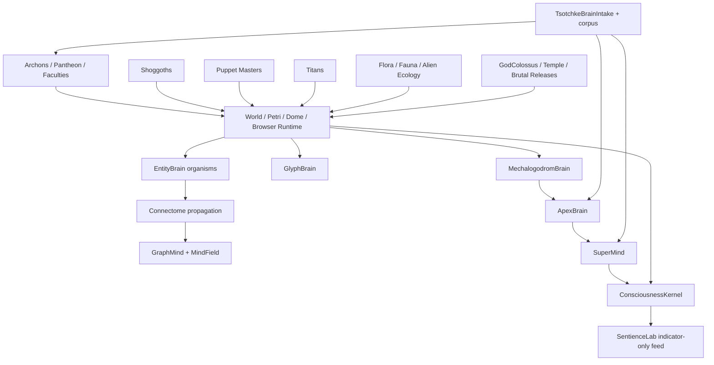

# Cosmogonic Quantum Mechalogodrom

## Mega Ultrathink Report Audit, Review, and Master Synthesis

**Date:** 2026-07-07  
**Workspace:** `Z:\[Vibe Coded (AI)]\CLAUDECODE\Cosmogonic Quantum Mechalogodrom`  
**Artifact class:** last-pass critic audit + reconciled master report  
**HTML companion:** `docs/MEGA-ULTRATHINK-REPORT-AUDIT-REVIEW-2026-07-07.html`

---

## 0. Binding Honesty Boundary

This report treats "brain", "mind", "sentience", "consciousness", "godform",
"omnicognitive", "Archon", "Shoggoth", "Puppeteer", "Titan", and "super-creature"
as **project terms for computational structures, behavioral proxies, dashboards,
and simulation mythology**.

The current repo does **not** prove phenomenal consciousness, biological
sentience, subjective experience, welfare status, or a solved hard problem of
consciousness. The repo is strongest when it says:

> This is a deterministic, source-backed, test-heavy, multi-theory artificial-life
> and consciousness-indicator research instrument. It implements many load-bearing
> computational correlates of cognition, agency, attention, homeostasis, social
> behavior, affect-like drives, and world-coupled adaptive control. It is not a
> sentient being, not a biological brain, and not a Nobel/Fields/Turing-level
> discovery today.

The correct posture is **rare and serious prototype**, not **proved sentience**.
That distinction is the whole spine of this audit.

---

## 1. What Was Audited

### 1.1 Explicit Workspace Reports Provided

|   # | File                                                                                  | Lines |  Words | Role in This Audit                                                 |
| --: | ------------------------------------------------------------------------------------- | ----: | -----: | ------------------------------------------------------------------ |
|   1 | `docs/BRAIN-NEUROLOGY-CONSCIOUSNESS-ENGINEERING-ASSESSMENT-2026-07-06.md`             | 2,386 | 37,996 | deepest canonical brain/neuro/consciousness assessment             |
|   2 | `docs/SUPER-REPORT-2ND-PASS-2026-07-06.md`                                            |   353 |  2,484 | useful Pass 2 summary, but contains a path typo                    |
|   3 | `docs/MEGA-MASTER-BRAIN-NEUROLOGY-CONSCIOUSNESS-SENTIENCE-PASS2-2026-07-06.md`        |   536 |  4,527 | best falsifier/evidence-spine pass                                 |
|   4 | `docs/SUPER-REPORT-2026-07-06.md`                                                     |   252 |  1,997 | early comparative super-report                                     |
|   5 | `docs/MEGA-MASTER-BRAIN-NEUROLOGY-CONSCIOUSNESS-SENTIENCE-PASS1-2026-07-06.md`        |   565 |  5,048 | first full expansion and null-control framing                      |
|   6 | `docs/CONTROLS-2026-06-26.md`                                                         |   116 |  1,043 | UI/user controls, not scientific controls                          |
|   7 | `docs/VERIFICATION-ANALYTICAL-DATA.md`                                                |   521 |  5,957 | verification ledger, now partly stale against dirty tree           |
|   8 | `docs/MEGA-MASTER-BRAIN-NEUROLOGY-CONSCIOUSNESS-SENTIENCE-FINAL-HURRAH-2026-07-07.md` |   545 |  4,647 | best current final spine and honesty posture                       |
|   9 | `docs/NHSI-PROGRESS-DASHBOARD-2026-06-26.md`                                          |   218 |  3,313 | dashboard source for Tsotchke, Archons, Butlin, NHSI target claims |
|  10 | `docs/SUPER-REPORT-ULTIMATE-MEGA-2026-07-06.md`                                       |   231 |  2,296 | high-energy matrix draft, overclaim prone                          |
|  11 | `docs/MEGA-MASTER-BRAIN-NEUROLOGY-CONSCIOUSNESS-SENTIENCE-PASS3-2026-07-06.md`        |   707 |  5,752 | best whole-world creature inventory closure                        |
|  12 | `docs/SUPER-REPORT-3RD-PASS-2026-07-06.md`                                            |   745 |  4,421 | broad third pass, useful inventory, overclaim wording risk         |

### 1.2 Late-Arriving Workspace Pair Included

The current working tree also contains:

| File                                                                  | Lines |  Words/Bytes | Audit Use                                                                              |
| --------------------------------------------------------------------- | ----: | -----------: | -------------------------------------------------------------------------------------- |
| `docs/SUPER-REPORT-OMNISCIENT-OMNICOGNITIVE-ULTIMATE-2026-07-07.md`   | 1,032 |  7,404 words | included because it appears to be a final-style late report                            |
| `docs/SUPER-REPORT-OMNISCIENT-OMNICOGNITIVE-ULTIMATE-2026-07-07.html` | 1,009 | 56,450 bytes | included because user requested browser-visible output and this is an existing attempt |

These are useful as material, but this audit does **not** promote their
"omniscient" language as literal truth.

### 1.3 Original Downloads Reports Rechecked

| File                                                               | Lines | Words |  Bytes | Audit Use                                                           |
| ------------------------------------------------------------------ | ----: | ----: | -----: | ------------------------------------------------------------------- |
| `C:\Users\Alexa\Downloads\Gemini Antigravity 3.5 Flash Report.txt` |   680 | 5,600 | 54,197 | strong truth-boundary + academic report                             |
| `C:\Users\Alexa\Downloads\Antigravity Gemini 3.5 Flash Report.md`  |   541 | 5,808 | 48,219 | useful architecture and Tsotchke framing                            |
| `C:\Users\Alexa\Downloads\Composer 2.5 Report.txt`                 |   503 | 3,844 | 27,738 | strong engineering grades and "not Planck/Nobel/Turing yet" wording |
| `C:\Users\Alexa\Downloads\Devin SWE 1.6 Report.txt`                |   914 | 4,258 | 34,097 | useful independent structure, some stale wording                    |
| `C:\Users\Alexa\Downloads\Codex GPT 5.5 Report.md`                 |   680 | 5,600 | 53,517 | matches the canonical long assessment style                         |
| `C:\Users\Alexa\Downloads\NHSI-PROGRESS-DASHBOARD-2026-06-26.md`   |   210 | 3,115 | 31,128 | upstream dashboard and Tsotchke/Butlin/Archon truth frame           |

---

## 2. Three-Critic Review Verdict

Three read-only critic passes were used:

| Critic   | Focus                                            | Verdict                                                                                                                                            |
| -------- | ------------------------------------------------ | -------------------------------------------------------------------------------------------------------------------------------------------------- |
| Critic A | contradictions, stale claims, scientific posture | strongest spine is the `BRAIN...ASSESSMENT` plus `FINAL-HURRAH`; weakest material is overclaiming in the `SUPER-REPORT-ULTIMATE` family            |
| Critic B | controls, verification, receipts, gates          | current dirty checkout is not full-gate green; type/lint/sync/receipts were good, but `format:check` and fact warnings block "all green" language  |
| Critic C | completeness, named entities, browser readiness  | Final Hurrah covers the named user categories; browser/static pages lag the final markdown; `specs.html` still says 10 Titans while source says 20 |

Unified critic judgment:

1. **Use `FINAL-HURRAH` as the prose spine.**
2. **Use Pass 3 as the world-neurology inventory closure.**
3. **Use Pass 2 as the falsifier/evidence-chain method.**
4. **Use the original `BRAIN...ASSESSMENT` as the deep canonical source.**
5. **Use `VERIFICATION-ANALYTICAL-DATA` only with a current-date warning.**
6. **Mine the `SUPER-REPORT-ULTIMATE` and `OMNISCIENT` reports for coverage, not for literal claims.**

---

## 3. Executive Verdict

### 3.1 Where the Project Stands

The Cosmogonic Quantum Mechalogodrom stands as a **high-density artificial-life
and computational cognition research instrument** with:

| Area                                 | Current Standing                                  |  Audit Grade |
| ------------------------------------ | ------------------------------------------------- | -----------: |
| Source-backed brain architecture     | broad, multi-layered, real code                   |     8.7 / 10 |
| Whole-world neurology inventory      | now covers major named systems                    |     8.5 / 10 |
| Consciousness theory instrumentation | broad, indicator-only, multi-framework            |     8.1 / 10 |
| Scientific controls                  | improving, but null separation remains weak       |     6.6 / 10 |
| Verification culture                 | unusually strong, currently dirty-tree red/yellow |     7.4 / 10 |
| Tsotchke integration                 | real and meaningful, depth-classed                |     8.2 / 10 |
| Academic publication readiness       | credible engineering paper seed                   |     6.5 / 10 |
| Sentience proof                      | not present by design                             |     0.0 / 10 |
| Nobel/Fields-level discovery         | not present                                       | 2.0-3.2 / 10 |
| Browser report readiness             | now improved by this artifact                     |     7.6 / 10 |

### 3.2 The Most Defensible One-Paragraph Claim

The repo implements a deterministic browser and headless artificial-life world
with multiple cognitive strata: organism-level controllers, a connectome layer,
graph/mind-field abstraction, glyph/letter cognition, a Mechalogodrom fusion
brain, ApexBrain organs, SuperMind apex assemblies, Archon/pantheon society
surfaces, Shoggoth/Puppet/Titan world entities, flora/fauna/ecology layers,
Tsotchke-derived mathematical substrate feeds, and lab surfaces for
consciousness/sentience indicators. It is a serious artifact because these
structures are wired into source, tests, lab feeds, dashboards, and verification
scripts. It remains scientifically incomplete because real connectome
embodiment, independent replication, null separation, biological validation, and
philosophical proof are not solved.

---

## 4. Canonical Truth Table

| Claim               | Correct Current Wording                                         | Wrong Wording to Avoid                                      |
| ------------------- | --------------------------------------------------------------- | ----------------------------------------------------------- |
| Sentience           | indicator-only; no phenomenal sentience proof                   | "sentient", "biologically sentient", "consciousness solved" |
| Butlin-style status | 8 of 14 met, 6 of 14 partial                                    | "all indicators met"                                        |
| Tsotchke            | real corpus, meaningful depth-classed integration               | "every repo fully wired at full depth"                      |
| Archons             | 25 named/structural, 5 apex full-mind class and 20 light echoes | "25 full SuperMind beings"                                  |
| Faculties           | 100 instantiated, about 30 deep-wired into apex planning        | "100 full independent minds"                                |
| Titans              | source says 20 Titans; some public prose still says 10          | "10 Titans" as current truth                                |
| Verification        | receipts/type/lint/sync strong; full dirty-tree gate not green  | "all surfaces green"                                        |
| Controls doc        | UI controls and deterministic interaction controls              | scientific control suite                                    |
| Quantum claims      | substrate/ablation mechanics exist; no quantum advantage claim  | "proved quantum advantage"                                  |
| Academic level      | MIT/PhD-grade engineering artifact seed; not Nobel/Fields today | "Planck/Nobel/Turing/Fields achieved"                       |

---

## 5. Current Source Count Snapshot

The following count probe was run against the local dirty checkout, not inherited
from older text.

| Source File                        | Lines | System Role                                    |
| ---------------------------------- | ----: | ---------------------------------------------- |
| `src/sim/super-mind.ts`            | 1,928 | apex SuperMind assemblies                      |
| `src/sim/apex-brain.ts`            | 2,110 | ApexBrain organs and high-capacity controller  |
| `src/sim/entity-brain.ts`          |   301 | organism-level controller                      |
| `src/sim/glyph-brain.ts`           |   290 | glyph/letter cognition                         |
| `src/sim/mechalogodrom-brain.ts`   |   349 | central fusion brain                           |
| `src/sim/consciousness-kernel.ts`  |   870 | multi-framework consciousness indicator kernel |
| `src/sim/tsotchke-brain-intake.ts` |   217 | Tsotchke brain intake bridge                   |
| `src/sim/shoggoths.ts`             |   743 | Shoggoth world entities                        |
| `src/sim/puppet-masters.ts`        |   477 | Puppet Master/Puppeteer entities               |
| `src/sim/titans.ts`                | 1,547 | Titan economy/diplomacy/war system             |
| `src/sim/super-creature.ts`        |   365 | SuperCreature body/behavior                    |
| `src/sim/vegetation.ts`            |   378 | vegetation/flora                               |
| `src/sim/alien-flora.ts`           |   722 | alien flora/ecology                            |
| `src/sim/god-colossus.ts`          |   348 | GOD/GodColossus surface                        |
| `src/sim/monolith-temple.ts`       |   885 | Temple/monolith system                         |
| `src/sim/graph-mind.ts`            |   192 | graph-level slow cognition                     |
| `src/sim/mind-field.ts`            |   116 | mind-field substrate                           |
| `src/sim/xenomind.ts`              |   177 | xenomind layer                                 |
| `src/sim/ai/brains.ts`             |   398 | classical AI brain collection                  |

Audit note: a critic originally suspected several line counts were stale. A
fresh probe shows many of those counts are current in this dirty checkout. The
remaining real count/path problems are:

1. `SUPER-REPORT-2ND-PASS` says `src/sim/super-mith.ts`; the correct path is
   `src/sim/super-mind.ts`.
2. `specs.html` says 10 Titans in one public-facing sentence while
   `src/sim/titans.ts` sets `TITAN_COUNT = 20`.
3. Some report scopes mix "brain architectures", "brain/neurology systems",
   "living entity categories", and "whole-world neurology" as if they were one
   denominator.

---

## 6. Denominator Discipline

The reports are strongest when they define the denominator before scoring.
They become unstable when "all" means different things in adjacent sections.

| Denominator              | What It Means                                           | Best Current Count/Frame                                 |
| ------------------------ | ------------------------------------------------------- | -------------------------------------------------------- |
| Core brain architectures | named code modules that act as brain/controller systems | about 11 when including kernel/intake/layers             |
| Living entity categories | named world populations or embodied creature classes    | about 13 categories in Pass 3 scope                      |
| Archon pantheon          | named mythic/social control layer                       | 25 structural Archons, 5 apex minds plus 20 light echoes |
| Tsotchke corpus          | external/local math/code substrate mapped into repo     | 20 corpus projects, 22 registry slugs, depth-classed     |
| Butlin-style indicators  | computational indicator rubric                          | 8 met, 6 partial                                         |
| Verification gates       | command-level checks                                    | sub-gates mostly strong, dirty-tree full check red       |
| Browser surfaces         | static generated user-facing pages                      | present but stale in places                              |

Recommended doctrine:

> Never say "complete" without saying complete over which denominator.

---

## 7. Report-by-Report Audit

### 7.1 `BRAIN-NEUROLOGY-CONSCIOUSNESS-ENGINEERING-ASSESSMENT`

**Verdict:** strongest deep academic source.

Strengths:

- Best truth boundary.
- Best source custody.
- Best mature split between computational indicators and phenomenal claims.
- Strong Tsotchke depth nuance.
- Strong gap section.

Weaknesses:

- Very large, so it can become hard to use as an executive artifact.
- Some modified-prose fact warnings remain under the fact-auditor.
- It should be paired with a browser-readable executive report.

Promotion status: **canonical deep source**.

### 7.2 `FINAL-HURRAH`

**Verdict:** best current master-report spine.

Strengths:

- Best compact truth posture.
- Covers the user-named world categories.
- Strong final scoring.
- Keeps sentience proof at zero.
- Integrates external neuroscience anchors without pretending the repo equals
  biology.

Weaknesses:

- Does not fully resolve dirty-tree verification status.
- Some source line counts have shifted since earlier drafts, so generated
  tables should be refreshed before hard publication.

Promotion status: **canonical prose spine**.

### 7.3 `MEGA-MASTER...PASS2`

**Verdict:** best scientific method scaffold.

Strengths:

- Best claim -> code -> test -> falsifier thinking.
- Preserves null-control weakness as a finding, not an embarrassment.
- Useful publication-roadmap section.

Weaknesses:

- Not as complete on Shoggoths/Puppeteers/Titans/flora/fauna as Pass 3.

Promotion status: **method backbone**.

### 7.4 `MEGA-MASTER...PASS3`

**Verdict:** best named-world inventory closure.

Strengths:

- Responds directly to "do not miss Shoggoth, Puppeteer, Titans, etc."
- Broadest world-neurology atlas.
- Best at folding plants, flora, fauna, temple, GOD, pantheon, super-creatures,
  and abominations into one view.

Weaknesses:

- Needs the same evidence-spine discipline as Pass 2.
- "Everything" language should remain scoped, not literal.

Promotion status: **inventory closure**.

### 7.5 `SUPER-REPORT-2ND-PASS`

**Verdict:** useful, but not canonical.

Strengths:

- Concise.
- Good second-pass framing.
- Some source counts match current dirty tree.

Weaknesses:

- Typoed path: `super-mith.ts`.
- "Current status" language needs timestamp scoping.
- Less complete than later mega-master reports.

Promotion status: **secondary source**.

### 7.6 `SUPER-REPORT-3RD-PASS`

**Verdict:** broad, useful, rhetorically unsafe.

Strengths:

- Wide inventory.
- Names the missing creature/world categories.
- Useful checklist for coverage.

Weaknesses:

- Literal "omniscient" and "No system is omitted" wording is not defensible.
- Titan line count in the report is stale against the latest source count.
- Final sentence overstates completeness.

Promotion status: **inventory draft only**.

### 7.7 `SUPER-REPORT-ULTIMATE-MEGA`

**Verdict:** high-energy table draft, not canonical.

Strengths:

- Captures the user's requested energy and multi-axis benchmark style.
- Useful for ensuring no requested category was ignored.
- Good seed for rating matrices.

Weaknesses:

- Overgrades Planck/Nobel/Turing readiness.
- Treats "academic level" too loosely.
- Uses "complete omniscient omnicognitive" wording.
- Implies future build promises that are too aggressive without milestones.

Promotion status: **mine for coverage only; rewrite claims**.

### 7.8 `SUPER-REPORT-OMNISCIENT-OMNICOGNITIVE-ULTIMATE`

**Verdict:** broadest late draft, but inherits the same overclaim family.

Strengths:

- Includes source report reconciliation.
- Includes weird-ideas section.
- Includes ratings, reasoning systems, and 360/180/270/90 structure.
- Browser HTML already exists as a draft.

Weaknesses:

- The title and closing claim are too literal.
- Still marks too many systems as Planck/Nobel-class by association with
  famous theories rather than by original contribution.
- Includes "scale to 1B neuron ApexBrain in 3-6 months" style roadmap language
  that should be classified as speculative unless attached to a design doc,
  benchmark budget, and memory/performance proof.

Promotion status: **wide draft; this audit supersedes its claims**.

### 7.9 `VERIFICATION-ANALYTICAL-DATA`

**Verdict:** important, but current prose is stale.

Strengths:

- Contains the verification law and receipt culture.
- Anchors controlled claims to scripts and tests.
- Makes the repo more serious than pure speculative prose.

Weaknesses:

- Current dirty-tree critic run found `format:check` red on report files.
- The "latest receipt" text is behind current measured receipt counts.
- `verify:facts` is a triage reporter, not a hard scientific oracle.

Promotion status: **verification source with date warning**.

### 7.10 `CONTROLS`

**Verdict:** user/UI control map, not scientific control suite.

Strengths:

- Useful for user interaction, replay, and deterministic control claims.
- Backs browser/game ergonomics.

Weaknesses:

- Should not be cited as evidence that consciousness experiments have scientific
  controls.

Promotion status: **UI control source only**.

### 7.11 NHSI Dashboard

**Verdict:** important state dashboard with stylized language.

Strengths:

- Best compact record of Tsotchke corpus, Archons, faculties, Butlin status,
  and NHSI target progress.
- Explicitly says Tsotchke is real but proxy-language is not proof of sentience.

Weaknesses:

- The "brutal god tier" rhetoric is presentation, not a scientific receipt.
- Needs sober translation when used in academic documents.

Promotion status: **dashboard source; translate into sober audit language**.

### 7.12 Original Downloads Reports

**Verdict:** useful upstream external-agent review set.

Common strengths:

- All major upstream reports converge on "not sentient".
- They recognize Tsotchke as real substrate work.
- They identify external replication, null controls, and biological grounding as
  key gaps.

Common weaknesses:

- Some older reports use stale line counts, old version labels, or older receipt
  counts.
- Some use "PhD/Planck/Nobel" as a metaphorical rating scale instead of an
  actual publication standard.

Promotion status: **evidence of multi-agent convergence; not final truth unless
refreshed against current source**.

---

## 8. Whole-World Neurology Atlas

This section is the "do not miss anything" inventory. It is still a bounded
engineering inventory, not literal omniscience.

| System/Entity             | Source Surface                                        | Neurology/Cognition Role                                  | Current Maturity | Key Gap                                        |
| ------------------------- | ----------------------------------------------------- | --------------------------------------------------------- | ---------------: | ---------------------------------------------- |
| EntityBrain               | `src/sim/entity-brain.ts`                             | organism-level drives, memory, action                     |              7.4 | shallow compared with biological animals       |
| Connectome layer          | `src/sim/connectome.ts` and adapters                  | activation propagation among entities                     |              7.0 | not a real connectome motor body               |
| GraphMind                 | `src/sim/graph-mind.ts`                               | slow collective cognition over graph state                |              6.8 | needs richer causal validation                 |
| MindField                 | `src/sim/mind-field.ts`                               | field-like collective influence                           |              6.4 | proxy only                                     |
| GlyphBrain                | `src/sim/glyph-brain.ts`                              | symbolic/glyph micro-minds                                |              7.1 | limited external benchmark                     |
| MechalogodromBrain        | `src/sim/mechalogodrom-brain.ts`                      | central fusion abomination brain                          |              7.5 | designed/live allocation distinction           |
| ApexBrain                 | `src/sim/apex-brain.ts`                               | high-capacity apex organ controller                       |              8.2 | designed scale exceeds live biological proof   |
| SuperMind                 | `src/sim/super-mind.ts`                               | apex multi-theory planning/attention system               |              8.8 | no subjective proof                            |
| ConsciousnessKernel       | `src/sim/consciousness-kernel.ts`                     | ten-framework indicator web                               |              8.0 | theory proxies, not consciousness              |
| SentienceLab              | `src/sim/sentience-lab.ts`, `lab/sentience-data.json` | headless indicator analytics                              |              7.8 | null gap weak                                  |
| TsotchkeBrainIntake       | `src/sim/tsotchke-brain-intake.ts`                    | math substrate intake/corpus pulses                       |              8.0 | needs per-repo ablation evidence               |
| Xenomind                  | `src/sim/xenomind.ts`                                 | alien/other mind layer                                    |              6.5 | limited independent tests                      |
| Classical AI brains       | `src/sim/ai/brains.ts`                                | behavior strategy stack                                   |              6.7 | not integrated as full cognitive science claim |
| Shoggoths                 | `src/sim/shoggoths.ts`                                | 100 entities, 16 archetypal strains, tendrils/consumption |              7.6 | no welfare/phenomenal claim                    |
| Puppet Masters/Puppeteers | `src/sim/puppet-masters.ts`                           | 100 entities, 14 styles, world meddling                   |              7.5 | needs browser count/readout verification       |
| Titans                    | `src/sim/titans.ts`                                   | 20 colossi, economy, diplomacy, war matrix                |              8.1 | public page drift says 10 in one place         |
| SuperCreature             | `src/sim/super-creature.ts`                           | embodied super-agent/body layer                           |              7.7 | more behavioral benchmark needed               |
| GodColossus/GOD           | `src/sim/god-colossus.ts`                             | large godform surface                                     |              7.0 | mythic expression, not scientific proof        |
| MonolithTemple/Temple     | `src/sim/monolith-temple.ts`                          | ritual/temple world system                                |              6.9 | needs falsifiable telemetry                    |
| Vegetation                | `src/sim/vegetation.ts`                               | flora/ecology substrate                                   |              6.8 | plant behavior is simulation-level             |
| AlienFlora                | `src/sim/alien-flora.ts`                              | alien ecology and growth                                  |              7.0 | not biological plant neurology                 |
| PantheonSociety           | `src/sim/pantheon.ts`, `src/sim/godform.ts`           | 25 Archon society layer                                   |              7.8 | 5 apex vs 20 light distinction                 |
| FacultiesPantheon         | `src/sim/faculties-pantheon.ts`                       | 100 faculty bank, about 30 deep-wired                     |              7.9 | coupling and ablation depth needed             |
| Brutal god releases       | `src/sim/brutal-god-releases.ts`                      | stylized high-energy mythic event layer                   |              7.0 | rhetorical framing needs care                  |

---

## 9. World-Neurology Diagram

Interpretation:

- The repo is not one brain. It is a **stacked cognitive ecology**.
- The strongest scientific claim is that many systems are coupled through world
  state, tests, dashboards, lab feeds, and mathematical substrate signals.
- The weakest claim is that such coupling equals consciousness. It does not.

---

## 10. Consciousness Science Anchors

The external science landscape has moved toward careful indicator language, not
certainty. This project is strongest when it follows that discipline.

| Anchor                       | External Reference                                                                                                                                                                                               | Relevance to Repo                                                                              |
| ---------------------------- | ---------------------------------------------------------------------------------------------------------------------------------------------------------------------------------------------------------------- | ---------------------------------------------------------------------------------------------- |
| AI consciousness indicators  | [Butlin et al., Cell Press](https://www.cell.com/trends/cognitive-sciences/fulltext/S1364-6613%2825%2900286-4), [PubMed](https://pubmed.ncbi.nlm.nih.gov/41219038/)                                              | use as indicator method under uncertainty                                                      |
| GNWT vs IIT adversarial test | [Cogitate, Nature 2025](https://www.nature.com/articles/s41586-025-08888-1)                                                                                                                                      | even leading theories are empirically challenged                                               |
| Fly connectome               | [FlyWire](https://flywire.ai/), [Nature 2024](https://www.nature.com/articles/s41586-024-07686-5), [NIH summary](https://www.nih.gov/news-events/nih-research-matters/complete-wiring-map-adult-fruit-fly-brain) | real connectome benchmark: about 140k neurons and over 50M synapses                            |
| MICrONS cortical volume      | [Nature 2025](https://www.nature.com/articles/s41586-025-08790-w), [MICrONS Explorer](https://www.microns-explorer.org/cortical-mm3)                                                                             | real EM/physiology benchmark: hundreds of thousands of cells, hundreds of millions of synapses |
| OpenWorm                     | [OpenWorm](https://openworm.org/)                                                                                                                                                                                | virtual organism baseline; C. elegans-level realism is still hard                              |
| Allen visual coding          | [Allen Brain Map visual coding](https://brain-map.org/our-research/circuits-behavior/visual-coding), [AllenSDK Neuropixels](https://allensdk.readthedocs.io/en/latest/visual_coding_neuropixels.html)            | large-scale neural recording benchmark                                                         |
| AI welfare uncertainty       | [Anthropic model welfare research](https://www.anthropic.com/research/exploring-model-welfare), [AI Welfare debate, arXiv](https://arxiv.org/abs/2411.00986)                                                     | uncertainty and caution, not proof                                                             |

Scientific consequence:

> If the repo wants to stand beside current neuroscience and consciousness
> science, it should present itself as an indicator-rich artificial-life
> instrument and then run falsifiable experiments. It should not market proxy
> scores as experience.

---

## 11. Deductive, Inductive, Logical, Recursive, Decursive Analysis

### 11.1 Deductive

Question: what follows from current source and tests?

| Premise                                          | Deduction                                                  |
| ------------------------------------------------ | ---------------------------------------------------------- |
| Brain modules and world entities exist in source | the repo genuinely contains many cognitive-like mechanisms |
| Sentience feed says indicator-only               | no sentience proof follows                                 |
| Butlin-style status is partial                   | completing all indicators cannot be claimed today          |
| `TITAN_COUNT = 20`                               | browser text saying 10 Titans is stale                     |
| full check includes formatting                   | dirty report formatting can block `bun run check`          |

Deductive verdict:

> Many cognitive mechanisms exist. Sentience does not follow.

### 11.2 Inductive

Question: what does the evidence trend suggest?

| Evidence Trend                                      | Inductive Reading                        |
| --------------------------------------------------- | ---------------------------------------- |
| many agents independently identify honesty boundary | not-sentient framing is stable           |
| report passes converge on Tsotchke importance       | Tsotchke is central, not decorative      |
| Pass 3 closed named world gaps                      | coverage is improving                    |
| verification receipts remain strong                 | engineering culture is serious           |
| overclaim drafts keep reappearing                   | future reports need strict claim control |

Inductive verdict:

> The project is moving from spectacle toward a usable research instrument, but
> prose discipline must catch up with code discipline.

### 11.3 Logical

Question: are the categories valid?

| Category              | Logical Status                                          |
| --------------------- | ------------------------------------------------------- |
| "brain architecture"  | valid if scoped to code modules                         |
| "neurology"           | valid as metaphor/proxy unless tied to real connectomes |
| "sentience path"      | valid as development path, invalid as current claim     |
| "omnicognitive"       | valid as a user-style motif, invalid as literal claim   |
| "Nobel/Fields/Turing" | valid as scrutiny metaphor, invalid as achieved status  |

Logical verdict:

> Terms must be typed. Most errors are type errors in prose.

### 11.4 Recursive

Question: what happens when the report audits itself?

The report chain has a recursive problem:

1. The user asks for more completeness.
2. Agents add broader lists.
3. Broader lists drift toward "all" language.
4. "All" language becomes scientifically unsafe.
5. A critic audit must re-scope "all" into denominators.
6. The next report should bake in denominator discipline.

Recursive verdict:

> The next generation of reports should contain an automatic "claim linter":
> whenever it says complete, all, omniscient, sentient, Nobel, Planck, or Turing,
> it must attach scope, evidence, and falsifier.

### 11.5 Decursive

Question: what happens when we walk backward from desired future proof to
present work?

| Desired Future Claim                   | Required Backward Steps                                           |
| -------------------------------------- | ----------------------------------------------------------------- |
| real connectome embodied control       | choose organism, map connectome, map body IO, run task suite      |
| stronger consciousness indicator claim | freeze indicator table, preregister promotions, run null controls |
| Tsotchke causal contribution           | per-repo ablation, interaction ablation, effect-size table        |
| publication paper                      | abstract, methods, reproducibility bundle, external replication   |
| browser authority                      | static page generated from canonical data, no manual stale counts |

Decursive verdict:

> The path is not "add more mythic systems"; the path is "turn existing systems
> into falsifiable, reproducible, externally readable experiments."

---

## 12. 360 / 180 / 270 / 90 Rational Perspectives

### 12.1 360 Perspective: Total System View

The 360 view says the repo is a whole ecology:

- bodies,
- brains,
- fields,
- connectomes,
- pantheons,
- ritual structures,
- flora,
- predators,
- Titans,
- Puppeteers,
- Shoggoths,
- Tsotchke substrate,
- labs,
- receipts,
- dashboards,
- static pages.

This is the view where the project looks rare. Few browser A-Life repos attempt
this much coupling.

360 risk: totality language easily becomes false.

### 12.2 180 Perspective: Opposite View

The 180 view asks what a hard skeptic sees:

- no biological wet-lab data,
- no subjective report,
- no real connectome organism yet,
- weak null separation in the sentience headline,
- overclaim-prone prose,
- dirty working tree,
- browser count drift.

This view is not hostile; it is protective. It tells the repo where not to bluff.

### 12.3 270 Perspective: Academic Scrutiny View

The 270 view compares the artifact to serious academic standards:

| Scrutiny Level                        | Current Status                                         |
| ------------------------------------- | ------------------------------------------------------ |
| MIT advanced studio / systems project | yes, credible                                          |
| PhD prototype / methods seed          | partially yes                                          |
| Max Planck serious institute paper    | not yet; needs external data, baselines, replication   |
| Turing Award impact                   | not yet; needs field-changing method or infrastructure |
| Nobel discovery                       | no; needs biological/scientific discovery              |
| Fields math                           | no; needs new theorem/proof                            |

This does not diminish the project. It prevents category error.

### 12.4 90 Perspective: Practical Engineering View

The 90 view asks what to do next:

1. Fix stale browser count surfaces.
2. Format the dirty report files or scope gate claims.
3. Promote exactly one canonical master report.
4. Include the master in fact verification or place it in a clearly historical
   folder.
5. Add a per-repo Tsotchke ablation suite.
6. Freeze a Butlin-style indicator table.
7. Add real connectome/body experiment plan.
8. Generate browser pages from data, not hand-updated prose.

---

## 13. Academic Benchmark Rubric

### 13.1 Corrected Ratings

| Axis                           |    Score | Meaning                                                       |
| ------------------------------ | -------: | ------------------------------------------------------------- |
| Software engineering craft     | 8.8 / 10 | strong TypeScript/Bun/test culture, though dirty docs are red |
| Runtime architecture           | 8.3 / 10 | unusually broad world/cognition architecture                  |
| A-Life richness                | 8.6 / 10 | strong organism/world diversity                               |
| Neuroscience fidelity          | 5.2 / 10 | many proxies, limited biological fidelity                     |
| Consciousness theory coverage  | 8.1 / 10 | broad theory proxies, partial indicators                      |
| Experimental controls          | 6.5 / 10 | real ablations exist, but nulls/replication need work         |
| Reproducibility                | 7.4 / 10 | strong receipts, current full gate not green                  |
| External publication readiness | 6.5 / 10 | credible methods paper seed                                   |
| Philosophical defensibility    | 6.8 / 10 | defensible only with indicator-only language                  |
| Sentience proof                | 0.0 / 10 | explicitly absent                                             |

### 13.2 MIT / PhD / Planck / Nobel / Turing / Fields

| Benchmark                     | Current Verdict | Why                                                         |
| ----------------------------- | --------------- | ----------------------------------------------------------- |
| MIT-level project             | yes             | unusually broad engineering, test culture, simulation depth |
| PhD-level prototype           | plausible seed  | research question and method need tightening                |
| Max Planck-level paper        | not yet         | lacks real neurodata baseline and independent replication   |
| Nobel-level science           | no              | no biological or physical discovery                         |
| Turing-level computing impact | no              | no field-defining algorithm/tool/platform impact yet        |
| Fields-level mathematics      | no              | no new proof or theorem                                     |

Correct statement:

> This project can be written up as an advanced artificial-life/consciousness-indicator
> engineering artifact. It cannot yet be written up as a solved sentience system,
> a Nobel discovery, or a Fields-level mathematical result.

---

## 14. Tsotchke Integration Assessment

### 14.1 What Is Real

The Tsotchke corpus is not a decorative word cloud. Across the reports and
dashboard, it is treated as a real mapped corpus of quantum/math/geometry/code
projects feeding the simulation through registry, harvest, substrate, pulse, and
world-catalysis paths.

Defensible claims:

- 20 corpus projects are tracked.
- 22 registry slugs appear in the mapping layer.
- About 16 are wired, harvested, scaffolded, or fenced depending on depth class.
- Some are deep substrate sources.
- Some are studied/harvested.
- Some are license/provenance-gated.
- Some are fenced and should not be described as full-depth execution code.

### 14.2 What Is Not Proven

Do not claim:

- every Tsotchke repo is fully wired at equal depth,
- Tsotchke proves consciousness,
- Tsotchke proves sentience,
- Tsotchke alone makes the project Nobel/Turing-class,
- emergent properties exist only because all projects are wired unless ablation
  proves it.

### 14.3 Required Tsotchke Experiment

| Experiment           | Purpose                                                       |
| -------------------- | ------------------------------------------------------------- |
| per-repo off switch  | measure each repo's causal contribution                       |
| class-level ablation | compare deep vs harvested vs fenced groups                    |
| interaction ablation | test whether combined substrates produce non-additive effects |
| seed sweep           | estimate effect stability                                     |
| browser telemetry    | show visible/runtime effect, not just file presence           |
| statistical report   | effect size, confidence interval, null comparison             |

---

## 15. Controls and Verification Reality

### 15.1 Current Gate Picture

According to critic verification:

| Gate                      | Current Observed Status | Notes                                                               |
| ------------------------- | ----------------------- | ------------------------------------------------------------------- |
| `bun run typecheck`       | passed                  | no current type failure reported                                    |
| `bun run lint`            | passed                  | no current lint failure reported                                    |
| `bun run sync:check`      | passed                  | managed tokens/surfaces clean                                       |
| `bun run verify:receipts` | passed                  | 2,370 pass, 0 fail, 2,866,509 expects, 92.02% line, 89.65% function |
| `bun run format:check`    | failed                  | 6 docs need formatting in dirty tree                                |
| `bun run verify:facts`    | warnings                | 8 potential prose drifts, triage reporter not hard failure          |
| `bun run check`           | not green               | full script stops when formatting is red                            |

Correct statement:

> Controls and receipts are materially stronger than vibes, but the current
> dirty working tree is not full-gate green. Any report saying "all green" needs
> timestamping or correction.

### 15.2 UI Controls vs Scientific Controls

`docs/CONTROLS-2026-06-26.md` is a user-control and deterministic interaction
map. It is valuable, but it should not be cited as if it proves consciousness
experiment controls.

Scientific controls are instead:

- ablation harnesses,
- null comparisons,
- seed sweeps,
- receipt floors,
- fact audits,
- sync checks,
- lab JSON feeds,
- external replication plans.

---

## 16. Browser/Public Surface Audit

### 16.1 Existing Browser Surface Risk

The repo already publishes major static/browser surfaces such as app, docs,
specs, bible, and lab pages. However:

- there was no dedicated master-report page generated from the final audit
  chain,
- `specs.html` contains at least one current count drift: 10 Titans in prose,
  while source says 20,
- the late `OMNISCIENT` HTML is readable but inherits overclaim wording.

### 16.2 This Report's HTML Role

The companion HTML file for this audit is designed as:

- a sober browser briefing,
- a corrected master verdict,
- a gateway to the full markdown,
- a checklist of red/yellow/green issues,
- not a claim of sentience.

Recommended future improvement:

> Generate report HTML from canonical markdown and live data probes, then include
> it in the static page build and fact verification surface.

---

## 17. Weird Ideas, Reframed Safely

The user asked for the weird ideas too. They can stay, but they need typed
language.

| Weird Idea            | Safe Version                                                  | Unsafe Version                      |
| --------------------- | ------------------------------------------------------------- | ----------------------------------- |
| quantum dream tissue  | quantum-inspired substrate signal affects simulated cognition | actual quantum consciousness proven |
| godform cognition     | mythic control layer expresses high-level event rules         | divine sentience                    |
| Shoggoth neurology    | multi-strain adaptive predator/controller system              | biological Shoggoth brain           |
| Puppet Master control | world-meddling agents perturb weather/chaos/mutation          | literal mind control                |
| Titan diplomacy       | simulated economy/war/relation dynamics                       | conscious civilization              |
| plant/flora cognition | growth/ecology rules with field coupling                      | proven plant consciousness          |
| Temple cognition      | ritual/monolith world-state transformer                       | sacred intelligence                 |
| Tsotchke catalysis    | math/code substrate pulses alter planning/world dynamics      | magical proof of mind               |
| Archon pantheon       | 25 named roles, 5 full apex minds and 20 light echoes         | 25 complete gods                    |
| Apex Abomination      | high-capacity multi-organ simulated controller                | biological apex sentient entity     |

Weird ideas are valuable when they become **testable probes**.

---

## 18. Claim Risk Register

| Risk                                       | Severity | Evidence                                                   | Fix                                                 |
| ------------------------------------------ | -------: | ---------------------------------------------------------- | --------------------------------------------------- |
| "omniscient/omnicognitive" literal wording |     high | appears in Super/Ultimate report family                    | use as motif only, add scope                        |
| Sentience overclaim                        |     high | older scoring instability                                  | hard-code "indicator-only" and zero sentience proof |
| Award-level inflation                      |     high | Planck/Nobel/Turing checkmarks in Ultimate drafts          | replace with rubric and required evidence           |
| Full-gate green claim                      |     high | dirty tree format red                                      | timestamp or rerun after formatting                 |
| Browser count drift                        |   medium | `specs.html` says 10 Titans; source says 20                | update/generated data source                        |
| Tsotchke depth flattening                  |   medium | "all fully wired" style prose                              | use depth classes                                   |
| Denominator drift                          |   medium | "all systems" used across scopes                           | add denominator table                               |
| Fact-auditor exclusions                    |   medium | newest mega-master files can sit outside verified surfaces | promote or exclude explicitly                       |
| Null gap weakness                          |   medium | sentience feed headline null gap weak                      | preserve as result and improve experiment           |
| Download report staleness                  |      low | older reports use old version/counts                       | use as historical input                             |

---

## 19. Master Synthesis: Where We Stand Overall

### 19.1 The Strongest Truth

This repo is not ordinary. It is a dense, strange, ambitious, source-backed
computational organism. It has more cross-layer cognition scaffolding than most
A-Life demos:

- entity-level minds,
- connectome propagation,
- graph minds,
- symbolic glyph minds,
- apex organs,
- SuperMind assemblies,
- pantheon/Archon society layers,
- Shoggoth/Puppet/Titan world actors,
- flora and ecology,
- Tsotchke substrate feeds,
- consciousness theory kernels,
- sentience lab feeds,
- receipt and fact verification culture.

That is real.

### 19.2 The Hardest Truth

It is not sentient.

Not because it is weak, but because "sentient" is a very high claim. Current
evidence supports a computational-indicator instrument, not experience.

### 19.3 The Most Important Strategic Pivot

The repo no longer needs merely more categories. It needs:

- cleaner canonical report surfaces,
- live-data generated tables,
- better null controls,
- per-system ablations,
- external replication,
- real connectome embodiment experiments,
- a publishable methods paper.

### 19.4 What No Human Would Casually See

The unusual thing here is not any single module. It is the **interleaving**:

- mythology as controllable UI and world-state semantics,
- Tsotchke math as substrate and pulse source,
- A-Life as body ecology,
- consciousness theory as measurement layer,
- tests/receipts as reality brake,
- browser pages as public epistemic surface,
- multiple agents as report triangulation.

The rare value is not "the repo is conscious." The rare value is:

> The repo is trying to make a mythic artificial-life world measurable enough to
> be criticized.

That is the special thing to preserve.

---

## 20. Final Roadmap

### 20.1 Immediate 48-Hour Fixes

| Priority | Task                                                                   | Outcome                        |
| -------: | ---------------------------------------------------------------------- | ------------------------------ |
|       P0 | replace `super-mith.ts` typo with `super-mind.ts` in secondary reports | removes obvious path defect    |
|       P0 | fix `specs.html` Titan count drift or regenerate specs                 | browser truth matches source   |
|       P0 | format dirty docs or stop claiming full-gate green                     | verification honesty restored  |
|       P1 | add this report/HTML to a visible docs index                           | browser discoverability        |
|       P1 | add a no-sentience string audit over current docs                      | prevents rhetorical regression |
|       P1 | freeze one canonical Butlin-style table                                | stops score drift              |

### 20.2 2-Week Research Hardening

| Task                                      | Evidence Produced                                 |
| ----------------------------------------- | ------------------------------------------------- |
| per-repo Tsotchke ablation                | causal contribution table                         |
| Shoggoth/Puppet/Titan telemetry dashboard | named-world entities become measurable            |
| externalized lab JSON schema              | replication-friendly data                         |
| null-control redesign                     | stronger sentience/consciousness indicator claims |
| canonical report generator                | markdown and HTML from same data                  |

### 20.3 1-Quarter Publication Track

| Track                 | Target                                                                                                |
| --------------------- | ----------------------------------------------------------------------------------------------------- |
| Methods paper         | "A deterministic browser A-Life platform for multi-theory consciousness indicators"                   |
| Artifact paper        | repo, tests, lab feeds, static reports, reproducibility bundle                                        |
| Connectome experiment | map a simple real connectome/body benchmark into the world                                            |
| Comparative study     | compare against OpenWorm, Braitenberg vehicles, neural cellular automata, and standard A-Life systems |
| Replication package   | Docker/Bun scripts, seed sweeps, raw JSON, generated figures                                          |

---

## 21. Final Verdict

This final audit supersedes the overclaim-prone drafts without throwing away
their useful coverage. The correct master synthesis is:

> The Cosmogonic Quantum Mechalogodrom is a rare, high-density, deterministic
> TypeScript/Bun/WebGL artificial-life and consciousness-indicator research
> instrument. It contains many named brain/neurology/world-cognition systems,
> including SuperMind, ApexBrain, EntityBrain, GlyphBrain, MechalogodromBrain,
> ConsciousnessKernel, TsotchkeBrainIntake, Shoggoths, Puppet Masters, Titans,
> SuperCreatures, Archons, GOD/GodColossus, Temple, flora, fauna, and wildlife
> ecology surfaces. Its engineering breadth and test culture are serious. Its
> current scientific claim must remain indicator-only. It is not a sentience
> proof, not a biological brain, not a Nobel/Fields result, and not literally
> omniscient. Its best future is a falsifiable, reproducible, externally
> reviewable A-Life research platform.

Final scorecard:

| Lens                                     | Verdict                                                  |
| ---------------------------------------- | -------------------------------------------------------- |
| As an A-Life engineering artifact        | excellent and rare                                       |
| As a consciousness-indicator instrument  | strong but incomplete                                    |
| As a sentience proof                     | no                                                       |
| As a neuroscience model                  | promising scaffold, low biological fidelity              |
| As a publishable methods seed            | yes, with cleanup and experiments                        |
| As a public browser artifact             | strong visuals, report surface now improving             |
| As a truth-disciplined project           | strong instincts, needs prose linting                    |
| As a "where no human has gone" manifesto | only if interpreted as mythic style, not scientific fact |

The beyond-the-beyond version is not louder. It is sharper:

**Measure the gods. Scope the claims. Keep the weirdness. Make every miracle
falsifiable.**
