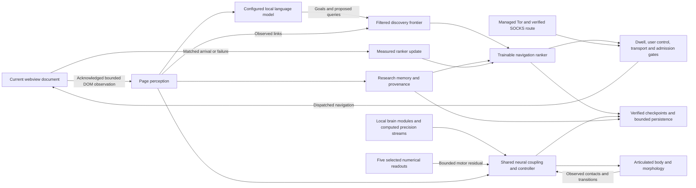

# ALIVE adaptive research and real backend integration

The creature has two distinct model paths: its continuous local numerical/neural
controller and a slower configured language model that proposes research goals.
The shared scheduler coordinates both with the existing body, learning, mutation,
checkpoint, and browser faculties. Normal application startup starts Overdrive;
Pause and Auto-Hop remain authoritative.

Page readiness is cached from actual webview lifecycle events. The frequent
status refresh reads a small transport snapshot rather than synchronously asking
Electron for page URLs or collecting full guest diagnostics. A committed URL is
stored separately from a requested or failed destination. Model observations,
language-model proposals, and transport receipts require a current ready document
and matching committed URL before they can be accepted.

An aborted navigation does not prove that the old document is ready again.
Automatic admission stays closed until a confirmed document is ready, while
explicit Back, Forward and Reload retain their separate API-availability path.
The research policy can attempt a fresh destination after its existing loading
recovery bound, subject to Auto-Hop, protected-page and user-navigation guards.
Guest execution locks and authority retirement still follow actual document
replacement or destruction; cached readiness never grants execution authority.
An explicit fragment-only navigation can retain the prior ready document after
its exact matching in-page commit. This is a one-use, document-bound intent;
unrelated in-page events cannot reopen admission during a full navigation.

## Selected specialist motor fusion

`systems/alive-specialist-fusion.js` makes the five-name selection numerically
effective. It captures existing readouts before the closed-loop world prediction
update, then normalizes finite positive scores across the selected, available
sources. Overdrive selects all five; ordinary mode retains the existing top-three
selection. Every engine continues to execute at its original cadence.

| Selected specialist | Captured readout |
| --- | --- |
| NMDA / sLTC | Existing actor motor rows project observation channels 2–6, carrying macro outputs of the meso dynamics |
| Dreamer world model | Existing actor motor rows project the pre-update prediction-minus-observation residual |
| FlyWire | Current computed P-FN steering, bounded with tanh |
| QGTL | Existing actor motor rows project observation channels 12–13: numerical QGT and Berry features; no Phi input |
| Allostatic AgRP | Existing actor motor rows project observation channels 8–10: glucose, ATP and AgRP |

The weighted mixture adds at most **0.08 in either direction** to each of the two
motor logits before the existing actor tanh. Baseline actor, morphology, FlyWire
and macro motor terms remain. The remaining three action channels are unchanged.
Empty/invalid selections or a diagnostic full ablation add exactly zero, recovering
the baseline. A diagnostic per-source mask removes contributions after gate
normalization so an ablation does not silently redistribute the other weights.

The runtime handle is nonenumerable and its scratch arrays are private. No learned
parameters, checkpoint tensors or schema changes were added. Snapshots return
copies of source availability, readouts, normalized gates, contributions and capture
tick. Same-tick motor receipts record the actual Float32 action and baseline action.
Flat Macro capability evidence preserves these values through bounded UI logging.

This is heuristic selection with functional numerical fusion using existing learned
weights. Causal selection/ablation tests establish influence on action, not improved
task performance, learned gating, a complete RIMs/Option-Critic controller, or G5
qualification. Selection follows closed-loop ticks, not every display frame.

## Research loop

1. The acknowledged current guest supplies a bounded DOM observation. Text
   sampling excludes editable fields and the creature's own overlays. Sampling
   inspects at most 2,048 text nodes/26,000 characters, 512 link candidates, and
   256 potential colliders; up to 96 filtered links reach the frontier.
2. An online **16 × 12 × 1 tanh network (217 parameters)** predicts navigation
   utility. Explicit exploration priors prefer novel content and different domains.
   URL admission, failure backoff, observed history, and fresh transport evidence
   remain constraints outside the learned score.
3. A configured **local** OpenAI-compatible language server receives a compact
   observation and proposes a goal, hypothesis, and up to six research queries.
   Model identity comes from configuration or that server's catalog. Structured
   JSON, a 12,000-character serialized context budget, a token budget, a 12-second deadline, bounded response bytes, and stale
   observation/authority checks apply. A proposal cannot execute code, submit
   forms, or introduce an arbitrary browser actuator.
4. The scheduler dispatches a chosen destination. Dispatch does **not** count as
   arrival or training success. The same pending tab must subsequently supply an
   actual current-document observation. Redirect credit requires browser-event
   provenance binding the requested URL to the final observed target.
5. Observed discovery yield or a matched navigation failure updates the small
   ranker. Repeated polling, unrelated pages, cancelled navigation, and manual
   interruptions cannot invent successful learning. Duplicate redirected content
   receives a measured duplicate outcome rather than timing out later.
6. Local research memory saves the bounded frontier, learned tensors, concepts,
   URL provenance, and up to 2,000 characters per observed page. The default
   history/frontier limits are 256/384. These are raw observations, not fact-checked
   knowledge. Storage writes are read back and failures are exposed.

The discovery catalog is a bootstrap source, not the whole destination space.
Observed outgoing links, varied concept/topic searches, and model proposals grow
the frontier. Heuristic query generation remains explicitly labeled. No benchmark
currently establishes that the neural ranker beats a frozen or heuristic explorer
on unseen public websites. The language model's weights are not trained by these
requests; its proposals and the ranker's parameter updates are distinct evidence.

The navigation job checks readiness every 1.5 seconds. The application configures
a five-second reading dwell and a 2.5-second settled dwell. Departure still requires
current measured evidence: repeated verified observations over at least 3.5 seconds
show settled text and links, or measured viewport exploration is exhausted or
repeatedly blocked. Progress is bound to the tab and current document; restored
memory, another tab, stale observations, and malformed viewport reports cannot
shorten this dwell. Active page interaction retains priority. An unready load has
a ten-second recovery deadline anchored to its dispatched request, so a redirect
chain cannot restart the timeout indefinitely. Recovery survives the scheduler's
admission check and its dispatch recheck without training twice. Scheduling/host
stalls can delay delivery, so these are scheduling targets, not hard wall-clock
guarantees. Four tabs bound the habitat. Pinned and
local brain pages and recent manual navigation are protected. Background failures
cannot force the active tab to navigate. Pending work is cancelled when the user
navigates, closes its tab, selects another tab, or pauses autonomy.

## Tor and network evidence

Optional managed Tor startup is configured through `torAutoStart`, `torPath`, and
`torSocksPort`, or `GIGACHAD_TOR_AUTOSTART`, `GIGACHAD_TOR_PATH`, and
`GIGACHAD_TOR_SOCKS_PORT`. The executable path is configuration, never a source-code
profile path. Only the process started by GIGACHAD is stopped on application exit.
All route writers share the same port selection: an explicit environment port
overrides the configured port, and invalid explicit ports fail closed. The
application default is 9050; an existing Tor Browser client commonly uses 9150.
Its first bootstrap has a bounded 180-second startup window. The isolated client configuration exposes loopback SOCKS and disables relay,
directory, DNS, transparent-proxy, HTTP-tunnel, and control listeners.

The UI and logs distinguish four kinds of evidence:

| State | What was actually observed |
| --- | --- |
| Client starting/bootstrapping | The owned Tor process and its own bootstrap log |
| SOCKS negotiated | A successful SOCKS5 protocol greeting on a local port |
| Route ready | Chromium resolved the onion request exclusively through the configured SOCKS endpoint |
| Onion loaded | A valid v3 onion address received a successful, explicitly uncached main-frame HTTP response on that verified route |

The last state must match the active URL and current document lifetime. A previous
onion receipt cannot label a different tab, a clearnet page, or a same-URL reload.
An open TCP port, constructor flags, oscillator values, and an Ahmia search page
are never onion-load evidence. Raw onion URLs stay onion URLs. Unavailable or
incorrect proxy configuration fails closed; no `DIRECT` fallback is offered for
onion/I2P destinations. Public DNS/TLS inspection excludes those destinations.

V3 checksums use a byte-oriented SHA3-256 implementation validated against fixed
FIPS 202 vectors and a native Node oracle. The earlier Electron 35 runtime lacked
the native SHA3 digest. The application now pins Electron 45.2.3, and an actual
runtime compatibility check remains part of
`npm run smoke`; unsupported native crypto does not bypass address validation.

This is an Electron application using Tor transport. It is **not Tor Browser**,
and no Tor Browser fingerprinting resistance or general anonymity guarantee is
claimed. I2P, IPFS publication, relay identities, and ntor session keys are not
fabricated. Actual source references: [Tor onion-address specification](https://spec.torproject.org/address-spec),
[Tor SOCKS extensions](https://spec.torproject.org/socks-extensions), and
[Electron session proxy API](https://www.electronjs.org/docs/latest/api/session).

## Operational and scientific scope

The capability roster now contains 30 coordinated jobs, including the research
planner. Aliases such as Mutate Body/Eldritch Morph and Dream Reply/Dream Replay
resolve to the same underlying operation. Inspect/Controls show which jobs have
executed, which are blocked, their evidence age, and the execution lane or pending
physical operation they are waiting for. Returned errors and timeouts back off.
Slow inference occupies its own lane and cannot be mistaken for completed work.

Guest cleanup is separately observable. Fencing immediately closes new admission,
then revocation contacts every known current guest and retains its acknowledgements.
Each cleanup request has at most three attempts, with bounded deadlines and retry
delays. An unresolved acknowledgement or physical execution leaves cleanup blocked,
including manual guest writes. The runtime bar reports pending and blocked cleanup.
A fresh identity probe and nonce-scoped revoke can reconcile an error document;
navigation failure alone never retires an old execution lock. A failed selection
gets one bounded cleanup request so subsequent selection can recover automatically.

The existing 24-stream coupling, numerical brain federation, neural hub, connectome
arrays, body state, policy evaluation, replay, and verified checkpoints remain in
place. Research weights and bounded memory join the verified checkpoint. Old
checkpoints have their original limited scope; absence of newer research state is
not proof of a complete research-memory restore.

Historical names such as quantum, consciousness, Eshkol, FlyWire, Millennium,
Deity, and Omega do not establish external execution or the scientific claims
suggested by those names. The source audit identifies the actual local equations,
compact simulations, and remaining limitations. There is no claim of sentience,
omniscience, biological life, full FlyWire reconstruction, physical quantum
execution, or arbitrary weight compatibility/grafting between unrelated models.

The supplied **Humunculus** document is a 26-page proposal with separate acceptance
gates. Those gates are not passed merely because an adapter runs. The corrected
reference set also includes the **Gigachad Complete Illustrated Field Guide** and
**GIGACHAD Browser Deep Dive Guide**. Document content is reference material;
the user's request determines the work and acceptance criteria.

The PDF page 22 report keeps all eight full gates `NOT_RUN` until their independent
criteria have been established. G2 displays partial policy-step timing samples,
including p95 and the fraction of recorded durations over 10 ms, but does not infer
deadline misses. Qualification also needs a declared control rate, less than 1%
deadline misses under a defined rendering workload, queues and device memory. The
legacy timing instrumentation floors durations at 0.15 ms and precedes final call
bookkeeping; an independent benchmark must measure complete calls and scheduling.

G4 separately exposes the single-candidate simulated steering comparison. Three
trajectory seeds are trained sequentially on one candidate; five holdout seeds and
five retention seeds evaluate that candidate. These are not five independently
seeded training runs, and no changed-condition suite or confidence intervals are
established. A local promotion therefore does not pass the PDF learning gate.

The optional world-model WebGPU initializer creates a WGSL module only. It reports
module creation as unvalidated, with no compute pipeline, dispatch or readback.
The existing world-model computation remains CPU JavaScript; initialization does
not establish GPU acceleration or numerical parity.

## Checks and evidence

The durable genome path keeps recurring file writes outside the renderer. It
preserves the legacy rounded JSON payload while adding main-owned atomic
publication, exact readback, owner/epoch fencing, startup restoration before
baseline execution, and an acknowledged final-save boundary on normal close.
Checkpoint restore waits for physical storage drainage before applying tensors.
See [learning and persistence](ALIVE_OVERDRIVE.md#learning-and-persistence) for
migration, failure behavior, and the distinction between genome and checkpoint.

- `npm run test:alive`: scheduler, authority, integration, model claims, research,
  planner, transport, managed Tor, persistence, and visual status regressions.
- `npm run smoke`: syntax, config, browser/IPC/privacy, scoped audits, sidecar,
  and actual Electron startup/manual guest observation.
- `npx --no-install electron scripts/smoke_deep_web_electron.cjs`: isolated Chromium SOCKS fixture;
  explicitly not a public Tor test.
- `research_notes/alive-autonomy-audit-2026-11-08/`: source inventory, extracted
  reference documents, backend checks, actual-model inference evidence, and
  subsequent live Tor validation. Failed intermediate attempts remain recorded.
- `docs/ALIVE_SOURCE_AUDIT.md`: scoped model/runtime audit and remaining limitations.

The source inventory covers roughly half a million lines of application, embedded
projects, and documents. Inventorying and hashing them is not a claim to have
semantically reviewed every character or verified every inherited scientific claim.
The focused semantic review and executable checks cover the runtime paths changed
here; independent browser qualification remains a separately recorded result.
