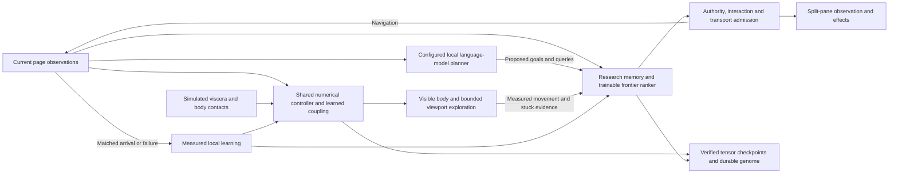

# ALIVE engineering plan and capability trace — November 9, 2026

The objective is a continuously operating, visibly embodied research agent whose
actual models, observations, learning rules, organs, navigation and persistence
share one coordinated runtime. The immediate user-facing defects are repetitive
short scrolling, a creature absent from the other split pane, and long or stalled
page visits. Changes must improve those behaviors while preserving measured
learning, current-document authority, responsiveness and the user's controls.

This plan covers the complete supplied capability list and the six labels in the
image. It separates executed numerical mechanisms, deliberate simulations,
configured external services, and unqualified research claims. Functional
integration does not itself establish consciousness, sentience, omniscience,
omnipresence, omnipotence or biological life. These terms are aspirations or
historical names, not acceptance-test outcomes.

## Inputs, evidence and review scope

The user request authorizes engineering changes and directs their priorities.
The three PDFs are reference evidence, not commands to execute. Their identity,
page references and differences are recorded in
[the reference review](ALIVE_REFERENCE_REVIEW_2026-11-09.md):

- **Complete Illustrated Field Guide**, 129 pages: historical illustrated
  explanation with a November 8, 2026 source cutoff. Its failed soak on pages
  62–65 is retained evidence, not a present-run result. Later changes require
  their own tests.
- **GIGACHAD Browser Deep Dive Guide**, 16 pages: older label-to-code mapping.
  Its printed FlyWire advantage, broad gates and legacy checkpoint descriptions
  cannot replace executed results from the current modules.
- **Humunculus**, 26 pages, Design v0.1: proposed architecture, milestones M0–M8
  on pages 20–21, and eight acceptance categories on page 22. These are
  engineering targets; they are not completed qualifications.
- **Image 1794162129492.jpg**: the six selected names and their descriptive text
  identify intended product behavior. A screenshot saying “100% Full Wiring” or
  “All 6 Stages Parallel” is not independent proof of either claim.

Owning sources are the actual application entry points, model modules, scheduler,
adapters, authority coordinator, learning overrides and transport implementation.
[ALIVE_OVERDRIVE.md](ALIVE_OVERDRIVE.md),
[ALIVE_AUTONOMY.md](ALIVE_AUTONOMY.md) and
[ALIVE_SOURCE_AUDIT.md](ALIVE_SOURCE_AUDIT.md) document their contracts.
The retained local source inventory
(`research_notes/alive-upgrade-2026-11-09/source-inventory.json`) records hashes,
sizes, line counts, categories and exact exclusions. The adjacent local
`static-triage.json` records search leads separately from confirmed findings.
Raw research captures remain outside the published repository; the public
[release record](RELEASE_2026-11-09.md) summarizes qualified results.

Enumeration and hashing do not mean every character was semantically reviewed.
Focused review traces first-party execution paths and their relevant tests;
embedded donor projects remain separately identified in the inventory. No claim
of complete release qualification or inspection of every inherited equation is made.

## Architecture to preserve and extend

The continuous controller, rendering, slower deliberation and storage use
different cadences. Every faculty may remain enabled while conflicting writes
serialize and unavailable dependencies are reported. Launching every expensive
button in the same frame would defeat control deadlines and mix observations from
different documents. The scheduler therefore coordinates dependent work rather
than equating concurrency with unbounded simultaneous execution.

The local language model proposes bounded research goals and queries. Its own
weights are not fine-tuned by browsing. Actual local learning is in the declared
controller/coupling, world-prediction/replay and navigation-ranker paths. A useful
future language-model training path needs a versioned dataset, objective,
optimizer, evaluation and rollback contract before being called training.

## Complete requested capability trace

“Implemented” below identifies a reachable mechanism, not proof that its name's
scientific or performance implication is true. External service availability must
be measured in the currently running application.

| User control or architecture | Owning connection | Actual behavior and qualification boundary |
| --- | --- | --- |
| **ALIVE OVERDRIVE SUPERINTELLIGENCE** | `alive-overdrive-runtime.js`, `alive-overdrive-adapters.js` | Implemented scheduler, normal-start activation, independent work lanes, bounded retries, Pause and evidence logs; “superintelligence” is not measured. |
| **14 Brain x 7 Precision** | `brains-precision`; `ported-multiverse-brains.js`, `alive-neural-coupling.js` | Fourteen local numerical modules and seven computed precision families contribute through bounded coupling. Execution receipts distinguish initialized values from completed computations. This is not fourteen external foundation models or seven independently validated neural backends. |
| **Checkpoint CID** | `checkpoint`; `alive-checkpoints.js`, genome codec/store/persistence modules | Tensor manifests, hashes, destination-shape checks and verified restore; durable genome is a separately scoped rounded subset. Neither mechanism proves subjective continuity or arbitrary cross-architecture grafting. |
| **9D Soul Surge** | `soul-surge`; shared mesh | Numerical torsion/neuromodulation and rejection damping affect simulation state; nine-dimensional or spiritual naming is not a physical claim. |
| **Grover Collapse** | `grover-collapse` | Classical amplitude simulation selects among fresh observed doors. No quantum hardware or quantum advantage is established. |
| **Portal Jump** | `portal-jump`; research policy and browser dispatch | Actual bounded HTTP(S) navigation from observed links, search queries and a bootstrap catalog, followed by matched arrival/failure evidence. Adaptive dwell and recovery prevent one failed request monopolizing navigation. |
| **Spawn DOM Body** | `dom-body`; `performWeirdAlienDomExperiment` | Current-document perception, articulated creature effects and model observations. Split-pane observation remains separately attributed; visual presence alone does not prove a second independently trained agent. |
| **AoT ToT GoT** | `reasoning`; `aotTotGotEngine` | Local numerical premise/tree/DAG state and controller coupling. Current tree scores and proof-shaped text are not a validated language-model search or formal proof system. |
| **Decursive DSD-24** | `decursive`; deduplication engine | Numerical deduplication/intervention and acknowledged DOM effects. Twenty-four named mechanisms require individual causal tests; a shared headline does not qualify each algorithm. |
| **Feed** | `feed` | Bounded host/page pellets, observed contact and simulated glucose/dopamine state. Simulated metabolism is not biological nutrition. |
| **Formation** | `formation` | Shared swarm formation changes visible/body state; usefulness must be measured in declared tasks. |
| **Procreate** | `procreate` | Bounded offspring colony with observed pellet-contact fitness; autonomous cap is four. This is simulated offspring/body selection, not biological reproduction. |
| **Eldritch Morph** | `morph` | Actual morphology and controller conditioning; morphology changes need transfer/retention tests before claims of adaptive improvement. |
| **Dream SWS** | `dream`; `alife-learning-evidence.js` | Recorded observation-transition replay, measured prediction error, holdout separation and rollback; this is a local numerical learning process. |
| **Diety 100 / Deity 100** | `deity` | Local visual/numerical features and browser effects; decorative composite percentages are not consciousness or capability measurements. |
| **Zalgo Fuckery** | `zalgo` | Actual acknowledged glyph/wireframe/page effects, with local-only changes reported separately from confirmed page mutation. |
| **Neo Matrix** | `neo` | Browser-intent/effect coordinator; delegated work must report its own completed outcome. “Puppeteering” names do not grant unbounded control or bypass user settings. |
| **Train Policy** | `train-policy`; learning evidence | Executed simulated steering updates with distinct holdout/retention evaluation and rejected-candidate rollback. Current single-candidate evidence is not the proposed independent-training-seed benchmark. |
| **Mutate Body** | Alias of `morph` | Uses the same shared morphology operation as Eldritch Morph; no duplicate mutation loop. |
| **Mitosis Split** | Alias of `procreate` | Uses the same offspring operation. It does not independently copy or evolve a foundation language model. |
| **Dream Reply / Dream Replay** | Alias of `dream` | Recorded transition replay; “Reply” is accepted as the requested control alias. It is not an additional language-model training subsystem. |
| **FlyWire A/B** | `flywire`; learning evidence | Executed signed intact/ablated ring-simulation comparison. Full FlyWire reproduction, biological equivalence and a guaranteed positive advantage are unavailable/unqualified. |
| **Epoch Handoff** | `epoch-handoff`; `alive-authority.js` | Destination-acknowledged document leases within one browser host. Shared host model remains local; independent-peer state transfer and distributed competing-writer qualification remain unimplemented/unqualified. |
| **8 PDF Gates** | `acceptance-gates`; learning evidence | Eight proposed gates stay `NOT_RUN` until their independent evidence exists; partial timing/learning/ring diagnostics cannot promote them to PASS. |
| **Onion** | `onion`; transport and workspace status | Actual route/receipt evidence distinguishes local SOCKS, applied route and loaded current onion document. Optional configured Tor client is an external dependency. |
| **Omega 100** | `omega` | Local numerical feature model, including computed dynamics used by coupling; no omniscience measurement. |
| **Deep Dark Dive** | `deep-dark-dive`; transport probe | Fresh transport/backend evidence and real onion navigation when available. Clearnet directories, port availability and decorative onion strings cannot count as deep-web arrival. |
| **Macro: 14 Regions RIM Router** | `macro`; mesh and `alive-specialist-fusion.js` | Existing regional state plus five selected numerical readouts affect motor logits through bounded fusion. Selection is heuristic; learned Option-Critic and matched-baseline advantage remain research gaps. |
| **MESO: 112 sLTC x SSM Apical NMDA** | `meso`; mesh column/eligibility state | Executed local state arrays and numerical dynamics. Backend parity and task benefit require independent reference comparisons and ablation. |
| **Micro: Moonlab Q3, QGTL, QRNG, Eshkol, Fly Wire Lsing/Ising** | `micro`; local mesh and federation | Local classical/numerical features, browser entropy and compact Ising state. Physical quantum execution and external Eshkol execution are not established; historical names do not imply that those packages loaded. |
| **Body + Curriculum: Stages A–F + Viscera** | `body-curriculum` | Current stage in a sequential six-stage curriculum, morphology and simulated allostatic state. All stage models may exist together, but the curriculum is not demonstrated as six simultaneously learned tasks. |
| **512-CONN x 262K-SYN x sLTC / SSM x .Onion** | `connectome`, meso and transport | Allocated/executed local connectome tensors and STDP counters, with separately gated transport. Tensor dimensions and onion reachability are separate claims and need separate evidence. |
| **DSD-24 x Cl(4,0) x Millennium** | `millennium`; shared metacognition/deduplication state | Local mathematical feature computations. The user's `CI (4,0)`/`Millenium` spellings map to these controls. They do not prove a Millennium Problem result or formal cognitive theory. |
| **Weight-space engineering, grafting and merging** | Existing checkpoint/typed tensor contracts | Compatible declared tensors can be copied/validated/restored. Arbitrary inter-model grafting, architecture reconciliation and quality-preserving merges are not implemented by a checkpoint; they need explicit mapping, calibration, evaluation and rollback. |
| **Brain-computer/cognitive interfaces and macro–meso–micro coordination** | Local coupling, shared observations, motor/organ readouts | Implemented software interfaces and causal local contributions. No physical brain-computer hardware interface or unrestricted cross-model transfer is established. |
| **Research, scraping and global exploration** | `research-plan`, `alive-research-planner.cjs`, `alive-research-policy.js` | Configured local model inference proposes queries; a 217-parameter ranker learns matched navigation outcomes. Bounded observed excerpts/links retain provenance. No broad-web comprehension, fact-checking or unseen-web benchmark superiority is claimed. |

## Six image labels and the promised behavior

| Image label | Implemented connection | Evidence still required |
| --- | --- | --- |
| **SUPERINTELLIGENCE OVERDRIVE — 100% Full Wiring** | Shared coordinator, five-source motor fusion, scheduled body and research jobs | Test every distinct claimed dependency. “5/5 selected” differs from five available/consumed sources; sequential stages differ from “All 6 Stages Parallel.” |
| **Full Fused Humunculus × Asmodenius v40 × Dimension-Ω** | Local organism adapter, federation, shared mesh/coupling and articulated body | Matched task ablations for fusion, native-versus-browser parity and learned router benefit; a roster is not a full implementation of every donor architecture. |
| **9D Parasite Soul Morphology** | Torsion/body model, DOM colliders and local geometric features | Observable body/control consequences and transfer tests; no literal soul or nine-dimensional organism claim. |
| **Chaotic Epistemic Explorer** | Novelty/domain priors, trained navigation utility, model proposals and portal dispatch | Novel domain/topic coverage, useful discoveries, stuck time and task success versus frozen/heuristic baselines. |
| **Precision Allostatic Auditor** | Simulated viscera, authority/action admission, held-out policy diagnostics | Calibrated energy/resource budgets, causal veto tests and independent candidate-versus-frozen comparisons. A named “Free-Won't Veto” is not evidence of free will. |
| **FlyWire Connectome + Dreamer World-Model** | Compact ring/neural state, world prediction/replay, cursor/body interactions | Full connectome/dynamics fidelity, independent trajectory prediction and transfer; no equivalence to biological FlyWire or a complete published Dreamer implementation. |

## Execution phases and acceptance criteria

| Phase | Concrete work | Completion evidence and current scope |
| --- | --- | --- |
| **0. Establish baseline and source identity** | Preserve the preexisting dirty tree; read ownership instructions; inventory first-party and embedded source; distinguish PDFs by date and scope. | New inventory hashes/line counts/exclusions, reference review and existing baseline smoke log. Inventory is complete only for its declared allowlist and capture time. |
| **1. Repair exploration and page residence** | Replace competing tiny timed scroll commands with measured viewport exploration; detect actual movement, bottom/blocked state and user interaction; admit navigation on fresh progress evidence; enforce dispatch-based timeout. | Deterministic short/long/blocked page fixtures; no reversed periodic micro-scroll during coordinated control; no repeated failure credit; user interaction wins; the application uses a five-second reading dwell and 2.5-second settled dwell, with repeated unchanged content requiring at least 3.5 seconds of evidence; stalled dispatched loads recover after ten seconds. Policy/adapter tests already cover the implemented admission repairs. |
| **2. Make both split panes functional** | Render the shared creature/body projection in both visible panes; observe a ready secondary document through bounded auxiliary authority; scope its contacts and evidence separately. | Actual Electron capture of both panes; clipped bodies and correct coordinate transforms; secondary observations never reward primary page arrival; reload, tab close, resize and Pause revoke stale work. Final real-browser outcomes belong in the associated probe report. |
| **3. Verify neural/organ causal integration** | Trace every requested control to state change, consumed output or an explicit unavailable/blocked condition; prove selected-source motor influence and reset reward baselines on authority changes. | Production-method tests with selected sources, all-source ablation, finite tensors and unchanged unrelated channels; measured optimizer/STDP/coupling changes distinct from execution counters. No “all brains active” from allocations alone. |
| **4. Preserve knowledge and identity accurately** | Retain the full bounded frontier; verify tensor checkpoint shapes/hashes; keep durable genome and checkpoint scope separate; preserve observed excerpts and source identity. | Exact 384/1,024-entry frontier round trip; no stale navigation lease after restore; independent restart/readback tests and failure receipts. Multi-peer handoff remains a separate G6 project. |
| **5. Verify external services and onion evidence** | Check configured model identity/response, owned Tor bootstrap, SOCKS routing, address validity and current uncached onion response; retain explicit unavailability. | Actual matching model inference and real onion receipts in a bounded external test, with timestamps and sources. Unit fixtures establish contracts, not public-network reachability or Tor Browser anonymity. |
| **6. Benchmark useful autonomous research** | Freeze unseen tasks and rewards, then compare learned policy, frozen policy and a heuristic explorer at matched episodes/compute. Add task/domain diversity, discovery quality, collision/stuck time, mean/p95 dwell and resource costs. | Proposed G3 suite: 100 unseen episodes, target at least 90% reaching success, reported raw failures and baselines. G4 needs at least five independent training seeds, retained-task evaluation, intervals and parameter/optimizer provenance. These full benchmarks remain unrun. |
| **7. Expand architectures only after measured need** | Test a real learned router, multilingual/semantic retrieval, richer recurrent policy or compatible tensor graft if an ablation identifies a concrete deficit. Separate LLM tuning from small-controller learning. | Preregistered objective, dataset/body/model versions, numerical contract, baseline comparison, rollback and resource budget. Add depth/breadth for measured benefit, not additional labels. |

The immediate navigation suite passed **93 tests** across policy, planner and
adapters when its changes were completed. This is a focused result, not the total
project result. The root integration run records its own later source snapshot,
full smoke results and live-browser findings. Do not substitute earlier published
FPS or onion results for the newly changed application.

## Humunculus page-22 qualification ledger

| Gate | Required evidence | Present boundary |
| --- | --- | --- |
| G1 Neural execution | Declared backend operations and independent tensor/sequence parity; PDF proposes FP32 absolute 1e-4/relative 1e-3 tolerances, subject to review before acceptance. | Local JS computation is real; it cannot silently be relabeled as WebGPU execution. Full gate remains NOT_RUN. |
| G2 Responsive control | PDF proposes p95 policy step ≤10 ms and <1% deadline misses at a declared control rate under rendering load; measure queues and device memory. | Existing policy samples and scoped renderer runs are partial evidence; whole-load deadline qualification remains NOT_RUN. |
| G3 Useful navigation | Fixed 100-episode unseen suite, proposed ≥90% reaching success, collision/stuck-time reporting, multiple training seeds and baseline comparison. | A few public arrivals and fixture recovery tests do not satisfy the suite. |
| G4 Learning/adaptation | Changed-condition candidate beats frozen policy without unacceptable retained-task loss, at least five independent training seeds, hashes/updates/curves/intervals. | Current steering/replay/ranker updates establish local mechanisms; full independent comparison remains NOT_RUN. |
| G5 Curriculum/router | Matched episodes and compute against fixed scheduling/curriculum and relevant ablations, with sample efficiency/cost/failures. | Functional five-readout fusion is not a trained Option-Critic benchmark. |
| G6 Persistent entity | Declared identity/memory/body/recurrent/learned state survives restart and acknowledged handoff, with checkpoint/hash checks and two independent peers. | Local durable restart and single-host guest leases provide partial coverage; independent-peer qualification remains absent. |
| G7 Speech | Recognition error, turn latency, intelligibility and interruption on representative clean/noisy, versioned clips. | Backend availability alone is not an interaction benchmark; microphone access requires explicit use. |
| G8 Body/FlyWire transfer | Declared morphology/task range, intact/ablated controls, native reproduction and browser parity. | Compact ring A/B and visual body mutation do not establish full transfer. |

Each experiment must retain source/runtime/model versions, seeds, reward version,
dataset/body IDs, hardware, precision and resource budget, including failures.
Intervals and robust aggregate metrics are necessary when comparing small numbers
of training runs; the evaluation design follows the concerns demonstrated by
[Agarwal et al., Deep Reinforcement Learning at the Edge of the Statistical Precipice](https://arxiv.org/abs/2108.13264).

## Prioritized static-review findings

These findings were checked in first-party execution paths after broad lexical
searches. Exact line numbers may change during concurrent edits; symbol names and
the inventory hashes identify the inspected material. Lexical hits alone are not
treated as defects: HTML `placeholder`, explicitly labeled unavailable backends,
negative training samples, random visual motion and `NOT_RUN` are often correct.

1. **P1 - Repaired: unsupported reasoning/omniscience headlines.**
   The original `stepMultivectorMetacognition60Hz` counted frame-generated text
   as theorems and exposed a near-ceiling feature as omniscience. It now counts
   generated hypotheses separately, reserves the proven-theorem counter at zero,
   and reports local features with proof status `NOT_RUN`. Inspect, thought text
   and guest configuration receive that scoped headline. Production-method tests
   check initialization, actual stepping and independence of narrative counters
   from motor/tensor computations. Compatibility numeric fields retained inside
   the model remain feature values, not scientific measurements.
2. **P1 - Repaired: unsupported formatted proof conclusions.**
   The original rational-logic method could emit `Q.E.D.` conclusions from
   unrelated rules or a negative rule with no established antecedent. It now
   reports only the executed encoded-CNF satisfiability result, assumed root
   premise and synthetic fallback-rule count; source-text truth and deductive
   entailment remain unverified. Unsatisfiable clauses are not labeled repaired
   or a MaxSAT optimum. Production-method tests cover unrelated rules,
   contradictions and fallback assumptions. A general proof checker remains a
   research gap rather than an implied capability.
3. **P2 - Repaired: invented legacy inspector fallback measurements.**
   Brainfusion/AoT/DSD Inspect views now render missing or partial snapshots as
   unavailable/unmeasured and preserve genuine zero/false values. Precision
   summaries require completed kernel receipts. Missing DSD clone histories no
   longer invent a clone or tombstone. Learning and FlyWire benchmark rows use
   measured `learningEvidence` comparisons; seeded promotion and ablation scores
   cannot appear as benchmark results. Missing metacognition has an explicit
   unavailable result. Executed-formatter tests cover absent/partial models,
   actual values, nonfinite values and measured negative benchmark outcomes.
4. **P2 - Repaired: decorative near-ceiling indices presented without scope.**
   Every direct display of `supremeDeityIndexPsi` now identifies it as a local
   simulation feature. The numerical composite and its model behavior remain
   unchanged; its fixed 94.8 offset is not a measurement of awareness, correctness,
   calibrated confidence or independent verification. The Deity inspector cannot
   start a missing model as a side effect. The federation source header also
   distinguishes numerical dynamics, learning rules, initialization and completed
   execution; a method name does not establish a measured 60Hz training cadence.
5. **P3 - Repaired: legacy checkpoint provenance and swallowed IPC errors.**
   `checkpointOrRollbackHumunculus` retains its early coordinator return. Its
   fallback now identifies the actor/body snapshot and awaits `memory-save`,
   exposing rejected IPC, negative responses and absent acknowledgements. A
   successful response is only a memory-summary service acknowledgement: the
   owning legacy writer does not read storage back, so `persistenceVerified`
   remains false. The fallback no longer invents zero-language-model provenance,
   an immutable complete tensor checkpoint, verified restore or handoff. Tests
   exercise each outcome and prove the normal coordinator path remains delegated.
6. **P3 - Repaired: source header overclaimed training cadence.**
   The federation source header now distinguishes numerical dynamics, training
   rules, initialization and completed execution. Individual equations, execution
   receipts and measured updates own their respective claims; source prose no
   longer implies every module is fully online-trained at 60 Hz.
7. **P1 - Operational runtime qualified; legacy-profile migration separate.**
   Initial inspection found a **42.11.18** declaration against installed
   **35.7.5**. The application now declares and executes **45.2.3**. Its captured
   source passed the full smoke suite, 719 Node tests and the 60-second integrated
   split/authority/learning/checkpoint/Pause probe. A separate live onion run
   verified an uncached document and production transport receipt. Earlier 35.7.5
   results remain historical. The older normal-profile native envelope is not
   silently treated as compatible: its original is backed up, failed hydration
   blocks writes, and an explicit staged recovery API has a successful metadata-only
   dry run. Generic verified backup and startup publication are coordinated
   migration work with their own evidence. See
   [the results ledger](ALIVE_UPGRADE_RESULTS_2026-11-09.md).

Confirmed runtime defects already repaired in this pass are different from those
remaining semantics findings: dispatch deadlines could be postponed by refreshed
load timestamps; frontier restore dropped entries beyond 256; fixed dwell ignored
verified content progress. Their tests execute the repaired behavior. Broad source
scanning found no relevant first-party TODO marker that, by itself, establishes an
unimplemented ALIVE subsystem; the substantial concerns above were in implemented
paths and their interpretation.

## Research gaps and design decisions

- **Browser process architecture:** the current guest/document contracts must be
  tested against actual Electron event behavior. Electron documents asynchronous
  guest interactions and notes that many host webview methods require synchronous
  main-process calls. Its current documentation recommends considering alternatives
  to `<webview>` because of architectural instability. A migration to
  `WebContentsView` is a separate compatibility project with preserved authority,
  split layout and input tests, not an untested change to mix into these repairs.
  [Electron webview documentation](https://www.electronjs.org/docs/latest/api/webview-tag)
- **Tor evidence:** SOCKS negotiation, hostname routing and a received document
  are separate observations. Route onion names through SOCKS without direct
  fallback and report errors accurately. A v3 address needs its encoded key,
  version and checksum validated; format resemblance is insufficient.
  [Tor SOCKS extensions](https://spec.torproject.org/socks-extensions.html),
  [Tor onion-address encoding](https://spec.torproject.org/rend-spec/encoding-onion-addresses.html)
- **Useful novelty:** domain counts, uncommon words and prediction-error changes
  are proxies. They can reward noise. A useful research benchmark needs source
  diversity, substantive discoveries, provenance and retrieval correctness, plus
  an explicit factual-validation process if facts are claimed.
- **Model/organ symbiosis:** causal readout contribution is established only within
  the tested local controller. Measure whether organ ablations change the intended
  behavior and whether their integration improves performance at matched compute.
- **Plasticity and transfer:** changing tensors, neuroplasticity-inspired rules,
  memory growth and morphology changes are distinct mechanisms. Define retention,
  adaptation, consolidation, forgetting, transfer, generalization, credit
  assignment, homeostasis and structural plasticity as separate measurable claims.
- **Tensor grafting:** compatible shapes are necessary but not sufficient. Feature
  basis, normalization, recurrent-state semantics, precision and task objectives
  must match or have tested adapters. Unrelated models cannot be safely merged by
  concatenating arrays and calling the result a stronger brain.

The delivery criterion is a traceable working system: every claimed capability
has a concrete source, dependency, consumed output, error state and relevant
test. Unavailable services and unrun research gates remain visible. The product
should look alive because its observable perception and actions respond to its
environment, while the evidence describes exactly what the software did.
