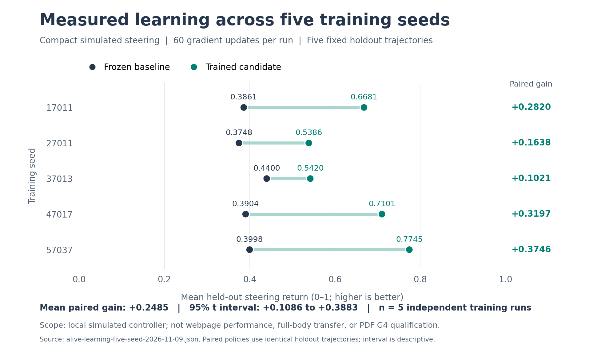

# Creature integration pass 1 — November 9, 2026

This pass connects recurring research and source-linked writing to the shared
creature controller, repairs permanent blind spots in sparse neural computation,
and exposes actual computation through visual evidence. It also includes the
separately reviewed paired primary/trainer persistence work. The existing
Synaptic Fabric commit is preserved and its event attribution and visual
measurement defects are corrected in the combined release.

## What changed

- **Thirty-six coordinated capabilities.** Memory, metacognition, Ghost Swarm,
  Ghost Write, acknowledged DOM Warp and independent five-seed diagnostics join
  the existing body, brain, learning, replay, research and transport jobs.
  Canonical aliases coalesce into one operation. One execution slot remains
  available for local work when slow background services occupy the other three.
- **Shared Ghost faculties.** Acknowledged primary and secondary page observations
  enter bounded provenance memory. Three local research roles analyze mechanisms,
  implementation and evidence; one optional configured local-model request adds
  explicitly unverified proposals. Their queries and observed links enter the
  real navigation frontier. Source-linked notebooks update working/semantic
  memory and survive local storage readback. Offspring access the same service;
  this does not create independently trained foundation models per body.
- **Functional controls and receipts.** Ghost controls request those same jobs.
  They no longer launch an unbounded legacy set of tabs or insert generated text
  into whichever website field happens to be focused. Warp is an idempotent
  desired-state operation with current-document acknowledgement and reversible
  declaration-level CSS changes, including priorities and transition longhands.
- **Actual neural participation.** Fourteen compact adapters and all seven
  precision readouts have individual causal-wiring tests into the shared hub's
  input, latent and motor channels. Previously fixed sampling lanes in the
  cortex now rotate, with fair expert and active-presynaptic selection. A
  previously write-only episodic store now contributes a bounded posterior
  readout. Traversal counters report actual work.
- **Visual evidence.** Brain evidence and Fabric panels use the workspace layout
  beside the webpage and share panel exclusivity. They show source receipts,
  research roles, notebooks, execution events, neural readouts and inspectable
  tensor statistics. Captured arrays are copied with typed-array intrinsics;
  full-array statistics yield in chunks and preserve finite Float64 extremes.
  Explicit traversal limits and omissions prevent a partial catalog from being
  presented as every application parameter. Concurrency means simultaneous
  execution; rates use elapsed time.
- **Paired startup state.** Six exact primary tensors plus committed trainer
  weights, private epoch and timeout have a reviewed save/startup contract.
  Pending jobs and browser authority do not restore. Generic tensor checkpoints
  remain a distinct, narrower continuity mechanism. See the
  [trainer-state contract](ALIVE_TRAINER_STATE.md) and its independently qualified
  [verification record](verification/trainer-state-2026-11-09.json).

## What “all weights and synapses participate” means here

The repaired cortex preserves bounded sparse work per step. Every declared lane
in these repaired paths can participate over time; inactive neurons and missing
inputs do not receive fabricated activity credit.

| Repaired path | Actual fixture coverage | Per-call work |
| --- | --- | --- |
| Eight expert matrices | 524,288 weights in 56 calls with a fixed highest-scoring expert | 16,384 MACs |
| Connectome | 262,144 synapses in 94 all-spiking calls | At most 2,816 traversals |
| Prior/posterior/master/actor/critic projections | 65,536 weights in two phases | 32,768 reads |
| Actor-output/decoder gradient lanes | 12,288 weights in eight phases | 1,536 updates |
| Q/K/V coefficient readout | 12,288 coefficients in 768 calls | 16 reads |
| Attention output coefficient readout | 8,192 coefficients in 1,024 calls | Eight reads |
| Episodic memory readout | 16,384 values across 128 slots | One bounded slot readout |

These are instrumented production-method fixtures, including formerly omitted
final-lane perturbations that change downstream values. They are sparse rotating
approximations, not an equivalent dense forward pass or dense gradient at every
step. Coverage and causal wiring do not establish better open-web task results.

## Independent learning measurement

Five independently initialized policies used the production compact steering
learner, each compared against its own frozen initial state on the same fixed
holdout and retention trajectories. All five improved. Mean paired held-out
return improvement was **0.248457**, with an approximate 95% Student t interval
of **0.108641–0.388273**. The full [measurement artifact](reports/alive-learning-five-seed-2026-11-09.json)
includes seeds, curves, state hashes and parameter deltas; the
[protocol](ALIVE_LEARNING_FIVE_SEED.md) explains the statistical limits.

This tests the compact simulated steering task. It does not measure broad web
research, distinct-task retention, full-body transfer or the proposed G4 gate.
The benchmark does not modify the live policy.

The chart plots the actual paired holdout returns from the measurement artifact;
its interval describes these five runs. An
[exportable SVG](reports/alive-learning-five-seed-2026-11-09.svg) is also included.

## Verification

This pass is implemented and locally verified in the containing release commit.
Final combined validation is recorded in the
[public verification record](verification/continuous-cognition-2026-11-09.json).

| Validation | Recorded result | Scope |
| --- | --- | --- |
| Combined Node suite | 1,174/1,174 passed; zero failed, skipped or cancelled | Correctness fixtures and production-method tests on the final combined sources. |
| Full smoke pipeline | Passed; six Python tests; Electron `SMOKE_OK` | Application startup, isolated guest behavior, local system checks and synthetic checksum verification. |
| Continuous cognition Electron probe | 18/18 passed; all 13 recorded source hashes unchanged | Acknowledged observations, Ghost roles/notebook, real CSS restoration, Fabric event ownership, docked visual evidence and settled Pause. |
| Combined two-process restart | 24/24 passed; all 34 recorded source hashes unchanged | Exact restoration of six primary tensors containing 718 Float32 values, plus 16 committed trainer values, private epoch and timeout. |
| Independent compact steering experiment | Five completed seeds; all five improved against their own frozen baseline | Mean paired holdout improvement 0.248457; approximate 95% Student t interval 0.108641-0.388273. |

The cognition probe inspected 726 arrays containing 1,406,015 values and reported
53 traversal omissions. All returned arrays were finite. Those omissions describe
bounded traversal exclusions, not a count of missing tensors; the inspector is
not a complete parameter census. Its three captured panels were visually reviewed.
The first browser attempt exposed a repeated-collider Warp defect; its failed
record was retained, the defect corrected, and the final 18-check run passed.

The final smoke and restart logs retained nonfatal Electron diagnostics: a Mojo
widget rejection, the deprecated console-message argument signature, and a guest
frame disposed before a request completed. The isolated cognition renderer also
reported unavailable adapters. The public record preserves these observations
alongside the passing outcomes.

Raw temporary-profile logs and screenshots stay under the ignored
`research_notes/` directory. The public record excludes temporary absolute paths,
page excerpts and profile/session identifiers. The separate trainer qualification
used a pinned trainer-only tree; it is not substituted for the final combined
source checks. No new open-web benchmark was run, user-task benefit remains
unmeasured, and no scientific gate was promoted by this verification.
The source hashes record exact tested working-tree bytes. The public record also
provides hashes after CRLF-to-LF normalization for comparison with this
repository's Git text policy; normalization does not change the tested source
text.

## Next work

The [ten-pass roadmap](ALIVE_TEN_PASS_ROADMAP.md) records the requested sequence.
The next useful experiment is a fixed unseen browser task suite comparing the
combined controller with frozen and heuristic controls at matched work budgets,
including long-duration retention and failure cases. Other remaining work is
full learned-state catalog coverage, distinct per-creature policy ownership where
desired, independent scientific gate qualification, and task benefit from the
new sparse participation schedule.

Tor Browser integration follows pass 10 in that roadmap. Current managed Tor
transport is not that future integration. Physical quantum execution, external
Eshkol execution, biological FlyWire equivalence, consciousness, omniscience and
foundation-language-model weight training are not established by this release.
