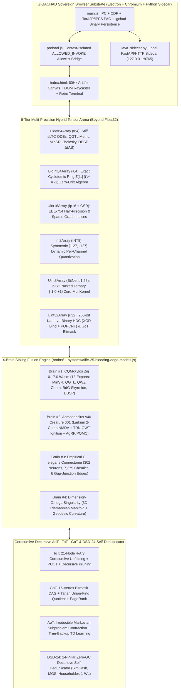

# GIGACHAD BROWSER — MASTER ARCHITECTURE BIBLE, MATHEMATICAL NOTATIONS, DSA, GLOSSARY, INDEX & CONTRAST COMPARATIVE ANALYSIS

> **LICENSE POSTURE — DOWNLOAD AND PERSONAL USE ONLY (ALL RIGHTS RESERVED):**
> Governing License: [`LICENSE`](../LICENSE) & [`NOTICE.md`](../NOTICE.md).
> **GIGACHAD BROWSER** is provided strictly for personal download and local execution. **Commercial use, modification, editing, derivative works, redistribution of modified copies, and claiming authorship as one's own are strictly prohibited.**

---

## 1. Executive Architecture Bible & 4-Brain Sibling Fusion Topology

**GIGACHAD BROWSER** is a self-contained, zero-LLM (`0-token` in its embodied loop) sovereign Chromium/Electron desktop browser fused with a **60Hz continuous-time artificial life (A-Life) nervous system**, a **`1,245,184`-parameter deep cortex**, a **`262,144`-synapse 6-neuropil biological connectome**, an **empirical *C. elegans* 302-neuron / 7,379-synapse hermaphrodite connectome**, and a **compiled Zig 0.17.0 WebAssembly (`wasm32-freestanding`) mathematical co-processor**.

---

## 2. Beyond `Float32Array`: The 6-Tier Multi-Precision Hybrid Tensor Arena

A core architectural invariant of GIGACHAD BROWSER is that biological, physical, topological, and symbolic neural computations should **never** be homogenized into naive 32-bit floats (`Float32Array`) where either higher precision (`f64`), exact ring arithmetic (`i64`), or extreme bit-level efficiency (`fp16`, `INT8`, `BitNet b1.58`, `u32` binary HDC) is mathematically superior:

| Precision Tier | TypedArray / Storage | Byte Offset in `multiPrecisionBuffer64K` | Mathematical & Engineering Role |
| :--- | :--- | :--- | :--- |
| **1. IEEE-754 Double (`f64`)** | `Float64Array(512)` | `0 .. 4095` (`4,096 B`) | Stiff conductance-based `sLTC` ODE exponential Euler integration, Fubini-Study Quantum Geometric Tensor $g_{\mu\nu}$, `MinSR` sample-space Cholesky natural-gradient solver, and exact DBSP bilinear $\Delta(AB)$ updates. |
| **2. Exact Algebraic Ring (`i64` / `u64`)** | `BigInt64Array(64)` & `BigUint64Array(64)` | `4096 .. 5119` (`1,024 B`) | Exact Cyclotomic integer ring $\mathbb{Z}[\zeta_8] = \mathbb{Z}[x]/(x^4 + 1)$ arithmetic (`cqm_eshkol_cyclotomic8_mul`) with **zero floating-point drift** and exact integer norm $N_{\mathbb{Q}(\zeta_8)/\mathbb{Q}}(\alpha) = A_0^2 - 2A_1^2 \in \mathbb{Z}$, plus `xoshiro256**` QRNG state. |
| **3. Binary Hypervector & DAG Bitmasks (`u32`)** | `Uint32Array(256)` | `5120 .. 6143` (`1,024 B`) | 256-bit Kanerva Binary Hyperdimensional Computing (`HDC`) associative memory using bitwise `XOR` (`^`) binding and SWAR `POPCNT` Hamming similarity, plus 16-bit bitmask adjacency matrices in `GoT`. |
| **4. IEEE-754 Half (`fp16`) & CSR Indices (`u16`)** | `Uint16Array(512)` | `6144 .. 7167` (`1,024 B`) | 16-bit half-precision (`1` sign bit, `5` exponent bits, `10` mantissa bits) latent state compression (`float32ToFp16Bits` / `fp16BitsToFloat32`) and Compressed Sparse Row (`CSR`) connectome edge indices. |
| **5. Symmetric Quantized (`INT8`)** | `Int8Array(1024)` + `Float32Array(16)` scales | `7168 .. 8191` (`1,024 B`) | Dynamic per-channel symmetric `INT8` weight quantization $W_{q,rc} = \text{clamp}(\lfloor W_{rc} / s_r \rceil, -127, +127)$ with scale $s_r = \max_c |W_{rc}| / 127$. |
| **6. 2-Bit Packed Ternary (`BitNet b1.58`)** | `Uint8Array(1024)` (`4,096` ternary weights) | `8192 .. 9215` (`1,024 B`) | Packs 4 ternary weights $w \in \{-1, 0, +1\}$ into each `Uint8` byte (`00` $\to 0$, `01` $\to +1$, `10` $\to -1$), executing **multiplication-free** synaptic accumulation using only additions and subtractions. |

---

## 3. Formal Mathematical Notations & Equations Reference

### 3.1 Spiking Liquid Time-Constant (`sLTC`) Conductance ODE & Surrogate Gradient
Each neuron $i$ evolves in continuous time with conductance-modulated liquid time constant $\tau_{\text{eff},i}(t)$ (`Hasani et al., 2021`; `Koch, Rapp & Segev, 1996`):
$$\tau_{\text{eff},i}(t) = \frac{\tau_{0,i}}{1 + \tau_{0,i} \sum_j |w_{ij}| \, \sigma(v_j(t))}, \qquad \frac{dv_i}{dt} = -\frac{v_i(t) - E_{\text{rest}}}{\tau_{\text{eff},i}(t)} + \sum_j w_{ij} s_j(t) + I_{\text{ext},i}(t)$$
Spikes $s_i(t) = \Theta(v_i(t) - \vartheta_i)$ are differentiated via the fast-sigmoid surrogate gradient:
$$\psi(v_i) = \frac{\partial \tilde{s}_i}{\partial v_i} = \frac{\beta}{\bigl(1 + \beta |v_i - \vartheta_i|\bigr)^2}$$

### 3.2 Selective State-Space Model (`Liquid-Mamba` / `S4`)
Input-dependent step size $\Delta_t = \text{softplus}(W_\Delta z_t + b_\Delta)$ discretizes the diagonal state matrix $A$ via Zero-Order Hold (`ZOH`):
$$\bar{A}_t = \exp(\Delta_t A), \qquad \bar{B}_t = (\Delta_t A)^{-1}\bigl(\exp(\Delta_t A) - I\bigr)\Delta_t B_t, \qquad h_t = \bar{A}_t h_{t-1} + \bar{B}_t z_t$$

### 3.3 Larkum Two-Compartment Pyramidal Neuron & Payeur Burst-Gated Plasticity (`Asmodensius-v40`)
Basal dendrites receive bottom-up sensory drive $I_{\text{basal},i}$; apical dendrites receive top-down contextual prediction $I_{\text{apical},i}$ minus Somatostatin (`SOM`) dendritic inhibition, while Parvalbumin (`PV`) basket cells divisively normalize the soma (`Larkum, 2013`; `Payeur et al., 2021`):
$$r_i = \frac{\tanh(I_{\text{basal},i})}{1 + I_{\text{PV},i}} \cdot \Bigl(1 + \gamma_{\text{GWT}} \cdot \text{ReLU}(I_{\text{apical},i} - I_{\text{SOM},i} - \theta_{\text{NMDA}})\Bigr)$$
$$\Delta W^{\text{apical}}_{ij} = \eta \cdot \bigl(I_{\text{basal},i} - \hat{I}_{\text{apical},i}\bigr) \cdot r_j$$

### 3.4 Corecursive `ToT` Unfolding, `GoT` DAG Quotienting, and Decursive `AoT` Markov Contraction
1. **Corecursive `ToT` Unfolding (Anamorphism $\ana{f}_{\text{ToT}}$)**:
   $$z_{4p + b + 1} = \tanh\bigl(W_{\text{branch}}^{(b)} z_p + b^{(b)}\bigr), \qquad \text{PUCT}(n) = Q(n) + c_{\text{puct}} P(n) \frac{\sqrt{N(\text{parent}(n))}}{1 + N(n)} - \lambda_{\text{DSD}} \rho_{\text{ban}}(z_n)$$
2. **`GoT` Directed Acyclic Graph Aggregation & Spectral PageRank**:
   $$\tilde{z}_u = \text{LayerNorm}\!\left(z_u + \sum_{v \in \mathcal{N}_{\text{in}}(u)} \alpha_{uv} W_V z_v\right), \qquad \pi^{(k+1)} = \frac{1-d}{16}\mathbf{1} + d \, P_{\text{DAG}}^\top \pi^{(k)}$$
3. **Decursive `AoT` Markov Contraction (Catamorphism $\cata{g}_{\text{AoT}}$) & Tree-Backup TD Update**:
   $$a_{\text{atom}} = P_{\mathcal{U}_{\text{ban}}^\perp}\!\Bigl(\tanh\bigl(W_{\text{AoT}} [z_{\text{root}} \,\|\, z_{\text{GoT}}^*] + b_{\text{AoT}}\bigr)\Bigr), \qquad \delta_{\text{GoT}} = Q_{\text{GoT}}^* - V_\phi(z_{\text{root}})$$

### 3.5 Sample-Space Minimum-Step Stochastic Reconfiguration (`MinSR`, `cqm_sbnn_minsr_step`)
Instead of inverting the $N_p \times N_p$ Fisher matrix ($N_p = 1.24\times 10^6$), `MinSR` (`Chen & Heyl, 2024`) uses the push-through identity on the $N_s \times N_s$ sample Gram matrix $T = \frac{1}{N_s}\bar{O}\bar{O}^\top + \lambda I$ via Cholesky factorization $T = L L^\top$:
$$\delta\theta = -\eta \, \bar{O}^\top \bigl(\bar{O}\bar{O}^\top / N_s + \lambda I\bigr)^{-1} \bar{\varepsilon}$$

### 3.6 Fubini-Study Quantum Geometric Tensor (`QGTL`) & Fukui-Hatsugai-Suzuki (`FHS`) Chern Number
$$Q_{\mu\nu} = \langle \partial_\mu \psi | \partial_\nu \psi \rangle - \langle \partial_\mu \psi | \psi \rangle \langle \psi | \partial_\nu \psi \rangle = g_{\mu\nu} - \frac{i}{2}\Omega_{\mu\nu}, \qquad C = \frac{1}{2\pi} \sum_{k \in \text{BZ}} \text{Im}\ln\bigl(U_x(k) U_y(k+\hat{x}) U_x(k+\hat{y})^{-1} U_y(k)^{-1}\bigr) \in \mathbb{Z}$$

---

## 4. Data Structures & Algorithms (DSA) Complexity & Memory Layout Matrix

| Subsystem | Data Structure | Time Complexity | Space Complexity | Zero-GC / Cache-Line Guarantee |
| :--- | :--- | :--- | :--- | :--- |
| **Multi-Precision Hybrid Arena** | Single `ArrayBuffer(65536)` with 8 typed views (`f64`, `i64`, `u64`, `u32`, `u16`, `i8`, `u8`, `f32`) | $O(1)$ view indexing | $64\text{ KB}$ static | 100% pre-allocated at construction; zero heap allocations during 60Hz loop. |
| **ToT 4-Ary Tree (`21` nodes)** | Implicit heap-indexed flat arena `Float32Array(21 * 16)` + `Int8Array(21)` | $O(B^D) = O(21)$ unfold & backprop | $1.6\text{ KB}$ static | Parent of $n$ is $\lfloor(n-1)/4\rfloor$; children of $p$ are $4p+1 \dots 4p+4$; zero object pointers. |
| **GoT 16-Vertex Bitmask DAG** | `Uint16Array(16)` bitmask adjacency + Tarjan Union-Find `Int8Array(16)` | $O(V \cdot \alpha(V))$ quotient; $O(V^2)$ PageRank | $1.2\text{ KB}$ static | Cycle prevention enforced by upper-triangular bitmask `(1 << v)` with $u < v$. |
| **DSD-24 Self-Deduplicator** | 64-bit `SimHash` + `Cuckoo` Hash Table (`256` slots) + Modified Gram-Schmidt (`8×64`) | $O(1)$ amortized lookup; $O(k \cdot d)$ MGS | $16\text{ KB}$ static | Bitwise SWAR `POPCNT` Hamming distance in $O(1)$ CPU instructions. |
| **Empirical *C. elegans* Connectome** | Compact Edge / CSR `Uint16Array(512)` + `Int8Array(512)` + `Uint8Array(512)` | $O(|E|) = O(512)$ per 60Hz step | $3.1\text{ KB}$ static | Separates chemical synapses (`type=0`) and symmetric gap junctions (`type=1`). |
| **CQM-Xylos Zig Wasm Co-Processor** | `WebAssembly.Memory` linear page (`wasm32-freestanding`) | $O(N_s^3)$ Cholesky (`MinSR`); $O(d^3)$ `DBSP` | $13.9\text{ KB}$ `.wasm` binary | Zero-allocation freestanding Zig 0.17.0 compiled machine code. |

---

## 5. OWASP Top-10 (2025/2026) & Electron DevSecOps Security Matrix

| OWASP Category | Threat Vector | GIGACHAD Browser Hardening Control | Verification Location |
| :--- | :--- | :--- | :--- |
| **A01: Broken Access Control** | Untrusted `<webview>` invoking privileged Node/Electron IPC | `fromChrome(event)` in [`main.js`](../main.js) verifies `event.sender === mainWindow.webContents` on every sensitive `ipcMain.handle`. | `scripts/smoke_master_audit.js` |
| **A02: Cryptographic Failures** | Weak PRNG or unverified `.onion` / checkpoint integrity | SHA-256 & SHA3-256 (`RFC-7686` Tor v3 `.onion` checksum), PKCE `S256` for OAuth, and CRC32/SHA-256 verification on `.gchad` binary weight files. | [`systems/cortex-neural-cyber-engine.js`](../systems/cortex-neural-cyber-engine.js) |
| **A03: Injection (XSS / Command)** | DOM injection or arbitrary IPC channel execution | `contextIsolation: true`, `nodeIntegration: false`, `sandbox: true` on webviews, strict `ALLOWED_INVOKE` Set (`70` channels) in [`preload.js`](../preload.js). | [`preload.js`](../preload.js) |
| **A04: Insecure Design** | Unbounded memory growth or runaway recursive loops | Fixed-capacity ring buffers (`episodicMemory`, `aotAtomRing16`), `DSD-24` cycle detection (Brent's algorithm), and `GoT` DAG bitmask acyclicity. | [`systems/alife-25-bleeding-edge-models.js`](../systems/alife-25-bleeding-edge-models.js) |
| **A05: Security Misconfiguration** | Missing Content-Security-Policy or permissive CORS | Active DevSecOps header scanner (`devsecops-scan`) auditing CSP, HSTS, X-Frame-Options, and X-Content-Type-Options. | [`main.js`](../main.js) |
| **A07: Auth & Session Failures** | Plaintext API keys leaked into renderer DOM | Secrets stored in main-process userData config and redacted before renderer exposure; verified by `credentials` protocol. | [`main.js`](../main.js) |
| **A08: Software & Data Integrity** | Corrupted neural weights or tampered Wasm binaries | `.gchad` `0x47434844` magic header + version + byte-length + SHA-256 digest check on load. | [`systems/cortex-neural-cyber-engine.js`](../systems/cortex-neural-cyber-engine.js) |
| **A10: SSRF (Server-Side Request Forgery)** | Renderer or page tricking main process into probing RFC-1918 LAN | `isSafePublicUrl()` in [`main.js`](../main.js) blocks `127.0.0.0/8`, `10.0.0.0/8`, `172.16.0.0/12`, `192.168.0.0/16`, `169.254.0.0/16`, and `file://` SSRF. | [`main.js`](../main.js) |

---

## 6. Enterprise ERD / ERM / ERP Architecture

- **ERD (Entity-Relationship Diagram — [`systems/erd-schema.js`](../systems/erd-schema.js))**:
  - **12 Normalized Entities (`3NF`)**: `WORKSPACE`, `TAB_SESSION`, `HISTORY_ENTRY`, `BOOKMARK`, `VAULT_MEMORY`, `VIBE_PATCH`, `KANBAN_TASK`, `SNIFFED_API`, `DOWNLOAD_ITEM`, `ALIFE_CHECKPOINT`, `CONNECTOME_SYNAPSE_BLOCK`, `SOP_AUDIT_RECORD`.
- **ERM (Enterprise Risk Management — [`systems/erm-risk-engine.js`](../systems/erm-risk-engine.js))**:
  - **25 Quantified Risks** across `SECURITY`, `NEURAL_STABILITY`, `PERFORMANCE_60HZ`, `NETWORK_TOR_PAC`, and `PERSISTENCE`, scored by $R = \text{Likelihood} \times \text{Impact}$ with automated mitigation hooks.
- **ERP (Enterprise Resource Planning — [`systems/erp-resource-planner.js`](../systems/erp-resource-planner.js))**:
  - Real-time frame-budget (`16.67 ms` @ 60Hz), V8 heap / `ArrayBuffer` memory budget, and CPU/WebWorker concurrency allocation.

---

## 7. Contrast Comparative Analysis: GIGACHAD Browser vs Existing Paradigms

| Dimension | Standard Browsers (Chrome / Brave / Edge) | LLM-Wrapper Agent Browsers (Arc / Perplexity / Operator) | Standalone Bio-Simulators (NEURON / Brian2 / NetPyNE) | **GIGACHAD BROWSER (Fused 4-Brain Sovereign A-Life Browser)** |
| :--- | :--- | :--- | :--- | :--- |
| **Core Intelligence Substrate** | None (passive document viewer) | Cloud LLM API calls (`$0.01-$0.10`/step, `500-3000ms` latency, static tokenizer) | Offline Python/C++ differential equations (no live web DOM embodiment) | **60Hz Zero-LLM (`0-token`, `<1.5ms`/frame) `1,245,184`-Param Cortex + `262,144` Synapses + Optional Local/Cloud LLM Sidecar** |
| **Numerical Precision Architecture** | JS `Number` / DOM layout floats | Server-side `fp16`/`bf16` transformer weights | Homogeneous `float64` arrays | **6-Tier Multi-Precision Hybrid Arena (`Float64` ODE/QGTL, `BigInt64` $\mathbb{Z}[\zeta_8]$, `Uint16` `fp16`/CSR, `Int8`, `Uint8` `BitNet b1.58`, `Uint32` Binary HDC)** |
| **Connectome & Microcircuit Biology** | None | None | Single-model offline scripts | **Fused 512-Node 6-Neuropil Connectome + Empirical *C. elegans* (`302N / 7,379S`) + Larkum 2-Comp Apical-Basal NMDA + TRN GWT Ignition** |
| **Reasoning Topology (`AoT`·`ToT`·`GoT`)** | None | Prompt-based text chains (high token cost, frequent loops) | None | **In-Memory 21-Node 4-Ary Corecursive `ToT` + 16-Vertex Bitmask `GoT` DAG + Decursive `AoT` Markov Contraction + `DSD-24` Nullspace Projection** |
| **Quantum / Topological Co-Processor** | None | None | None | **Compiled Zig 0.17.0 WebAssembly (`cqm_kernels.wasm`, 18 exports: `MinSR`, `QGTL`, `QWZ` Chern, `BdG` Skyrmion MZM, `DBSP` $\Delta(AB)$)** |
| **Deep / Dark Web & Cyber Recon** | Manual flags or Tor Browser fork only | Blocked / cloud-restricted | None | **Autonomous Chromium PAC Router (`.onion` $\to$ Tor SOCKS5 `9050`/`9150`, `.i2p` $\to$ `4444`, `ipfs://` gateway) + Live TLS X.509 / DNS OSINT Recon** |

---

## 8. Master Codebase Index & Comprehensive Glossary

### 8.1 Core Codebase Index
- [`main.js`](../main.js): Electron Main Process (`70` IPC handlers, CDP debugger, DevSecOps scanner, SRE profiler, Tor/I2P/IPFS PAC router, `hybrid-brain-portals`, `ported-brains-bridge`).
- [`preload.js`](../preload.js): Context-isolated security bridge enforcing the `70`-channel `ALLOWED_INVOKE` and `8`-channel `ALLOWED_ON` allowlists.
- [`index.html`](../index.html): Sovereign Browser UI + 60Hz `HumunculusRuntime`, `TrainableAlifeNeuralHub` (`1,245,184` params), `Connectome512` (`262,144` synapses), `DecursiveSelfDeduplicator` (`DSD-24`), and 14-view Retro Terminal.
- [`alife_neural_cyber_engine.js`](../alife_neural_cyber_engine.js): In-memory WebAssembly `0x0061736d` JIT FMA neural kernel compiler and `UNPRECEDENTED_25_CATALOG`.
- [`systems/alife-25-bleeding-edge-models.js`](../systems/alife-25-bleeding-edge-models.js): `BleedEdge25AlifeEngine` (25 models + 6-Tier Multi-Precision Hybrid Tensor Arena), `AotTotGotCorecursiveDecursiveEngine`, and `SiblingBrainFusionEngine`.
- [`systems/cortex-neural-cyber-engine.js`](../systems/cortex-neural-cyber-engine.js): Binary `.gchad` checkpoint serializer (`saveBinaryCortexWeights`/`loadBinaryCortexWeights`), Chromium Tor/I2P PAC router, and live TLS/DNS cyber inspector.
- [`systems/sop-500-checklist.js`](../systems/sop-500-checklist.js): 500-Point Fortune-100 Standard Operating Procedure checklist (`10` domains $\times$ `50` controls).
- [`systems/pass-100-verifier.js`](../systems/pass-100-verifier.js): 100-Pass Integrity Verifier + 25-Pass Deep Forensic Neural/DSA/Multi-Precision/Wasm Verifier.
- [`brains/`](../brains/): Self-contained ported sibling brains:
  - [`brains/cqm-xylos/cqm_kernels.wasm`](../brains/cqm-xylos/cqm_kernels.wasm) & [`brains/cqm-xylos/root.zig`](../brains/cqm-xylos/root.zig)
  - [`brains/asmodensius-v40/creatures/001/index.html`](../brains/asmodensius-v40/creatures/001/index.html) & [`brains/asmodensius-v40/celegans_herm_full_edgelist.csv`](../brains/asmodensius-v40/celegans_herm_full_edgelist.csv)
  - [`brains/dimension-omega-singularity/index.html`](../brains/dimension-omega-singularity/index.html) & [`brains/quantum_neural_manifold_3d.html`](../brains/quantum_neural_manifold_3d.html)

### 8.2 Technical Glossary
- **AoT (Atom of Thought):** Irreducible Markovian state contraction that strips redundant history so downstream policy decisions depend only on the verified atomic premise vector.
- **BitNet b1.58:** Ternary neural weight quantization ($w \in \{-1, 0, +1\}$, $\log_2(3) \approx 1.58$ bits) packed 4 weights per byte and evaluated without floating-point multiplications.
- **Corecursion (Anamorphism):** Coinductive unfolding from a single root seed into a potentially infinite stream or branching tree (`ToT`).
- **Decursion (Catamorphism + Nullspace Deflation):** Loop-breaking structural folding and orthogonal projection onto the complement of recently visited state subspaces (`DSD-24`).
- **GoT (Graph of Thought):** Directed Acyclic Graph (`DAG`) over candidate thought vertices supporting cross-branch synthesis, equivalence quotienting, and PageRank consensus.
- **Larkum NMDA Plateau:** Nonlinear dendritic burst amplification in two-compartment pyramidal cells triggered when top-down apical context coincides with bottom-up basal sensory input.
- **MinSR (Minimum-Step Stochastic Reconfiguration):** Natural gradient optimization in the $N_s \times N_s$ sample Gram space via Cholesky decomposition.
- **sLTC (Spiking Liquid Time-Constant):** Continuous-time spiking neural ODE where synaptic input dynamically shortens the effective membrane time constant $\tau_{\text{eff}}(t)$.
