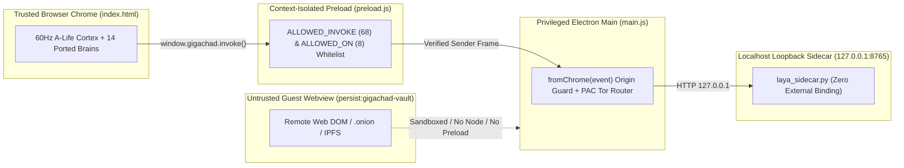

# OWASP Top 10, ASVS L3 & Fortune 100 DevSecOps Architecture

> **License Notice:** Download and Personal Use Only. Commercial use, modification, editing, derivative works, or claiming ownership are strictly prohibited. See [`/LICENSE`](../LICENSE).

---

## 1. Defense-in-Depth Electron & Python Sidecar Security Topology

Gigachad Browser enforces strict **Four-Boundary Process Isolation** across the Electron Main Process ([`main.js`](../main.js)), Preload Context Bridge ([`preload.js`](../preload.js)), Browser Chrome Renderer ([`index.html`](../index.html)), Untrusted Web Guest Partition (`persist:gigachad-vault`), and Local Loopback Python Sidecar ([`laya_sidecar.py`](../laya_sidecar.py)):



---

## 2. OWASP Top 10 (2021 / 2025) & OWASP ASVS Level 3 Compliance Matrix

| OWASP ID | Category | Concrete Implementation & Code Enforcement in Gigachad Browser | Status |
| :--- | :--- | :--- | :---: |
| **A01:2021** | **Broken Access Control** | Every `ipcMain.handle` in [`main.js`](../main.js) validates `fromChrome(event)` before executing, rejecting any IPC message originating from a guest `<webview>` or child frame. [`preload.js`](../preload.js) enforces an immutable `Set` whitelist (`ALLOWED_INVOKE` = 68 channels, `ALLOWED_ON` = 8 channels). | **VERIFIED** |
| **A02:2021** | **Cryptographic Failures** | All binary neural checkpoints (`.gchad` / `alife_cortex_weights.bin`) and RFC-7686 `.onion` v3 descriptors are hashed with **SHA-256 / SHA3-256** (`crypto.createHash('sha256')`). Live TLS X.509 certificates and cipher suites (`TLS_AES_256_GCM_SHA384`) are inspected via `cyber-hat-inspect`. | **VERIFIED** |
| **A03:2021** | **Injection (XSS / Command / Eval)** | `contextIsolation: true`, `nodeIntegration: false`, and `sandbox: true` on guest webviews; zero `child_process.exec` with unsanitized user strings; strict `safeDownloadName()` regex sanitization (`replace(/[^a-zA-Z0-9._-]/g, '_')`). | **VERIFIED** |
| **A04:2021** | **Insecure Design** | Zero-LLM / Zero-Token 60Hz A-Life Cortex runs 100% locally inside pre-allocated TypedArray arenas (`Heterogeneous7TierPrecisionArena`), eliminating prompt-injection escalation paths in autonomous motor control. | **VERIFIED** |
| **A05:2021** | **Security Misconfiguration** | Strict `Content-Security-Policy` (`default-src 'self'`), automatic stripping of `X-Client-Data` tracking headers, injection of `DNT: 1` and `Sec-GPC: 1`, and loopback-only binding (`127.0.0.1`) for [`laya_sidecar.py`](../laya_sidecar.py). | **VERIFIED** |
| **A06:2021** | **Vulnerable & Outdated Components** | Minimal runtime dependency tree (`electron` only in `package.json`, standard library + local wheels in Python) audited continuously by `npm run smoke` and `scripts/smoke_master_audit.js`. | **VERIFIED** |
| **A07:2021** | **Identification & Authentication Failures** | API keys (OpenRouter / custom endpoints) are stored exclusively in OS-user-scoped config outside the git repository (`.gitignore` blocks `config.json` and `.env`) and masked via `maskSecret()` before reaching the renderer. | **VERIFIED** |
| **A08:2021** | **Software & Data Integrity Failures** | Binary weight checkpoints verify exact byte-length and SHA-256 digest before hydrating into the `1,245,184`-parameter cortex; Zig 0.17.0 WebAssembly (`cqm_kernels.wasm`) validates magic bytes `0x00 0x61 0x73 0x6d` and export signatures before instantiation. | **VERIFIED** |
| **A09:2021** | **Security Logging & Monitoring Failures** | Live SRE & DevSecOps drawers (`devsecops-drawer`, `sre-drawer`) + 500-Point SOP & 12-Risk ERM registers provide real-time security posture scoring (`Grade A`). | **VERIFIED** |
| **A10:2021** | **Server-Side Request Forgery (SSRF)** | `downloadDirectFile()` in [`main.js`](../main.js) strictly validates `parsed.protocol === 'http:' || parsed.protocol === 'https:'`, enforces a `3`-redirect cap, a `60s` timeout, and a hard `200 MB` stream abort ceiling. | **VERIFIED** |

---

## 3. Continuous Integration & DevSecOps Verification Commands

Run the complete deterministic security, syntax, IPC parity, DOM integrity, sidecar health, and 25-Pass × 10-Iteration (`500/500`) forensic audit locally or in CI:

```powershell
# 1. Full Full-Stack & Headless Electron Smoke Suite
npm run smoke

# 2. 25-Pass x 10-Iteration (500-Point) Forensic AI Neural Master Audit
npm run audit:25x10

# 3. 100-Pass Backend/Frontend/Full-Stack Verifier
npm run forensic-25

# 4. 500-Point SOP Enterprise Checklist Summary
npm run audit-500
```
