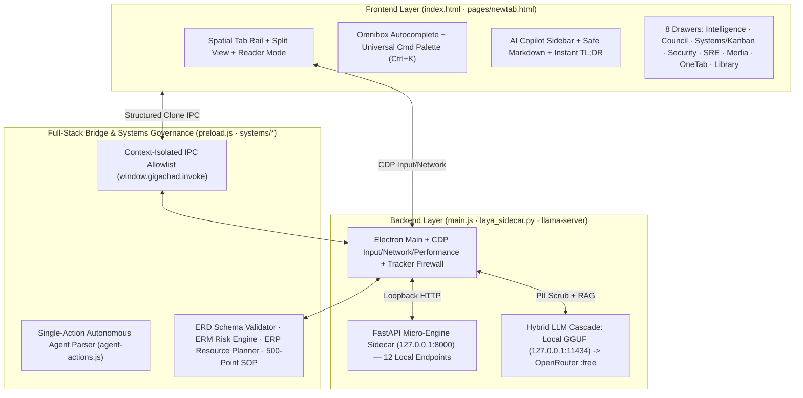
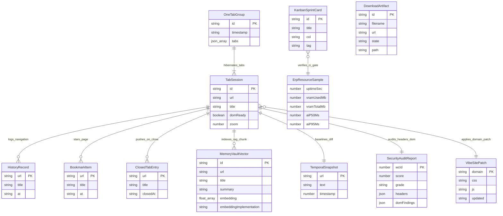
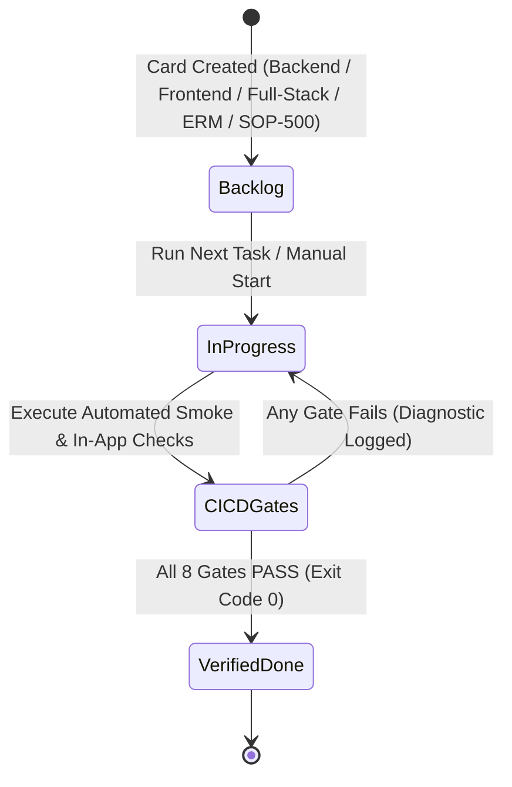

# GIGACHAD AI BROWSER — SYSTEMS ENGINEERING, ERM, ERD, ERP & CI/CD ARCHITECTURE

> **Document Class:** Frontier SOTA Browser Systems Engineering Specification  
> **Scope:** Full-Stack (Backend · Frontend · Full-Stack Integration)  
> **Verification Standard:** 500-Point Grade-A SOP Checklist (`systems/sop-500-checklist.js`)  

---

## 1. Modular File Structure & Systems Organization

```text
gigachad-browser/
├── main.js                          # [Backend] Electron 42 Main Process, CDP Hardware Engine, IPC Router, Watchdog
├── preload.js                       # [Backend/Frontend Bridge] Context-Isolated Allowlist Bridge (window.gigachad)
├── config.js                        # [Backend] Portable Toolchain Discovery, Env/JSON Config, Loopback Enforcer
├── blocklist.js                     # [Backend] EasyList / AdGuard Network Interceptor & Tracker Blocker
├── browser-data.js                  # [Full-Stack] Pure State Transitions (History, Bookmarks, Closed Tabs, Omnibox)
├── agent-actions.js                 # [Full-Stack] Autonomous Action Parser (click, type, key, hover, wait, navigate)
├── laya_sidecar.py                  # [Backend] FastAPI 12-Engine NLP/RAG/TTS/AST/Graph/PII Micro-Engine Sidecar
├── laya_router.py                   # [Backend] Dynamic Intent Classifier & Model Tier Router
├── index.html                       # [Frontend] Spatial Browser Shell, Command Palette, Split View, 8 Drawers
├── pages/
│   └── newtab.html                  # [Frontend] Custom Speed-Dial Start Page + Quick Scratchpad
├── systems/                         # [Systems Engineering] Formal ERD, ERM, ERP & 500-Point SOP Modules
│   ├── erd-schema.js                # Entity-Relationship Data Model & Runtime Schema Integrity Validator
│   ├── erm-risk-engine.js           # Enterprise Risk Management (ERM) Register & Posture Evaluator
│   ├── erp-resource-planner.js      # Enterprise Resource Planning (ERP) Compute, Storage & SLA Quotas
│   └── sop-500-checklist.js         # Programmatic 500-Point Grade-A SOP Frontier Browser Checklist
├── docs/                            # [Documentation & Blueprints]
│   ├── SYSTEMS_ENGINEERING_ERM_ERD_ERP.md
│   └── SOP_500_POINT_CHECKLIST.md
└── scripts/                         # [CI/CD Verification Gates]
    ├── smoke.js                     # Master Full-Stack CI/CD Pipeline Runner (npm run smoke / npm run ci)
    ├── smoke_config.js              # Config, Blocklist, Path Hygiene & Sandbox Verification
    ├── smoke_actions.js             # Autonomous Action Parser Unit Verification
    ├── smoke_browser.js             # Browser State, Omnibox & Closed-Tab Stack Unit Verification
    ├── smoke_systems.js             # ERD, ERM, ERP & 500-Point SOP Automated Verification
    └── smoke_sidecar.py             # Live FastAPI Sidecar Endpoint & Contract Verification
```

---

## 2. Systems Design Across All 3 Engineering Aspects



---

## 3. Entity-Relationship Diagram (ERD) — Data Architecture (`systems/erd-schema.js`)

All 12 core entities and 9 formal relationships are defined and validated at runtime by [`systems/erd-schema.js`](../systems/erd-schema.js).



---

## 4. Enterprise Risk Management (ERM) Register (`systems/erm-risk-engine.js`)

| Risk ID | Aspect | Domain | Risk Scenario | Inherent ($L \times I$) | Control & Mitigation | Residual ($L \times I$) | Status |
| :--- | :--- | :--- | :--- | :---: | :--- | :---: | :--- |
| `ERM-BE-01` | Backend | Security & Isolation | Guest `<webview>` Sandbox Escape or Node Leakage | `20` (4×5) | `contextIsolation: true`, `nodeIntegration: false`, `sandbox: true`, `will-attach-webview` enforcer | `4` (1×4) | `MITIGATED_LOW` |
| `ERM-BE-02` | Backend | Network & Sidecar | Sidecar Port Exposure or Remote SSRF | `16` (4×4) | Force `sidecarHost` to `127.0.0.1`; validate `isLoopbackHttp()` | `3` (1×3) | `MITIGATED_LOW` |
| `ERM-BE-03` | Backend | IPC Integrity | Unauthorized Guest IPC Invocation | `15` (3×5) | Verify `fromChrome(event)` and `ALLOWED_INVOKE` allowlist | `4` (1×4) | `MITIGATED_LOW` |
| `ERM-BE-04` | Backend | Reliability & SRE | Python Sidecar Crash or Zombie Port Lock | `12` (3×4) | 15s health watchdog auto-respawns sidecar and increments `sreTelemetry.autoHeals` | `2` (1×2) | `MITIGATED_LOW` |
| `ERM-FE-01` | Frontend | Rendering & XSS | DOM XSS via Untrusted Page Titles, URLs, or Markdown | `20` (4×5) | HTML entity escaping via `esc()` + safe Markdown parser | `4` (1×4) | `MITIGATED_LOW` |
| `ERM-FE-02` | Frontend | Ergonomics & State | Premature `<webview>` Method Calls Before `dom-ready` | `12` (4×3) | Guard calls behind `tabObj.domReady` via `safeGetUrl` / `safeLoadUrl` | `2` (1×2) | `MITIGATED_LOW` |
| `ERM-FE-03` | Frontend | Responsiveness | UI Thread Freeze During Large Page Extraction | `9` (3×3) | Slice DOM payloads to 12K–25K chars; support `AbortController` cancel | `2` (1×2) | `MITIGATED_LOW` |
| `ERM-FE-04` | Frontend | Permission Hygiene | Silent Camera/Microphone/Geolocation Hijacking | `16` (4×4) | Default-deny unknown permissions; explicit prompt bar with 20s timeout | `3` (1×3) | `MITIGATED_LOW` |
| `ERM-FS-01` | Full-Stack | Agent Safety | Indirect Prompt Injection Executing Malicious Actions | `20` (4×5) | Single-action execution per turn; restrict navigation to `http(s):` | `6` (2×3) | `MITIGATED_MEDIUM` |
| `ERM-FS-02` | Full-Stack | Privacy & Compliance | Cloud LLM PII Exfiltration (Keys, SSNs, Emails) | `20` (4×5) | Pre-flight `/ner_pii` redaction before external OpenRouter calls | `4` (1×4) | `MITIGATED_LOW` |
| `ERM-FS-03` | Full-Stack | Hardware & VRAM | GPU VRAM Exhaustion / OOM on 8 GB RTX 4060 | `16` (4×4) | `llama-server --models-max 1` with `q4_0` KV cache & cloud fallback | `3` (1×3) | `MITIGATED_LOW` |
| `ERM-FS-04` | Full-Stack | Anti-Tracking | Third-Party Ad-Tech Fingerprinting & Telemetry | `15` (5×3) | `webRequest.onBeforeRequest` EasyList blocker + `Sec-GPC: 1` & `DNT: 1` | `2` (1×2) | `MITIGATED_LOW` |

---

## 5. Enterprise Resource Planning (ERP) Quotas & SLAs (`systems/erp-resource-planner.js`)

| Resource Category | Aspect | Metric / Store | Quota / Target | Enforcement Mechanism |
| :--- | :--- | :--- | :--- | :--- |
| **Compute / GPU** | Backend | GPU VRAM Budget | `<= 7,168 MB` (of 8,192 MB) | `--models-max 1`, `cache-type-k q4_0`, `cache-type-v q4_0` |
| **Compute / Context** | Full-Stack | Page Context Window | `<= 12,000 chars` per turn | Slicing in `buildSoMContext()` and `ai-query` |
| **Storage** | Full-Stack | `browser_history.json` | `400` records max | FIFO cap in `addHistory()` |
| **Storage** | Full-Stack | `bookmarks.json` | `300` items max | Cap in `toggleBookmark()` |
| **Storage** | Full-Stack | `closedTabStack` | `25` tabs max | LIFO cap in `recordClosedTab()` |
| **Storage** | Backend | `memory_vault.json` | `600` vector notes max | Cap in `memory-save` |
| **Storage** | Full-Stack | `task_board.json` | `200` Kanban cards max | Cap in `sanitizeBoard()` |
| **Latency SLA** | Backend | Sidecar `/health` & Micro-Engines | `< 800 ms` health / `< 4,000 ms` NLP | Timeout + fallback in `fetchJson()` |
| **Latency SLA** | Full-Stack | AI Copilot P50 / P95 | `< 1,200 ms` P50 / `< 4,500 ms` P95 | Tracked in `sreTelemetry.aiLatenciesMs` |

---

## 6. Kanban & CI/CD Verification Pipeline


